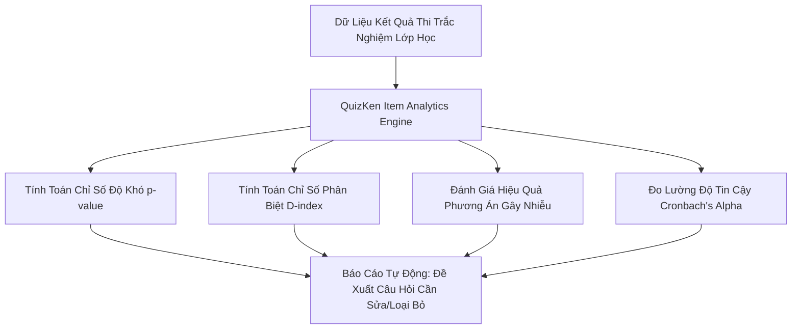

> **Tóm tắt nhanh (TL;DR):** Trong khoa học đo lường và đánh giá giáo dục (Educational Measurement), chất lượng của một đề thi trắc nghiệm không chỉ đánh giá qua cảm tính mà dựa trên các chỉ số định lượng chặt chẽ của **Lý thuyết trắc nghiệm cổ điển (Classical Test Theory - CTT)**: *Chỉ số độ khó ($p$-value)*, *Chỉ số độ phân biệt ($D$-index)*, *Hệ số tương quan điểm nhị phân ($r_{pbis}$)* và *Độ tin cậy nội hàm Cronbach's Alpha ($\alpha$)*. Nền tảng **QuizKen Analytics** tự động phân tích toàn bộ các chỉ số này sau mỗi bài kiểm tra, giúp giáo viên nhận diện chính xác các câu hỏi bị lỗi, phương án gây nhiễu không hiệu quả hoặc câu hỏi quá khó/quá dễ.

---

## 1. Các Chỉ Số Đo Lường Cốt Lõi Trong Đánh Giá Đề Thi Trắc Nghiệm

Theo chuẩn đo lường khảo thí quốc tế, một câu hỏi trắc nghiệm chuẩn mực phải đáp ứng 3 tiêu chí kỹ thuật:

### 1. Chỉ số độ khó ($p$-value / Item Difficulty)
Tỉ lệ phần trăm thí sinh trả lời đúng câu hỏi:
$$p = \frac{N_{\text{đúng}}}{N_{\text{tổng}}}$$
- $p > 0.85$: Câu hỏi **Quá dễ** (chỉ nên dùng cho 1-2 câu khởi động).
- $0.40 \le p \le 0.70$: Câu hỏi **Lý tưởng** (độ phân hóa tốt nhất).
- $p < 0.25$: Câu hỏi **Quá khó** hoặc đề bài bị tối nghĩa, đánh đố.

### 2. Chỉ số độ phân biệt ($D$-index / Item Discrimination)
Khả năng phân loại giữa nhóm học sinh giỏi ($27\%$ điểm cao nhất - nhóm $U$) và nhóm học sinh yếu ($27\%$ điểm thấp nhất - nhóm $L$):
$$D = \frac{R_U - R_L}{n}$$
- $D \ge 0.40$: Câu hỏi **Rất tốt** (phân biệt xuất sắc học sinh giỏi và yếu).
- $0.30 \le D \le 0.39$: Câu hỏi **Tốt** (chấp nhận được, có thể tinh chỉnh nhẹ).
- $0.20 \le D \le 0.29$: Câu hỏi **Tạm được** (cần sửa lại phương án gây nhiễu).
- $D < 0.20$ (hoặc âm): Câu hỏi **Kém / Bị lỗi** (cần loại bỏ ngay khỏi ngân hàng đề).

---

## 3. Bảng Chuẩn Đánh Giá Câu Hỏi Trắc Nghiệm Theo Lý Thuyết Khảo Thí CTT

| Chỉ số kỹ thuật | Khoảng giá trị | Đánh giá chất lượng chuyên môn | Khuyến nghị xử lý |
| :--- | :---: | :--- | :--- |
| **Độ khó ($p$)** | $p > 0.85$ | Quá dễ | Giảm bớt số lượng trong bài thi học kỳ |
| **Độ khó ($p$)** | $0.40 - 0.70$ | **Độ khó chuẩn mực** | Giữ nguyên cho các kỳ thi phân hóa |
| **Độ khó ($p$)** | $p < 0.25$ | Quá khó / Đánh đố | Kiểm tra lại độ rõ ràng của đề bài |
| **Độ phân biệt ($D$)** | $D \ge 0.40$ | **Phân loại xuất sắc** | Đưa vào ngân hàng đề thi chuẩn quốc gia |
| **Độ phân biệt ($D$)** | $D < 0.20$ | Phân loại kém | Xem lại các phương án bẫy |
| **Độ phân biệt ($D$)** | $D < 0$ (Âm) | **Đề bị lỗi đáp án** | Học sinh giỏi chọn sai vì bẫy sai kiến thức |
| **Cronbach's Alpha ($\alpha$)** | $\alpha \ge 0.80$ | **Độ tin cậy cao** | Đề thi đo lường rất nhất quán và chính xác |

---

## 4. Hướng Dẫn Giáo Viên Sử Dụng Tính Năng Phân Tích Đề Thi Trên QuizKen

### Bước 1: Cho học sinh hoàn thành bài kiểm tra
Tổ chức bài kiểm tra trắc nghiệm trực tuyến hoặc nhập bảng đáp án chấm thi giấy vào [QuizKen](https://quizken.com).

### Bước 2: Truy cập trang Báo cáo phân tích chuyên sâu (Item Analysis)
Ngay sau khi bài thi kết thúc, nhấp vào tab **Phân Tích Thống Kê**. QuizKen sẽ tự động:
1. Vẽ biểu đồ phân phối điểm số hình chuông (Gaussian Bell Curve).
2. Xếp hạng câu hỏi từ dễ nhất đến khó nhất kèm chỉ số $p$ và $D$.
3. Cảnh báo màu đỏ những câu hỏi có chỉ số phân biệt $D < 0.20$.

### Bước 3: Phân tích sức hút của các phương án gây nhiễu (Distractor Analysis)
Quan sát biểu đồ tỉ lệ chọn các đáp án A, B, C, D:
- Nếu một phương án sai mà **0% học sinh chọn**: Phương án đó quá ngô nghê, không có tác dụng gây nhiễu.
- Nếu một phương án sai mà **nhiều học sinh giỏi chọn hơn học sinh yếu**: Phương án đó bị lỗi diễn đạt mập mờ, cần chỉnh sửa lại.

### Bước 4: Tự động tối ưu hóa ngân hàng đề thi
Bấm nút **Tối Ưu Bằng AI**, hệ thống sẽ tự động đề xuất viết lại các câu hỏi bị lỗi hoặc gợi ý các phương án nhiễu mới hợp lý hơn.

---

## 5. Câu Hỏi Thường Gặp (FAQ)

### Sĩ số lớp học tối thiểu bao nhiêu em thì chỉ số D-index có ý nghĩa thống kê?
Để chỉ số $D$-index và $p$-value phản ánh chính xác nhất, kích thước mẫu lý tưởng là từ **30 đến 45 học sinh trở lên** (tương đương quy mô 1 lớp học tiêu chuẩn tại Việt Nam).

### Hệ số Cronbach's Alpha là gì và có ý nghĩa như thế nào với đề thi của trường?
Hệ số Cronbach's Alpha ($\alpha$) đo lường tính nhất quán nội tại của bài thi. Đề thi đạt $\alpha \ge 0.70$ được coi là đề thi có độ tin cậy tốt, phản ánh trung thực năng lực của học sinh mà không bị chi phối bởi yếu tố may rủi.
