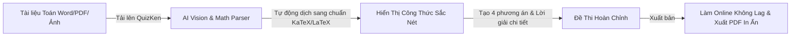

> **Tóm tắt nhanh (TL;DR):** Soạn thảo đề thi trắc nghiệm môn Toán học, Vật lí và Hóa học luôn là nỗi ám ảnh lớn của giáo viên vì phải gõ hàng trăm ký hiệu công thức phức tạp (tích phân, ma trận, phân số, phương trình hóa học) bằng Mathtype hoặc mã lệnh LaTeX thủ công. Với **QuizKen AI**, hệ thống tự động nhận diện tài liệu ảnh, file PDF hoặc văn bản thô để render công thức LaTeX sắc nét chuẩn KaTeX, tự sinh đáp án và giải thích chi tiết trong chưa đầy 3 giây.

---

## 1. Nỗi Đau Của Giáo Viên Khi Soạn Đề Toán & KHTN Truyền Thống

1. **Lỗi định dạng khi sao chép:** Khi copy từ Word hoặc Mathtype sang các nền tảng online cũ, công thức toán thường bị vỡ font, biến thành ký tự lạ hoặc hình ảnh mờ căm.
2. **Mất thời gian gõ cú pháp:** Giáo viên phải mất nhiều giờ để gõ từng dòng mã LaTeX như `\int_{0}^{1} x^2 dx` hoặc `\lim_{x \to \infty} \frac{2x+1}{x-3}`.
3. **Khó khăn khi xáo trộn mã đề:** Việc đảo thứ tự câu hỏi và 4 phương án lựa chọn chứa công thức toán bằng tay thường gây nhầm lẫn đáp án nghiêm trọng.

---

## 2. Bảng Ví Dụ Công Thức Toán Học Được AI QuizKen Xử Lý Tự Động

| Dạng toán | Cú pháp LaTeX chuẩn | Hiển thị trực quan trên QuizKen |
| :--- | :--- | :--- |
| **Phân số & Căn bậc hai** | `\frac{-b \pm \sqrt{b^2 - 4ac}}{2a}` | Công thức nghiệm phương trình bậc hai |
| **Tích phân & Đạo hàm** | `\int_{a}^{b} f(x)dx = F(b) - F(a)` | Định lý cơ bản của Giải tích |
| **Giới hạn (Limit)** | `\lim_{x \to 0} \frac{\sin x}{x} = 1` | Giới hạn lượng giác cơ bản |
| **Phương trình Hóa học** | `2\text{H}_2 + \text{O}_2 \xrightarrow{t^\circ} 2\text{H}_2\text{O}` | Phản ứng hóa học cân bằng có điều kiện nhiệt độ |
| **Vectơ & Tọa độ Oxyz** | `\vec{u} = (x_1, y_1, z_1), \vec{v} = (x_2, y_2, z_2)` | Tọa độ không gian 3 chiều |

---

## 3. Quy Trình 3 Bước Tạo Đề Thi Toán Bằng AI QuizKen

### Bước 1: Chuẩn bị nội dung hoặc chuyên đề bài học
Bạn có thể nhập tên chuyên đề (ví dụ: *"Hàm số lũy thừa, mũ và logarit lớp 12"* hoặc *"Hình học không gian Oxyz"*), hoặc dán trực tiếp đoạn văn bản chứa công thức có sẵn.

### Bước 2: Tải lên hệ thống QuizKen
Truy cập [QuizKen Tạo Đề Thi](https://quizken.com), chọn môn **Toán học** hoặc **Khoa học Tự nhiên**. Hệ thống hỗ trợ:
- Nhận diện văn bản Unicode toán học.
- Nhận diện mã nguồn LaTeX nguyên bản.
- Đọc file PDF/Word có nhúng MathType.

### Bước 3: Xem trước và xuất đề thi
Chỉ sau 3 giây, QuizKen sẽ:
1. Render toàn bộ công thức toán học sắc nét chuẩn vector (không bị vỡ hạt trên màn hình Retina hay điện thoại).
2. Tự động sinh ra lời giải thích chi tiết từng bước giải (*Step-by-step Solution*).
3. Cho phép tải về file PDF đề thi và phiếu trả lời trắc nghiệm chuẩn Bộ GD&ĐT.

---

## 4. Những Ưu Điểm Độc Quyền Khi Tạo Đề Toán Trên QuizKen

- **Tương thích hoàn hảo trên mọi thiết bị:** Học sinh làm bài trên điện thoại hay máy tính đều đọc rõ ràng từng chỉ số trên/dưới (*superscript/subscript*).
- **Hỗ trợ đầy đủ định dạng GDPT 2018:** Tạo câu hỏi Đúng/Sai 4 mệnh đề toán học và câu hỏi Trả lời ngắn điền số thập phân chính xác.
- **Trộn đề thông minh không lỗi công thức:** Hệ thống xáo trộn câu hỏi và các phương án A, B, C, D một cách chuẩn xác, tự động cập nhật bảng đáp án tương ứng.

👉 **Trải nghiệm ngay:** Soạn đề kiểm tra môn Toán chuẩn mực trong tích tắc với [AI Tạo Đề Toán QuizKen](https://quizken.com) ngay hôm nay!

---

## 5. Câu Hỏi Thường Gặp (FAQ)

### QuizKen có nhận diện được hình vẽ hình học không gian không?
Có. QuizKen hỗ trợ chèn hình ảnh minh họa bài toán hình học và sơ đồ mạch điện vào từng câu hỏi trắc nghiệm một cách trực quan.

### Giáo viên có cần học thuộc mã LaTeX để sử dụng QuizKen không?
Hoàn toàn không cần! Trí tuệ nhân tạo của QuizKen sẽ tự động chuyển đổi ngôn ngữ tự nhiên và ký tự toán học thành chuẩn LaTeX cho bạn.
