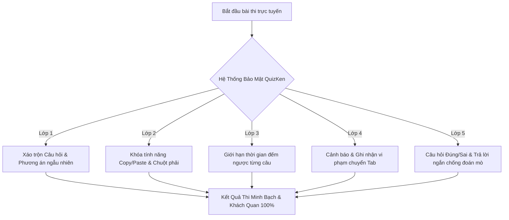

> **Tóm tắt nhanh (TL;DR):** Tổ chức thi thử và kiểm tra trực tuyến mang lại sự tiện lợi vượt bậc nhưng nỗi lo lớn nhất của các thầy cô và nhà trường là tình trạng học sinh gian lận, tra cứu câu trả lời trên AI/Google hoặc chia sẻ đáp án trong các nhóm chat bí mật. Bằng cách kích hoạt **bộ giải pháp bảo mật 5 lớp của QuizKen**, giáo viên có thể triệt tiêu hoàn toàn các hành vi gian lận và đảm bảo kết quả thi phản ánh 100% thực chất năng lực của học sinh.

---

## 1. Những Chiêu Trò Gian Lận Trực Tuyến Phổ Biến Hiện Nay

1. **Tra cứu đáp án bằng AI & Search Engine:** Học sinh sao chép (*Copy-Paste*) nội dung câu hỏi sang ChatGPT, Gemini hoặc Google để tìm câu trả lời trong vài giây.
2. **Chuyển tab và chia sẻ qua mạng xã hội:** Mở song song tab Zalo/Messenger/Discord để gửi ảnh chụp màn hình hoặc đọc đáp án cho nhau.
3. **Làm bài hộ / Nhờ người thi kèm:** Chia sẻ đường link hoặc tài khoản cho người khác làm giúp từ xa.
4. **Chia sẻ đề thi cho ca thi sau:** Chụp lại toàn bộ đề thi để gửi cho học sinh các lớp ca sau.

---

## 2. Bảng Tính Năng Bảo Mật: Kiểm Tra Thông Thường vs QuizKen

| Tính năng bảo mật | Google Forms / Nền tảng cũ | Nền tảng QuizKen Nâng Cao |
| :--- | :--- | :--- |
| **Xáo trộn câu hỏi & đáp án** | Xáo trộn đơn giản | Thuật toán xáo trộn ma trận ngẫu nhiên từng thí sinh |
| **Chống sao chép văn bản** | Không có (Copy tự do) | Khóa triệt để chuột phải, bôi đen và phím tắt `Ctrl+C` |
| **Giám sát chuyển Tab (Tab Switching)** | Không có | Phát hiện ngay lập tức, đếm số lần và tự động nộp bài nếu vi phạm |
| **Thời gian đếm ngược từng câu** | Chỉ có đồng hồ tổng bài thi | Hỗ trợ cấu hình đếm ngược riêng từng câu (ép phản xạ) |
| **Đa dạng dạng câu hỏi** | 4 lựa chọn đơn giản | Đầy đủ Đúng/Sai 4 ý và Trả lời ngắn số học |
| **Báo cáo hành vi bất thường** | Không hỗ trợ | Bảng Log chi tiết từng giây làm bài của thí sinh |

---

## 3. Quy Trình 4 Bước Thiết Lập Phòng Thi Trực Tuyến An Toàn Trên QuizKen

### Bước 1: Tạo bộ đề kiểm tra chuẩn hóa
Tải tài liệu hoặc dùng [AI Tạo Đề QuizKen](https://quizken.com) để xây dựng ngân hàng câu hỏi bám sát chương trình học.

### Bước 2: Kích hoạt chế độ phòng thi bảo mật (Secure Exam Mode)
Trong bảng cài đặt phòng thi của QuizKen, giáo viên chỉ cần bật các tùy chọn sau:
- **Đảo ngẫu nhiên câu hỏi & phương án:** Mỗi học sinh sẽ nhận được một đề thi có thứ tự hoàn toàn khác nhau.
- **Bật chế độ khóa sao chép (Anti-Copy):** Chặn học sinh copy nội dung câu hỏi để tra cứu bên ngoài.
- **Giới hạn số lần chuyển tab (Tab-Switching Limit):** Thiết lập tối đa 2 lần cảnh báo. Nếu học sinh cố tình mở tab khác lần thứ 3, hệ thống sẽ tự động khóa bài và thu bài ngay lập tức.
- **Hẹn giờ mở và đóng phòng thi tự động:** Đảm bảo tất cả thí sinh làm bài đồng thời trong cùng một khung giờ quy định.

### Bước 3: Gửi mã phòng thi hoặc đường liên kết riêng biệt
Học sinh truy cập đường dẫn, nhập họ tên và mã số học sinh để điểm danh vào phòng chờ trực tuyến.

### Bước 4: Giám sát thời gian thực & Xem bảng Log gian lận
Trong suốt quá trình thi diễn ra, giáo viên có thể quan sát màn hình điều khiển:
- Biết được học sinh nào đang làm đến câu mấy.
- Hệ thống tô đỏ những học sinh có hành vi chuyển tab hoặc mất kết nối bất thường.
- Xuất bảng điểm chi tiết kèm lịch sử thời gian làm từng câu hỏi.

---

## 4. Lợi Ích Của Kỳ Thi Trực Tuyến Minh Bạch

- **Đánh giá đúng thực chất:** Thầy cô nắm bắt chính xác mức độ tiếp thu của từng em học sinh để có kế hoạch phụ đạo kịp thời.
- **Tạo môi trường thi đua lành mạnh:** Khích lệ các học sinh chăm chỉ, trung thực nỗ lực ôn luyện.
- **Tiết kiệm chi phí in ấn:** Giảm thiểu 100% chi phí giấy thi, mực in và công sức chấm bài thủ công.

👉 **Tổ chức thi thử ngay:** Thiết lập phòng thi an toàn tuyệt đối với [QuizKen Secure Exam](https://quizken.com) hoàn toàn miễn phí!

---

## 5. Câu Hỏi Thường Gặp (FAQ)

### Nếu học sinh bị mất mạng đột ngột khi đang làm bài thì xử lý thế nào?
QuizKen có cơ chế tự động lưu câu trả lời theo từng giây (*Auto-save*). Khi kết nối mạng trở lại, học sinh có thể tiếp tục làm bài mà không bị mất dữ liệu đã làm trước đó.

### Có thể tổ chức thi cùng lúc cho 500 - 1.000 học sinh toàn trường không?
Hoàn toàn được. Hạ tầng máy chủ của QuizKen được tối ưu chịu tải cao, sẵn sàng phục vụ các kỳ thi thử quy mô toàn trường hoặc toàn khối mà không lo nghẽn mạng.
