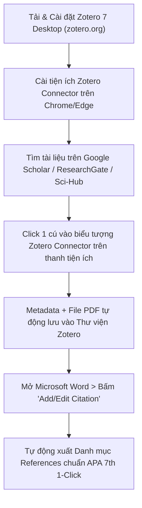

> **TL;DR (Tóm tắt nhanh):**  
> Việc **trích dẫn tài liệu tham khảo APA 7th miễn phí** thủ công trong Microsoft Word thường khiến sinh viên bị trừ điểm nặng vì sai dấu chấm phẩy, lệch khoảng trắng, sai thụt dòng (Hanging Indent) hoặc mất mã định danh DOI. Bằng cách sử dụng phần mềm mã nguồn mở **Zotero 7** kết hợp tiện ích **Zotero Connector**, bạn chỉ cần 1 cú click chuột để tự động lưu metadata bài báo từ Google Scholar và xuất danh mục tài liệu tham khảo chuẩn chỉnh 100%. Sau đó, bạn có thể xuất các định nghĩa cốt lõi vào **QuizKen** để AI tạo bộ câu hỏi kiểm tra độ hiểu sâu đề tài trước ngày bảo vệ khóa luận!

---

# Hướng Dẫn Sử Dụng Zotero Tự Động Trích Dẫn Chuẩn APA 7th Miễn Phí (Mới Nhất 2026)

Khi viết tiểu luận chuyên ngành, nghiên cứu khoa học sinh viên (NCKH) hay khóa luận tốt nghiệp đại học, quy định về **liêm chính học thuật và định dạng tài liệu tham khảo** ngày càng được các trường đại học siết chặt. 

Nhiều bạn sinh viên dành cả tuần để viết nội dung nhưng lại mất trắng 1 - 2 điểm bài luận chỉ vì:
* Gõ danh mục tài liệu tham khảo bằng tay: Tên tác giả, năm xuất bản, tên tạp chí in nghiêng lộn xộn.
* Định dạng trích dẫn trong bài (In-text citations) không khớp với danh mục cuối bài.
* Chỉnh sửa bổ sung thêm 1 nguồn mới là phải đánh số lại từ đầu toàn bộ văn bản Word.

Trong bài viết này, **QuizKen** sẽ hướng dẫn bạn cách làm chủ **Zotero 7** – phần mềm quản lý trích dẫn tài liệu khoa học mã nguồn mở số 1 thế giới hoàn toàn miễn phí!

---

## 1. Chuẩn Trích Dẫn APA 7th Edition Có Gì Cần Lưu Ý?

Định dạng của Hiệp hội Tâm lý học Hoa Kỳ phiên bản 7 (**APA 7th Edition**) là tiêu chuẩn phổ biến nhất trong các khối ngành Kinh tế, Xã hội, Giáo dục và Y tế tại Việt Nam:

1. **Trích dẫn trong bài (In-text):** 
   * 1 tác giả: `(Nguyễn, 2026)` hoặc `Nguyễn (2026) cho rằng...`
   * 2 tác giả: `(Trần & Lê, 2026)`
   * Từ 3 tác giả trở lên: Dùng chữ "et al." ngay từ lần đầu: `(Hoàng et al., 2026)`
2. **Danh mục tài liệu tham khảo (References):**
   * Sắp xếp theo thứ tự bảng chữ cái A-Z của họ tác giả đầu tiên.
   * Định dạng thụt lề hàng thứ hai trở đi (Hanging Indent: 1.27 cm / 0.5 inch).
   * Bắt buộc chèn đường link DOI dạng URL đầy đủ: `https://doi.org/10.xxxx/...` (không viết chữ tắt `doi:` như chuẩn APA 6th cũ).

---

## 2. Quy Trình Cài Đặt Zotero 7 & Zotero Connector

### Bước 1: Cài đặt Zotero 7 Desktop
1. Truy cập trang chủ chính thức: `https://www.zotero.org`.
2. Tải về và cài đặt **Zotero 7** (bản cập nhật mới nhất hỗ trợ giao diện tối Dark Mode, hiệu năng mượt gấp đôi bản Zotero 6 cũ).
3. Đăng ký tài khoản miễn phí để được đồng bộ dữ liệu đám mây (Cloud Sync).

### Bước 2: Kích hoạt Zotero Connector trên trình duyệt
1. Cài đặt tiện ích mở rộng **Zotero Connector** từ Chrome Web Store hoặc Add-ons của Firefox/Edge.
2. Mở sẵn phần mềm Zotero trên máy tính.
3. Khi bạn vào trang Google Scholar, ScienceDirect hoặc xem một bài báo PDF trên mạng, biểu tượng Zotero Connector ở góc trình duyệt sẽ biến thành hình cuốn sách hoặc bài báo.
4. Bạn chỉ cần **nhấp 1 cú chuột vào biểu tượng đó**, toàn bộ tên tác giả, năm xuất bản, tên tạp chí, số trang, tóm tắt và file PDF đính kèm sẽ tự động bay vào thư viện Zotero của bạn!

---

## 3. Cách Chèn Trích Dẫn Vào Microsoft Word Tự Động 100%

Khi bạn cài Zotero 7, một tab mới mang tên **Zotero** sẽ tự động xuất hiện trên thanh menu của Microsoft Word (hỗ trợ cả Windows và macOS):

1. **Chèn trích dẫn trong bài (In-text Citation):**
   * Đặt con trỏ chuột tại cuối câu cần dẫn chứng.
   * Bấm vào tab **Zotero** trên Word > chọn **Add/Edit Citation**.
   * Hộp thoại chọn kiểu xuất hiện: Chọn **American Psychological Association 7th edition**.
   * Gõ tên tác giả hoặc tên bài báo vào thanh tìm kiếm màu đỏ > Nhấn **Enter**.
   * Ngay lập tức, trích dẫn dạng `(Nguyễn & Hoàng, 2026)` sẽ xuất hiện chuẩn xác.
2. **Xuất danh mục tài liệu tham khảo (Bibliography):**
   * Đưa con trỏ xuống trang cuối cùng của bài khóa luận (mục Tài liệu tham khảo).
   * Bấm nút **Add/Edit Bibliography** trên tab Zotero.
   * Toàn bộ các nguồn bạn đã trích dẫn trong bài sẽ tự động được tổng hợp, xếp thứ tự A-Z và căn lề Hanging Indent chuẩn đến từng milimet!
   * Nếu bạn xóa bớt hoặc thêm mới một trích dẫn trong thân bài, chỉ cần nhấn nút **Refresh**, danh mục sẽ tự động cập nhật lại trong 1 giây.

---

## 4. Nâng Cấp Zotero Với AI: Chat Với Bài Báo Bằng Beaver Plugin

Trong phiên bản Zotero 7, nhờ có hệ thống **Local Web API**, bạn có thể cài thêm các plugin AI mã nguồn mở miễn phí như **Beaver** hoặc kết nối qua Model Context Protocol (MCP):
* Cho phép mở khung chat AI ngay bên cạnh file PDF trong Zotero.
* Yêu cầu AI tóm tắt phương pháp nghiên cứu (Methodology), trích xuất các hạn chế của đề tài (Research Limitations) và đối chiếu kết quả giữa các bài báo khác nhau trong thư viện.

---

## 5. Cầu Nối QuizKen: Chuẩn Bị Trả Lời Phản Biện Khóa Luận

Trích dẫn đẹp mắt giúp bài viết của bạn đạt điểm tối đa về hình thức, nhưng khi đứng trước Hội đồng chấm khóa luận, thầy cô sẽ hỏi sâu: *"Vì sao em lại chọn mô hình của tác giả X?", "Định nghĩa này khác gì so với nghiên cứu năm 2024?"*

Để không bị "đơ" trước các câu hỏi phản biện:
1. **Trích xuất các định nghĩa và luận điểm từ Zotero:** Gom các đoạn lý thuyết then chốt thành một file ghi chú tóm tắt.
2. **Nạp vào [QuizKen](https://quizken.com):** Đưa nội dung vào tính năng **Tạo Đề Thi Trắc Nghiệm AI**.
3. **Luyện tập phản xạ phản biện:** QuizKen sẽ tự động tạo các câu hỏi trắc nghiệm kiểm tra mức độ hiểu sâu định lý, giúp bạn nắm chắc từng khái niệm và tự tin trả lời thuyết phục trước toàn thể hội đồng chấm thi!

Hãy tải ngay Zotero 7 và áp dụng vào bài nghiên cứu tiếp theo của bạn để trải nghiệm sức mạnh của việc trích dẫn khoa học tự động!
