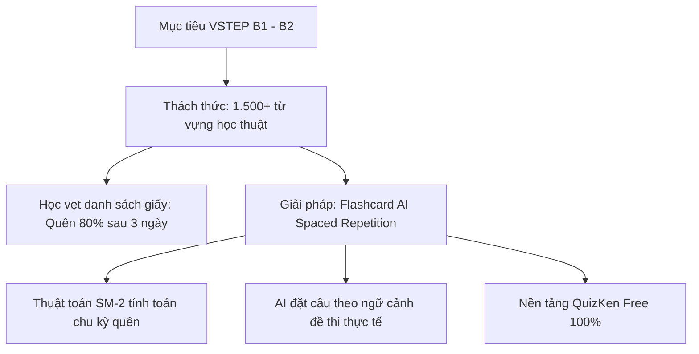

> **Tóm tắt nhanh (TL;DR):** Trong bối cảnh nhiều trường đại học tại Việt Nam công nhận chứng chỉ **VSTEP (Bậc 3 - B1, Bậc 4 - B2)** để miễn thi tốt nghiệp THPT và xét tuyển đầu vào theo chuẩn Khung năng lực ngoại ngữ 6 bậc (Thông tư 01/2014/TT-BGDĐT), vốn từ vựng học thuật đóng vai trò quyết định. Bài viết hướng dẫn cách ứng dụng hệ thống **Flashcard AI miễn phí (free)** kết hợp thuật toán lặp lại ngắt quãng (Spaced Repetition) để ghi nhớ 1.500 từ vựng VSTEP cốt lõi mà không sợ "học trước quên sau".

---

## 1. Tầm Quan Trọng Của Chứng Chỉ VSTEP Trong Năm 2026

Kỳ thi Đánh giá năng lực tiếng Anh theo Khung năng lực ngoại ngữ 6 bậc dùng cho Việt Nam (VSTEP) ngày càng khẳng định vị thế vững chắc:
* **Miễn thi tốt nghiệp THPT:** Đạt VSTEP B1 trở lên giúp học sinh lớp 12 được miễn thi môn Ngoại ngữ và quy đổi điểm 10 trong xét tốt nghiệp theo quy chế mới.
* **Chuẩn đầu ra & tuyển sinh đại học:** Hơn 80 trường đại học lớn trên toàn quốc (ĐHQG Hà Nội, ĐHQG TP.HCM, ĐH Bách Khoa, ĐH Kinh tế Quốc dân...) sử dụng VSTEP B1–B2 làm tiêu chí xét tuyển thẳng hoặc chuẩn đầu ra bắt buộc cho sinh viên.
* **Chi phí hợp lý:** So với IELTS hay TOEFL, lệ phí thi VSTEP tiết kiệm hơn rất nhiều đối với học sinh, sinh viên Việt Nam.

Tuy nhiên, trở ngại lớn nhất của người ôn VSTEP là khối lượng từ vựng học thuật (Academic Vocabulary) rộng lớn thuộc các chủ đề: Môi trường, Giáo dục, Công nghệ, Y tế và Đô thị hóa.

---

## 2. Vì Sao Phương Pháp Học Flashcard AI Vượt Trội Cách Học Truyền Thống?

Theo lý thuyết đường cong lãng quên của Hermann Ebbinghaus, não bộ con người có xu hướng quên tới 70% lượng từ mới chỉ sau 48 giờ nếu không có sự gợi nhắc đúng thời điểm.

| Tiêu chí | Học từ vựng theo danh sách chép tay | Học qua Flashcard AI QuizKen (Free) |
| :--- | :--- | :--- |
| **Thời điểm ôn tập** | Ngẫu nhiên, khi nào rảnh mới mở sổ xem lại | **Tối ưu hóa chính xác:** AI nhắc nhở ngay tại "thời điểm vàng" sắp quên |
| **Ngữ cảnh từ vựng** | Chỉ ghi từ và nghĩa tiếng Việt một cách cô lập | AI sinh câu ví dụ ngữ cảnh (Collocations) chuẩn đề thi VSTEP thực tế |
| **Phát âm chuẩn xác** | Khó tự kiểm tra cách phát âm IPA | Tích hợp phát âm chuẩn bản ngữ tự động |
| **Chi phí đầu tư** | Mua sách thẻ giấy hoặc tài khoản app đắt tiền | Sử dụng hệ thống Flashcard **AI miễn phí (free)** trên web & mobile |

---

## 3. Lộ Trình 30 Ngày Nạp 1.500 Từ Vựng VSTEP B1/B2 Cùng QuizKen Free

### Giai đoạn 1 (Ngày 1 – 10): 500 từ vựng nền tảng B1 (Bậc 3)
* Tập trung vào các chủ đề đời sống, miêu tả con người, trường học, sở thích và thói quen hàng ngày.
* Dùng tính năng tạo Flashcard thông minh của QuizKen: Hệ thống tự động phân loại danh từ, động từ, tính từ và từ đồng nghĩa (Synonyms).

### Giai đoạn 2 (Ngày 11 – 20): 500 từ vựng học thuật B2 (Bậc 4)
* Bước vào các chủ đề nâng cao: biến đổi khí hậu, năng lượng tái tạo, kinh tế số, tâm lý học và nghiên cứu khoa học.
* Luyện phản xạ nối từ (Matching Game) và điền từ vào chỗ trống trên QuizKen để nhớ sâu mặt chữ.

### Giai đoạn 3 (Ngày 21 – 30): Luyện ngữ cảnh đề thi VSTEP Listening & Reading
* Chuyển đổi bộ từ vựng thành các câu hỏi trắc nghiệm ngữ cảnh ngắn.
* Làm quen với các bẫy từ đồng nghĩa (Paraphrasing) thường xuất hiện trong Phần 3 và Phần 4 của bài thi Đọc hiểu VSTEP.

👉 **Bắt đầu ngay hôm nay:** [Truy cập kho Flashcard AI từ vựng VSTEP miễn phí trên QuizKen](https://quizken.com) để chinh phục mục tiêu B1–B2 dễ dàng!

---

## 4. 3 Thói Quen Nhỏ Tạo Nên Kết Quả Lớn Khi Ôn VSTEP

1. **Học ngắt quãng 15 phút mỗi ngày:** Đừng cố nhồi nhét 100 từ trong 2 tiếng một tuần; hãy chia nhỏ 20 từ mỗi ngày trong 15 phút giờ giải lao.
2. **Luôn học theo cụm từ (Chunky learning):** Thay vì chỉ học từ `environment`, hãy học cụm `environmental degradation` (sự suy thoái môi trường).
3. **Chủ động đặt câu cùng AI Tutor:** Hãy gõ một câu có chứa từ mới vào ô chat của QuizKen AI và nhờ AI chấm điểm ngữ pháp xem câu đó đã chuẩn ngữ cảnh học thuật hay chưa.

---

## Câu hỏi thường gặp (FAQ)

### 1. Thuật toán Spaced Repetition hoạt động như thế nào trên QuizKen?
Hệ thống sẽ theo dõi lịch sử trả lời của bạn. Nếu từ nào bạn thuộc nhanh, AI sẽ giãn khoảng cách ngày ôn tập (1 ngày -> 3 ngày -> 7 ngày -> 30 ngày). Từ nào bạn quên sẽ được lặp lại ngay trong ngày.

### 2. Bộ flashcard VSTEP trên QuizKen có được dùng miễn phí không?
Hoàn toàn **miễn phí (free)**. Học sinh và sinh viên có thể tạo không giới hạn các bộ flashcard từ vựng và tự do ôn tập mỗi ngày.

### 3. Có thể dùng QuizKen để ôn thêm từ vựng IELTS hay TOEIC được không?
Có. Ngoài VSTEP, QuizKen hỗ trợ đầy đủ ngân hàng từ vựng Oxford 3000, 5000, TOEIC 900+ và IELTS Band 7.0+ phân theo khung chuẩn CEFR.
