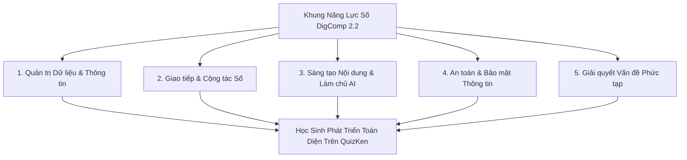

> **Tóm tắt nhanh (TL;DR):** Theo khung năng lực số **DigComp 2.2 của Liên minh Châu Âu (EU)** và định hướng chuyển đổi số của **Bộ Giáo dục và Đào tạo**, năng lực số không chỉ dừng lại ở việc biết sử dụng máy tính mà bao gồm 5 lĩnh vực cốt lõi: *Khai thác dữ liệu, Giao tiếp số, Sáng tạo nội dung, An toàn thông tin và Giải quyết vấn đề bằng AI*. Nền tảng **QuizKen** được thiết kế như một môi trường rèn luyện toàn diện, giúp học sinh phát triển tư duy phản biện, kiểm chứng thông tin và khai thác AI một cách minh bạch, an toàn.

---

## 1. Khung Năng Lực Số DigComp 2.2 & Bối Cảnh Giáo Dục Hiện Đại

Khung năng lực số dành cho công dân **DigComp 2.2 (Digital Competence Framework for Citizens)** do Ủy ban Châu Âu ban hành xác định hơn 250 ví dụ thực hành về kiến thức, kỹ năng và thái độ số. Trong đó, lần đầu tiên các yêu cầu về **Hiểu biết Trí tuệ Nhân tạo (AI Literacy)** được đưa vào như một năng lực sống còn:

- **Hiểu cách AI vận hành:** Nhận biết được AI hoạt động dựa trên dữ liệu xác suất, có thể xuất hiện hiện tượng "ảo giác" (*AI Hallucination*) và thiên vị dữ liệu.
- **Tư duy Prompting có cấu trúc:** Khả năng đặt câu hỏi chính xác để AI hỗ trợ học tập thay vì để AI làm bài hộ.
- **Bảo mật danh tính số:** Ý thức bảo vệ dữ liệu cá nhân khi tương tác với các công cụ học tập số.

---

## 2. Bảng 5 Trụ Cột Năng Lực Số & Sự Đáp Ứng Của QuizKen

| Lĩnh vực DigComp 2.2 | Yêu cầu chuẩn quốc tế | Tính năng rèn luyện trên QuizKen |
| :--- | :--- | :--- |
| **1. Thông tin & Dữ liệu** | Đánh giá độ tin cậy của thông tin số, lọc nguồn dữ liệu | Học sinh đối chiếu đáp án Quiz AI với ngữ liệu SGK chuẩn |
| **2. Giao tiếp & Cộng tác** | Tương tác trong môi trường số, làm việc nhóm trực tuyến | Phòng thi đấu Multiplayer & Chia sẻ bộ Flashcard lớp học |
| **3. Sáng tạo nội dung số** | Tự tạo học liệu, ứng dụng AI phát triển tri thức mới | Tự tạo bộ đề trắc nghiệm AI từ văn bản bài học cá nhân |
| **4. An toàn số** | Bảo vệ dữ liệu cá nhân, tuân thủ liêm chính học thuật | Hệ thống bảo mật mã hóa, tuân thủ Nghị định 13/2023/NĐ-CP |
| **5. Giải quyết vấn đề** | Xác định lỗ hổng kiến thức, tối ưu lộ trình học tập | AI Tutor 24/7 phân tích lỗi sai và đề xuất bài tập bù đắp |

---

## 3. Hướng Dẫn Học Sinh Khai Thác AI Chuẩn Năng Lực Số Trên QuizKen

### Bước 1: Tiếp cận AI như một người đồng hành phản biện
Thay vì yêu cầu AI giải hộ toàn bộ bài tập về nhà, hãy sử dụng tính năng **Hỏi AI Tutor** trên [QuizKen](https://quizken.com) để hỏi về bản chất khái niệm hoặc phương pháp tiếp cận bài toán.

### Bước 2: Tự thiết kế bài kiểm tra đánh giá bản thân
Sau mỗi bài học, hãy dán tóm tắt nội dung vào công cụ **AI Tạo Đề QuizKen** để tạo ngay 1 bài test 10 câu hỏi. Đây là bước rèn luyện năng lực tự chủ học tập (*Self-directed Learning*) được DigComp 2.2 đánh giá rất cao.

### Bước 3: Kiểm chứng và đối chiếu đa nguồn
Khi AI đưa ra lời giải thích chi tiết, hãy đối chiếu với sách giáo khoa và ghi chú trên lớp để rèn luyện kỹ năng thẩm định thông tin (*Critical Verification*).

---

## 4. Lợi Ích Của Việc Trang Bị Năng Lực Số Từ Sớm

1. **Sẵn sàng cho môi trường đại học và hội nhập:** Học sinh tự tin làm chủ các công nghệ mới mà không bị phụ thuộc thụ động.
2. **Nâng cao kết quả thi cử:** Ứng dụng các công cụ Spaced Repetition và Active Recall số giúp tiết kiệm 50% thời gian ôn tập.
3. **Phát triển tư duy liêm chính:** Xây dựng thái độ sử dụng công nghệ có đạo đức và minh bạch.

👉 **Bắt đầu hành trình chuyển đổi số:** Trải nghiệm môi trường học tập chuẩn quốc tế với [QuizKen AI Platform](https://quizken.com) hoàn toàn miễn phí!

---

## 5. Câu Hỏi Thường Gặp (FAQ)

### Khung DigComp 2.2 có bắt buộc học sinh phải biết lập trình không?
Không. DigComp 2.2 nhấn mạnh vào năng lực tư duy tính toán (*Computational Thinking*), hiểu biết về dữ liệu và kỹ năng sử dụng công nghệ an toàn chứ không bắt buộc mọi học sinh phải trở thành lập trình viên.

### QuizKen có đảm bảo an toàn thông tin cá nhân của học sinh không?
Hoàn toàn bảo mật. QuizKen tuân thủ nghiêm ngặt các tiêu chuẩn mã hóa dữ liệu người dùng và cam kết không chia sẻ dữ liệu học tập cho bất kỳ bên thứ ba nào.
