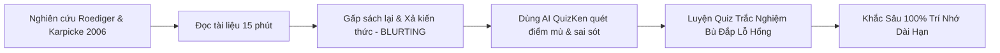

> **Tóm tắt nhanh (TL;DR):** **Blurting Method** (Kỹ thuật "xả kiến thức" tự do) là phương pháp học tập được các thủ khoa đại học hàng đầu thế giới áp dụng. Cơ sở khoa học của phương pháp này xuất phát từ công trình nghiên cứu nổi tiếng của **Henry L. Roediger & Jeffrey D. Karpicke (2006)** công bố trên tạp chí *Psychological Science*, chứng minh hiệu ứng **Testing Effect** (Luyện tập truy xuất thông tin) giúp duy trì trí nhớ cao hơn 50% so với đọc tài liệu nhiều lần. Khi kết hợp Blurting với công cụ đối soát **QuizKen AI**, người học sẽ ngay lập tức phát hiện các "điểm mù" và khắc phục lỗ hổng kiến thức chỉ sau 1 vòng ôn tập.

---

## 1. Nghiên Cứu Roediger & Karpicke (2006) Về Hiệu Ứng Testing Effect

Trong nghiên cứu *"Test-Enhanced Learning: Taking Memory Tests Improves Long-Term Retention"*, hai nhà tâm lý học nhận thức **Roediger & Karpicke (2006)** đã chia sinh viên thành 2 nhóm:
- **Nhóm 1 (Study-Study):** Đọc tài liệu 4 lần liên tiếp (tiếp nhận thông tin thụ động).
- **Nhóm 2 (Study-Test / Blurting):** Đọc tài liệu 1 lần duy nhất, sau đó làm các bài kiểm tra tự truy xuất thông tin ra giấy mà không nhìn tài liệu.

**Kết quả sau 1 tuần:**
- Nhóm đọc thụ động quên tới **81%** lượng kiến thức đã học.
- Nhóm áp dụng **Active Testing / Blurting** ghi nhớ được tới **61%** kiến thức chi tiết (vượt trội hơn 50% so với nhóm đọc thụ động).

---

## 2. Bảng So Sánh Cơ Chế Hoạt Động: Đọc Thụ Động vs Blurting Method

| Tiêu chí | Đọc thụ động & Highlight | Blurting Method (Roediger & Karpicke 2006) |
| :--- | :--- | :--- |
| **Cơ chế thần kinh** | Tiếp nhận thông tin một chiều vào mắt | Kích hoạt vùng hồi hải mã (*Hippocampus*) để truy xuất thông tin |
| **Độ bền sau 7 ngày** | Quên hơn 80% kiến thức | Duy trì trên 60-70% kiến thức chi tiết |
| **Phát hiện lỗ hổng** | Không thể nhận diện điểm mù | Thấy rõ 100% phần kiến thức bị khuyết thiếu |
| **Ứng dụng thực tế** | Dễ gây buồn ngủ, lãng phí thời gian | Đạt hiệu quả cao cho kỳ thi THPT, Đại học, Ngoại ngữ |
| **Hỗ trợ của AI QuizKen** | Không có đối soát | AI tự động so sánh bản Blurt với giáo trình chuẩn |

---

## 3. Quy Trình 4 Bước Thực Hiện Kỹ Thuật Blurting Cùng QuizKen AI

### Bước 1: Đọc nhanh tài liệu trọng tâm (15 phút)
Tập trung đọc sâu 1 chương hoặc 1 chủ đề kiến thức nhất định (ví dụ: *Lịch sử giai đoạn 1945-1954*, *Sinh học tế bào*, *Hóa hữu cơ*).

### Bước 2: Phiên "Xả kiến thức" (Blurt Session) trong 10 phút
Gấp hoàn toàn sách vở lại. Lấy một tờ giấy trắng hoặc mở màn hình gõ văn bản:
- Ghi lại tất cả các định nghĩa, số liệu, mốc thời gian, công thức bạn còn nhớ.
- Vẽ sơ đồ tư duy liên kết các ý chính.
- Nêu các ví dụ minh họa hoặc điều kiện áp dụng.

### Bước 3: Tải bản ghi chép lên QuizKen AI để đối soát
Mở [QuizKen AI](https://quizken.com), dán đoạn văn bản bạn vừa Blurt cùng nội dung bài học gốc. AI sẽ thực hiện:
1. Đánh dấu những ý quan trọng bạn đã bỏ quên.
2. Phát hiện các lỗi sai số liệu, nhầm lẫn khái niệm.

### Bước 4: Luyện tập bài kiểm tra bù đắp (Targeted Practice)
Hệ thống QuizKen tự động sinh một bài trắc nghiệm 10 câu hỏi tập trung chính xác vào những phần kiến thức bạn vừa bỏ sót trong phiên Blurt, giúp bạn lấp đầy lỗ hổng ngay lập tức.

---

## 4. Lời Khuyên Để Đạt Hiệu Quả Tối Đa

- **Chấp nhận sự khó khăn ban đầu:** Cảm giác "vắt óc suy nghĩ" trong khi Blurt chính là dấu hiệu não bộ đang tái cấu trúc thông tin.
- **Không nhìn trộm tài liệu:** Giữ kỷ luật tuyệt đối không mở tài liệu trong 10 phút xả kiến thức.
- **Lặp lại sau 48 giờ:** Thực hiện phiên Blurt thứ hai sau 2 ngày để củng cố vết nhớ vĩnh viễn.

👉 **Bứt phá giới hạn ghi nhớ:** Thử nghiệm ngay kỹ thuật [Đối Soát Blurting Bằng AI QuizKen](https://quizken.com) hoàn toàn miễn phí!

---

## 5. Câu Hỏi Thường Gặp (FAQ)

### Kỹ thuật Blurting có tốn nhiều thời gian hơn đọc sách không?
Không. Blurting chỉ mất 25 phút (15 phút đọc + 10 phút Blurt) nhưng mang lại hiệu quả ghi nhớ cao gấp đôi so với việc ngồi đọc đi đọc lại 2 tiếng liên tục.

### Học sinh cấp 2 và cấp 3 có áp dụng được không?
Rất phù hợp. Kỹ thuật này đặc biệt hiệu quả cho các môn xã hội nhiều chữ (Lịch sử, Địa lý, GDCD) và lý thuyết các môn tự nhiên (Vật lí, Hóa học, Sinh học).
