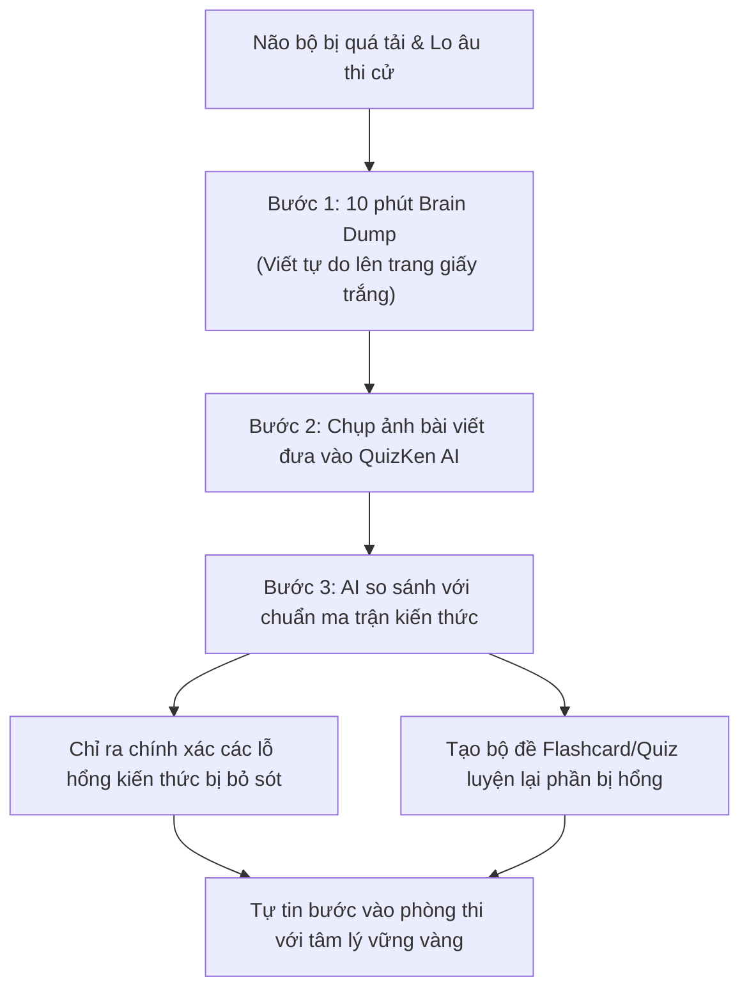

> **TL;DR (Tóm tắt nhanh):**  
> Trước kỳ thi quan trọng, não bộ của học sinh thường bị nghẽn (mental block) do quá tải thông tin và lo âu thi cử. Kỹ thuật **Brain Dump (Xả sạch não)** kết hợp **Active Recall (Gợi nhớ chủ động)** là phương pháp đã được khoa học thần kinh chứng minh giúp giải phóng bộ nhớ đệm (working memory) chỉ trong 10 phút. Bằng cách viết ra tất cả những gì còn đọng lại trong đầu lên một trang giấy trắng, sau đó nạp vào **QuizKen AI**, hệ thống sẽ lập tức quét ra những mắt xích kiến thức bị thiếu hụt và thiết kế bài test bù đắp lỗ hổng ngay tức khắc!

---

# Kỹ Thuật Brain Dump Kết Hợp Active Recall: Cách Lấy Gốc Và Chinh Phục Điểm 9+

Bạn đã bao giờ rơi vào trạng thái: Ngồi vào bàn học thấy đầu óc trống rỗng, mở đề thi thử ra thì cảm giác câu nào cũng mơ hồ quen quen nhưng không tài nào nhớ được công thức chính xác?

Đó không phải vì bạn kém thông minh, mà là do não bộ của bạn đang bị **"rò rỉ nhận thức" (Cognitive Overload)**. Khi bạn nạp quá nhiều kiến thức vào đầu mà không có cơ chế xuất bản và phân loại, não sẽ tự động kích hoạt cơ chế phòng vệ gây ra căng thẳng và hay quên.

Dưới đây là cẩm nang ứng dụng **Kỹ thuật Brain Dump** kết hợp cùng công nghệ sư phạm thông minh của **QuizKen**.

---

## 1. Kỹ Thuật Brain Dump Là Gì? Vì Sao Nó Lại Thần Kỳ?

**Brain Dump (Xả não)** là hành động lấy một tờ giấy trắng (hoặc một trang tài liệu trống) và viết ra **tất cả mọi thứ** bạn có thể nhớ về một chủ đề nhất định trong vòng 5 đến 10 phút mà **hoàn toàn không nhìn sách, không mở tài liệu**.

### Sự kết hợp hoàn hảo với Active Recall (Gợi nhớ chủ động)
Khi bạn bắt buộc bản thân phải "kéo" thông tin từ trong các nơ-ron thần kinh ra ngoài trang giấy, các liên kết synapse sẽ được củng cố mạnh mẽ gấp 10 lần so với việc bạn chỉ đọc lại sách giáo khoa.

---

## 2. Quy Trình 4 Bước "Lấy Lại Gốc Thần Tốc" Cùng QuizKen

| Bước | Tên bước | Thời gian | Hành động cụ thể |
| :--- | :--- | :---: | :--- |
| **Bước 1** | **Xả não tự do (The Dump)** | 7 - 10 phút | Chọn 1 chuyên đề (Ví dụ: Mạch dao động LC môn Vật lý hoặc Kháng chiến chống thực dân Pháp môn Lịch sử). Viết ra tất cả công thức, định nghĩa, mốc sự kiện mà bạn nhớ. Sai hay đúng không quan trọng, đừng dừng bút! |
| **Bước 2** | **Quét lỗ hổng (Gap Scanning)** | 2 phút | Mở điện thoại, chụp ảnh trang viết tay của bạn và tải lên [https://app.quizken.com](https://app.quizken.com). Công nghệ AI Vision của QuizKen sẽ tự động chuyển chữ viết tay thành văn bản kỹ thuật số. |
| **Bước 3** | **Đối chiếu thông minh (Diagnostic Match)** | 1 phút | QuizKen AI đối chiếu nội dung bạn viết với đề cương chuẩn SGK lớp 12 và báo cáo: Những phần bạn đã nắm vững (Màu xanh), những phần bị nhầm lẫn (Màu vàng) và những phần bạn quên hoàn toàn (Màu đỏ). |
| **Bước 4** | **Luyện tập bù đắp (Targeted Recall)** | 15 phút | Làm bài kiểm tra gồm 10 câu trắc nghiệm tập trung duy nhất vào các phần "Màu đỏ" và "Màu vàng" do QuizKen thiết kế riêng cho bạn. |

---

## 3. Lợi Ích Của Brain Dump Trước Ngày Thi

1. **Triệt tiêu cảm giác hoảng loạn phòng thi:** Khi viết hết mọi nỗi sợ và kiến thức ra giấy, vỏ não trước trán (Prefrontal Cortex) được giải phóng, giúp bạn lấy lại sự bình tĩnh và tập trung tối đa.
2. **Không học lan man:** Thay vì mất cả tuần ôn lại từ trang đầu đến trang cuối, bạn chỉ cần 30 phút để vá đúng những "lỗ hổng" chí mạng mà bài thi chuẩn format mới 2026 hay gài bẫy.
3. **Hình thành phản xạ nhanh:** Việc lặp lại chu kỳ Brain Dump $\rightarrow$ QuizKen Test $\rightarrow$ Sửa sai sẽ giúp bạn giải đề trắc nghiệm với tốc độ không tưởng.

---

## 4. Bắt Đầu Ngay Hôm Nay

Đừng chờ đến khi "nước đến chân mới nhảy". Hãy dành ra 15 phút tối nay, lấy một tờ giấy trắng, thực hiện bài Brain Dump đầu tiên và để **QuizKen AI** giúp bạn biến những kiến thức rời rạc thành một hệ thống vững chắc.

Trải nghiệm chẩn đoán lỗ hổng kiến thức miễn phí tại: [https://app.quizken.com](https://app.quizken.com).
