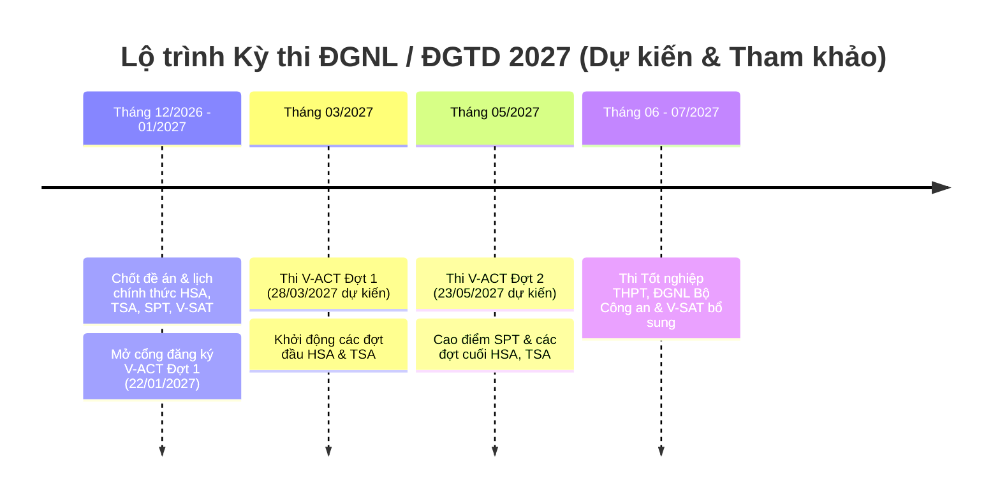

> **Tóm tắt nhanh (TL;DR):** Tính đến cuối tháng 11/2026, **ĐHQG TP.HCM (V-ACT)** là đơn vị đầu tiên công bố khung kế hoạch dự kiến cho mùa thi **2027** với 2 đợt: Đợt 1 đăng ký từ **22/01–12/02/2027** và thi ngày **28/03/2027**; Đợt 2 thi dự kiến **23/05/2027**. Các kỳ thi lớn còn lại gồm **HSA (ĐHQG Hà Nội)**, **TSA (Bách khoa Hà Nội)**, **SPT (ĐH Sư phạm)**, **V-SAT** và **Bộ Công an** dự kiến công bố lịch chi tiết từ tháng 12/2026–01/2027, tập trung cao điểm từ **tháng 3 đến tháng 6/2027**.

---

# Tổng Hợp Lịch Thi Đánh Giá Năng Lực & ĐGTD 2027 Mới Nhất Cho Thế Hệ 2K9

Trong bối cảnh Thông tư 95/2026/TT-BGDĐT giới hạn mỗi ngành đại học chỉ còn tối đa **3 phương thức xét tuyển** và xóa dần xét tuyển sớm độc lập, các kỳ thi **Đánh giá năng lực (mã `401`, `402`, `403`)** trở thành "tấm vé vàng" thứ hai song hành cùng kỳ thi tốt nghiệp THPT cho thí sinh 2K9. Nắm chắc khung thời gian đăng ký và ngày thi của 6 kỳ thi lớn nhất cả nước sẽ giúp bạn tránh trùng lịch và phân bổ lộ trình ôn tập hợp lý.

## 1. Bảng Tổng Hợp Lịch Thi ĐGNL & ĐGTD 2027 (Cập Nhật Cuối Tháng 11/2026)

| Kỳ thi & Đơn vị tổ chức | Thời gian Đăng ký (Dự kiến/Tham khảo) | Ngày thi 2027 (Dự kiến/Khung tham khảo) | Thang điểm & Hình thức | Xem cấu trúc & Đề thử |
| :--- | :--- | :--- | :--- | :--- |
| **V-ACT (ĐHQG TP.HCM)** | **Đợt 1:** `22/01 – 12/02/2027` (Dự kiến) **Đợt 2:** Khoảng Thg 4/2027 | **Đợt 1:** **`28/03/2027`** (Dự kiến) **Đợt 2:** **`23/05/2027`** (Dự kiến) | `1.200 điểm` • 120 câu/150 phút • Thi giấy tại ~15 tỉnh/thành | [Luyện đề V-ACT 2027](/de-thi/dgnl/v-act-dhqg-tphcm) |
| **HSA (ĐHQG Hà Nội)** | Dự kiến mở cổng Thg 2/2027 (đăng ký ca thi) | Chưa chốt chính thức • Khung quen thuộc **Thg 3 – Thg 5/2027** (5–6 đợt cuối tuần) | `150 điểm` • 150 câu/195 phút • Thi trên máy tính | [Luyện đề HSA 2027](/de-thi/dgnl/hsa-dhqg-ha-noi) |
| **TSA (ĐH Bách khoa HN)** | Dự kiến mở từng đợt từ cuối 2026 – đầu 2027 | Chưa chốt chính thức • Khung quen thuộc **Thg 3 – Thg 5/2027** (nhiều đợt) | `100 điểm` • 150 phút • Tư duy Toán, Đọc hiểu, Khoa học/GQVĐ trên máy tính | [Luyện đề TSA 2027](/de-thi/dgnl/tsa-bach-khoa) |
| **SPT (ĐH Sư phạm HN)** | Dự kiến Thg 3 – Thg 4/2027 | Chưa chốt chính thức • Khung quen thuộc **Thg 5/2027** | Thi theo môn (thang 10/môn) kết hợp trắc nghiệm & tự luận | [Luyện đề SPT 2027](/de-thi/dgnl/spt-su-pham) |
| **V-SAT (Nhiều trường ĐH)** | Theo từng đợt của từng trường thành viên | Chưa chốt chính thức • Rải rác **Thg 4 – Thg 7/2027** | Thi trên máy tính theo từng môn độc lập | [Luyện đề V-SAT 2027](/de-thi/dgnl/v-sat) |
| **ĐGNL Bộ Công an (CA1/CA2)** | Sau khi hoàn thành sơ tuyển công an địa phương | Chưa chốt chính thức • Thường vào **Thg 6/2027** (sau thi THPT) | `100 điểm` • 180 phút (Trắc nghiệm chung + Tự luận Toán/Văn) | Ôn theo chuyên đề THPT trên QuizKen |

---

## 2. Điểm Cần Đặc Biệt Lưu Ý Cho Từng Nhóm Thí Sinh Năm 2027

### Nhóm khu vực phía Nam (Trọng tâm V-ACT & V-SAT)
* **V-ACT 2027** giữ cấu trúc bài thi chuẩn hóa theo Chương trình GDPT 2018 gồm 120 câu hỏi trắc nghiệm khách quan (tăng trọng số phần *Tư duy khoa học* và xử lý tình huống thực tế từ bảng số liệu/bài đọc).
* Vì khoảng cách giữa **Đợt 1 (`28/03/2027`)** và **Đợt 2 (`23/05/2027`)** chỉ chưa đầy 2 tháng, thí sinh nên xác định **thi ngay Đợt 1** để lấy mốc điểm nền, sau đó có gần 8 tuần bù lỗ hổng nếu muốn cải thiện ở Đợt 2.

### Nhóm khu vực phía Bắc & miền Trung (Trọng tâm HSA, TSA, SPT)
* **HSA** và **TSA** đều tổ chức thi hoàn toàn trên máy tính và **cho phép chọn nhiều đợt thi**, nhưng cổng đăng ký thường hết chỗ rất nhanh tại các cụm thi lớn (Hà Nội, Hải Phòng, Nghệ An, Đà Nẵng). Thí sinh cần chuẩn bị sẵn ảnh thẻ, CCCD và tài khoản đăng ký ngay khi các trường công bố thông báo chính thức vào đầu tháng 12/2026–01/2027.
* **Cảnh báo mới từ Thông tư 95/2026:** Khi xét tuyển vào đại học năm 2027, điểm HSA/V-ACT/TSA sẽ được quy đổi sang thang 30 bằng phương pháp **bách phân vị** của từng trường (không quy đổi bắc cầu). Bạn có thể tham khảo mức quy đổi phổ biến tại công cụ [Quy đổi điểm IELTS, SAT & ĐGNL 2027](/cong-cu/quy-doi-diem-ielts-dgnl-2027).

---

## 3. Công Cụ Theo Dõi Mốc Thi & Luyện Đề ĐGNL Miễn Phí

Để không bỏ lỡ hạn đăng ký hoặc bị nước đến chân mới nhảy, bạn nên thiết lập lộ trình ôn thi ngay từ cuối tháng 11/2026:

1. **Ghim đồng hồ đếm ngược ngày thi:** Mở [Đếm ngược ngày thi THPT & ĐGNL 2027](/cong-cu/dem-nguoc-ngay-thi-2027) để theo dõi chính xác số ngày còn lại đến V-ACT Đợt 1 (`28/03/2027`) và kỳ thi Tốt nghiệp THPT.
2. **Làm quen câu hỏi tư duy liên môn:** Truy cập [Hub Đề thi Đánh giá năng lực 2027](/de-thi/dgnl) để thi thử theo ma trận chuẩn từng kỳ thi (`HSA`, `V-ACT`, `TSA`, `SPT`, `V-SAT`).
3. **Tự tạo đề ôn từ tài liệu trường:** Đưa đề cương ôn tập Toán, Lý, Hóa, Sinh, Sử, Địa lên [QuizKen](https://app.quizken.com) để hệ thống tự sinh bộ câu hỏi luyện phản xạ đọc hiểu số liệu và tính nhanh trong 50–150 phút.

---

## Câu hỏi thường gặp (FAQ)

### 1. Lịch thi V-ACT 2027 ngày 28/03 và 23/05 đã là lịch chính thức chưa?
Đây là **khung lịch dự kiến** trong kế hoạch năm học 2026–2027 của ĐHQG TP.HCM. Thời gian mở cổng và ngày thi chính thức từng đợt sẽ được ĐHQG TP.HCM xác nhận trong thông báo tuyển sinh đầu năm 2027.

### 2. Một thí sinh có thể thi cả HSA, TSA và V-ACT trong năm 2027 không?
Có. Các kỳ thi này độc lập về đơn vị tổ chức, miễn là không trùng ngày thi. Tuy nhiên, do mỗi kỳ thi có cấu trúc tư duy và ngân hàng dạng bài khác nhau, học sinh nên chọn tối đa 1–2 kỳ thi phù hợp nhất với nhóm trường mục tiêu để tránh bị phân tán sức lực.

### 3. Thi ĐGNL trên máy tính (HSA, TSA) khác gì với luyện đề trên giấy?
Thí sinh phải đọc trực tiếp đoạn văn dài, bảng biểu phức tạp trên màn hình và thao tác chuột/phím chọn đáp án dưới áp lực đồng hồ đếm ngược từng phần. Bạn nên luyện gõ và đọc màn hình thường xuyên qua [Kiểm tra tốc độ gõ phím](/cong-cu/kiem-tra-toc-do-go-phim-tieng-viet) và làm bài trực tuyến trên QuizKen.

### 4. Điểm ĐGNL 2027 được quy đổi sang thang 30 như thế nào?
Theo quy định của Bộ GD&ĐT, từng trường đại học tự xây dựng bảng quy đổi dựa trên **bách phân vị (percentile)** và phổ điểm thực tế của kỳ thi ĐGNL so với phổ điểm thi tốt nghiệp THPT cùng năm, công bố công khai trong Đề án tuyển sinh.
