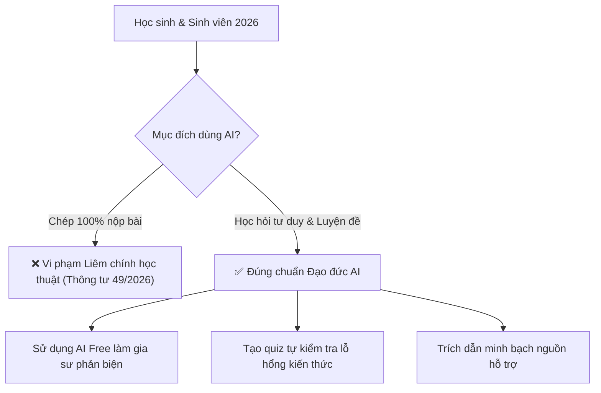

> **Tóm tắt nhanh (TL;DR):** Sự phổ biến của các mô hình ngôn ngữ lớn đã thúc đẩy Bộ Giáo dục và Đào tạo ban hành các hướng dẫn chi tiết về **Liêm chính học thuật** trong bối cảnh chuyển đổi số, đặc biệt qua **Thông tư 49/2026/TT-BGDĐT**. Làm thế nào để học sinh và sinh viên tận dụng sức mạnh của các công cụ **AI miễn phí (free)** để học giỏi hơn mà không vi phạm pháp luật hay các quy chế đào tạo? Bài viết này sẽ làm rõ ranh giới pháp lý và hướng dẫn quy tắc ứng xử chuẩn mực.

---

## 1. Hành Lang Pháp Lý Về Liêm Chính Học Thuật Thời Đại AI Năm 2026

Trong năm 2026, câu hỏi "Có nên cấm học sinh dùng AI?" đã được Bộ GD&ĐT giải đáp rõ ràng: **Không cấm, nhưng phải kiểm soát chặt chẽ đạo đức và phương thức ứng dụng**.

Theo các văn bản quy phạm pháp luật hiện hành, các hành vi bị coi là vi phạm nghiêm trọng liêm chính học thuật gồm:
1. **Đạo văn qua trung gian AI:** Sử dụng AI để viết hộ 100% tiểu luận, báo cáo thực tập, bài nghiên cứu khoa học hoặc bài tập lớn rồi nộp dưới danh nghĩa cá nhân.
2. **Giả mạo số liệu thực nghiệm:** Dùng AI tạo dữ liệu khảo sát hoặc kết quả phòng thí nghiệm không có thật.
3. **Che giấu việc sử dụng AI:** Không khai báo trích dẫn khi sử dụng các ý tưởng hoặc dàn ý do công cụ AI gợi ý.

---

## 2. Bảng So Sánh: Sử Dụng AI Thông Minh vs. Gian Lận Học Thuật

| Tiêu chí | Sử dụng AI Hợp pháp & Thông minh | Hành vi Gian lận AI (Vi phạm) |
| :--- | :--- | :--- |
| **Mục đích chính** | Dùng AI để giải thích khái niệm khó, tìm kiếm lỗ hổng kiến thức, tạo đề trắc nghiệm tự luyện | Dùng AI để làm hộ bài tập về nhà nhằm đối phó với giáo viên |
| **Tác động tư duy** | Kích thích tư duy phản biện, giúp nhớ lâu nhờ phương pháp Active Recall | Làm thui chột khả năng suy luận độc lập và kỹ năng viết luận |
| **Tính minh bạch** | Khai báo rõ ràng: "Ý tưởng được thảo luận và tinh chỉnh cùng trợ lý AI" | Coppy-paste nguyên văn, tìm cách bypass các công cụ phát sinh văn bản AI |
| **Công cụ khuyên dùng** | Các nền tảng học tập **AI free (miễn phí)** định hướng sư phạm như **QuizKen** | Sử dụng các tool bot "giải hộ bài tập" không giải thích nguyên lý |

---

## 3. Bí Quyết Học Tập Bằng AI Miễn Phí (Free) Đúng Chuẩn Quy Định 2026

Để vừa đạt điểm cao vừa tự tin về năng lực thực chất, bạn hãy áp dụng 3 quy tắc vàng sau:

### Quy tắc 1: Áp dụng phương pháp vấn đáp Socratic
Khi gặp một bài toán khó, thay vì hỏi: *"Hãy cho tôi đáp án bài này"*, bạn hãy yêu cầu:
> *"Em chưa hiểu bước biến đổi hàm số này. Hãy đóng vai một người thầy, đặt cho em các câu hỏi gợi mở để em tự tìm ra hướng giải quyết."*

Trên nền tảng **QuizKen AI**, tính năng Chat Socratic được lập trình sẵn nhằm từ chối việc giải hộ trực tiếp, thay vào đó dẫn dắt người học từng bước tìm ra chân lý bài học.

### Quy tắc 2: Dùng AI làm "Người phản biện" (Devil's Advocate)
Sau khi viết xong một đoạn văn nghị luận xã hội hoặc bài phân tích lịch sử, bạn có thể tải nội dung lên QuizKen và yêu cầu AI:
> *"Hãy tìm ra 3 điểm yếu trong lập luận của tôi và phản biện lại dưới góc nhìn của một giám khảo khó tính."*

### Quy tắc 3: Tự kiểm tra năng lực bằng Flashcard & Quiz AI
Cách học an toàn và hiệu quả nhất là biến tài liệu bài học thành các bộ câu hỏi trắc nghiệm khách quan. QuizKen cho phép tạo đề thi từ tài liệu cá nhân hoàn toàn **miễn phí (free)**, giúp bạn đo lường chính xác mức độ ghi nhớ của não bộ mà không lo vi phạm bất kỳ quy định học thuật nào.

👉 **Học tập an toàn:** [Trải nghiệm trợ lý AI học tập miễn phí QuizKen chuẩn liêm chính](https://quizken.com) để tiến bộ vượt bậc mỗi ngày!

---

## Câu hỏi thường gặp (FAQ)

### 1. Giáo viên có cách nào phát hiện bài làm do AI viết không?
Có. Giáo viên hiện sử dụng các công cụ phân tích văn phong kết hợp phỏng vấn trực tiếp (vấn đáp) để kiểm tra mức độ thấu hiểu bài học của học sinh.

### 2. Dùng QuizKen để tự luyện trắc nghiệm có vi phạm liêm chính học thuật không?
Hoàn toàn không. Việc tạo đề trắc nghiệm và flashcard từ bài học của chính mình là hình thức tự kiểm tra (Self-assessment) được Bộ GD&ĐT khuyến khích nhằm nâng cao tính chủ động của người học.

### 3. Nền tảng QuizKen có thu phí khi sử dụng tính năng AI Tutor không?
Không. QuizKen cung cấp hạn ngạch sử dụng **AI Tutor miễn phí (free)** hàng ngày, tạo điều kiện bình đẳng tiếp cận công nghệ cho mọi học sinh trên toàn quốc.
