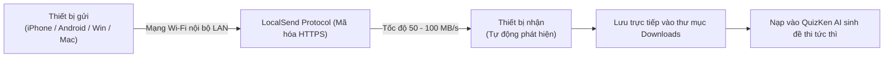

> **TL;DR (Tóm tắt nhanh):**  
> Việc chuyển tài liệu học tập, ảnh chụp đề thi hoặc video bài giảng nặng hàng gigabyte giữa các thiết bị khác hệ sinh thái (ví dụ: dùng iPhone nhưng xài Laptop Windows, hoặc dùng MacBook nhưng xài điện thoại Android) luôn là nỗi ác mộng đối với sinh viên. Zalo/Messenger thì bị nén vỡ nét và giới hạn dung lượng, cắm cáp USB thì rườm rà. **LocalSend** là ứng dụng mã nguồn mở miễn phí 100%, hoạt động như một "AirDrop vạn năng" truyền file qua mạng Wi-Fi cục bộ (LAN) không cần Internet, tốc độ lên tới 50 - 100 MB/s và mã hóa bảo mật tuyệt đối!

---

# LocalSend: Cách Bắn File Siêu Tốc Giữa Mac, Win, iPhone, Android Không Cần Mạng

Trong thời đại học tập kết hợp (Hybrid Learning), sinh viên thường sở hữu một hệ sinh thái thiết bị "lai":
* Điện thoại iPhone chụp ảnh bảng viết, tài liệu slide trên lớp.
* Laptop chạy Windows để làm bài tập, viết code hoặc chạy phần mềm chuyên ngành.
* Hoặc ngược lại: Điện thoại Android chụp ảnh nhưng máy tính lại là MacBook.

Khi cần chuyển gấp một video thuyết trình 2GB hoặc tệp PDF đề cương 200 trang để kịp giờ nộp bài, các phương pháp truyền thống đều bộc lộ nhược điểm:
* **Gửi qua Zalo/Telegram:** Bị giới hạn tốc độ mạng internet trường học, tốn dung lượng 4G và tài liệu dễ bị trôi mất sau một thời gian.
* **Cắm dây cáp kết nối:** Phải cài thêm iTunes hoặc driver phức tạp, dễ bị lỏng cáp ngắt kết nối giữa chừng.

**LocalSend** chính là vị cứu tinh miễn phí hoàn hảo nhất hiện nay.

---

## 1. Bảng So Sánh: LocalSend vs AirDrop vs Quick Share vs Zalo

| Tiêu chí | Apple AirDrop | Samsung Quick Share | Gửi qua Zalo / Cloud | LocalSend (Mã nguồn mở) |
| :--- | :---: | :---: | :---: | :---: |
| **Hỗ trợ hệ điều hành** | ❌ Chỉ riêng Apple (iOS/macOS) | ❌ Tối ưu cho Samsung / Windows | Đa nền tảng | ✅ **Mọi nền tảng (iOS, Android, Windows, macOS, Linux)** |
| **Yêu cầu kết nối Internet** | Không | Không | ❌ **Bắt buộc có Internet** | ✅ **Không cần Internet** (Chỉ cần chung mạng Wi-Fi LAN) |
| **Giới hạn dung lượng file** | Không | Tùy phiên bản | ❌ Giới hạn dưới 1GB | ✅ **Không giới hạn dung lượng** |
| **Chất lượng tệp tin** | Nguyên gốc 100% | Nguyên gốc | ❌ Bị nén ảnh/video | ✅ **Giữ nguyên gốc bit-for-bit** |
| **Mã hóa & Quyền riêng tư** | Apple Private | Samsung Cloud | Lưu trên server bên thứ 3 | ✅ **Mã hóa HTTPS cục bộ** (Không qua bất kỳ máy chủ nào) |

---

## 2. Cách Hoạt Động Cực Kỳ Thông Minh Của LocalSend

LocalSend không cần đăng ký tài khoản, không cần số điện thoại hay quét mã QR phức tạp. 
1. Cả hai thiết bị (ví dụ iPhone và Laptop Windows) chỉ cần cùng kết nối vào một mạng Wi-Fi (hoặc điện thoại phát Hotspot cho laptop).
2. Khi mở ứng dụng LocalSend, mỗi thiết bị sẽ được gán ngẫu nhiên một cái tên vui nhộn (Ví dụ: *Clever Apple, Fast Orange*).
3. Thiết bị nhận sẽ tự động hiện lên trên màn hình thiết bị gửi. Bạn chỉ cần chọn file, nhấn gửi $\rightarrow$ Bên nhận bấm **Accept (Chấp nhận)** là file bắn qua với tốc độ tối đa của router Wi-Fi!

---

## 3. Hướng Dẫn Tải & Cài Đặt LocalSend Đa Nền Tảng Miễn Phí

* **Dành cho Windows:** Tải miễn phí trên **Microsoft Store** (tìm từ khóa `LocalSend`) hoặc tải file `.exe` từ trang chủ `localsend.org`.
* **Dành cho macOS:** Cài đặt từ **Mac App Store** hoặc tải file `.dmg`.
* **Dành cho iPhone / iPad:** Tải trên **App Store**.
* **Dành cho Android:** Tải trên **Google Play Store** hoặc **F-Droid**.

---

## 4. Quy Trình Học Tập Tối Ưu: Bắn Tài Liệu Sang Máy Tính & Nạp QuizKen

Sự kết hợp giữa **LocalSend** và **QuizKen** tạo nên một chu trình học tập khép kín đỉnh cao:
1. Bạn ngồi trên lớp, dùng điện thoại chụp lại các bài tập khó hoặc tài liệu tài liệu photo của thầy cô.
2. Về nhà mở laptop, mở LocalSend để bắn toàn bộ ảnh tài liệu sang máy tính trong 2 giây.
3. Kéo thả các bức ảnh đó vào [https://app.quizken.com](https://app.quizken.com) để AI tự động chuyển hóa thành đề thi trắc nghiệm thử thách phản xạ và ghi nhớ sâu kiến thức.

Tải ngay LocalSend và bắt đầu cách học tập thông minh cùng QuizKen tại: [https://app.quizken.com](https://app.quizken.com).
