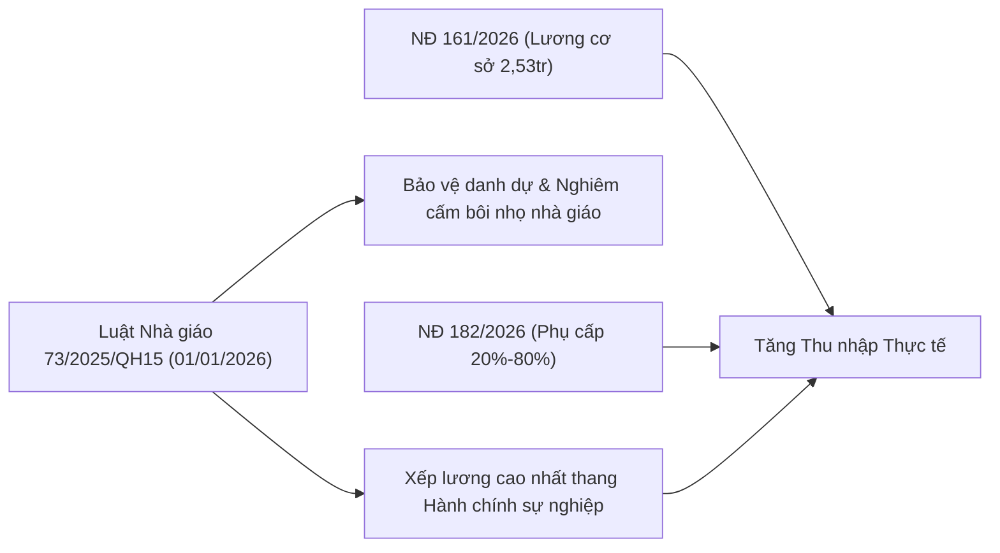

> **Tóm tắt nhanh (TL;DR):** Năm 2026 đánh dấu bước ngoặt lịch sử về đãi ngộ nhà giáo tại Việt Nam khi **Luật Nhà giáo số 73/2025/QH15** chính thức có hiệu lực từ **01/01/2026** (khẳng định lương nhà giáo xếp cao nhất trong hệ thống thang bậc lương hành chính sự nghiệp). Kết hợp với mức lương cơ sở mới **2,53 triệu đồng/tháng** từ **01/07/2026** (Nghị định 161/2026/NĐ-CP) và **Nghị định 182/2026/NĐ-CP**, khung phụ cấp ưu đãi nghề giáo dục được điều chỉnh rộng từ **20% đến 80%** (mầm non, tiểu học phổ thông **45%**; THCS, THPT phổ thông **40%**; nhân sự hỗ trợ giáo dục lần đầu hưởng **20%**).

---

# Luật Nhà Giáo & Nghị Định 182/2026: Toàn Cảnh Chính Sách Lương, Phụ Cấp Mới Cho Thầy Cô

Không chỉ nâng cao thu nhập bằng văn bản luật, hệ thống chính sách năm 2026–2027 còn giải quyết hai bài toán lớn mà đội ngũ sư phạm mong mỏi suốt nhiều năm: **bảo vệ danh dự nghề nghiệp nhà giáo** và **giảm tải thủ tục hành chính, sổ sách giấy tờ** thông qua chuyển đổi số.

## 1. Bảng Tổng Hợp Mức Lương Cơ Sở & Phụ Cấp Ưu Đãi Nghề Theo Nghị Định 182/2026

| Nhóm đối tượng công tác trong cơ sở giáo dục công lập | Mức phụ cấp ưu đãi nghề | Căn cứ & Ghi chú áp dụng |
| :--- | :--- | :--- |
| **Giáo viên Mầm non & Tiểu học (địa bàn thông thường)** | **`45%`** | Tính trên mức lương hiện hưởng theo lương cơ sở **`2,53 triệu đồng`** (từ 01/07/2026). |
| **Giáo viên THCS & THPT (địa bàn thông thường)** | **`40%`** | Áp dụng đồng bộ cho khối phổ thông cơ sở và phổ thông trung học công lập. |
| **Nhà giáo vùng khó khăn, biên giới, hải đảo, trường chuyên biệt** | **`60% – 80%`** *(có lộ trình tới `100%` tại địa bàn ĐBKK)* | Được hưởng chính sách tiền lương, phụ cấp cao hơn mặt bằng chung và hỗ trợ nhà ở công vụ/thuê nhà. |
| **Nhân sự hỗ trợ giáo dục (thư viện, thiết bị, y tế, văn thư...)** | **`20%`** | **Điểm mới đột phá** của NĐ 182/2026: lần đầu tiên lực lượng hỗ trợ giáo dục được hưởng phụ cấp ưu đãi nghề. |

Ngoài ra, Luật Nhà giáo cũng mở rộng cơ chế cho phép **giáo viên mầm non** (vốn có đặc thù lao động nặng nhọc, áp lực cao) được xem xét nghỉ hưu ở tuổi thấp hơn quy định chung nếu đáp ứng đủ điều kiện theo hướng dẫn.

---

## 2. Bảo Vệ Danh Dự Nhà Giáo & Chuẩn Hóa Vị Thế Ngoài Công Lập

Một điểm nhân văn rất đáng chú ý trong **Luật Nhà giáo 73/2025/QH15** là lần đầu tiên pháp luật quy định cơ chế bảo vệ uy tín sư phạm:
* **Nghiêm cấm phát tán thông tin sai lệch, xúc phạm danh dự nhà giáo** khi chưa có kết luận chính thức từ cơ quan có thẩm quyền — giúp thầy cô yên tâm giữ kỷ cương lớp học trước áp lực dư luận mạng xã hội.
* **Chuẩn hóa nhà giáo ngoài công lập:** Luật xác lập rõ quyền lợi, chuẩn nghề nghiệp và chế độ phát triển chuyên môn cho giáo viên trường tư thục, dân lập, không còn khoảng cách pháp lý như trước.

---

## 3. Giảm Tải Áp Lực Soạn Đề & Quản Lý Lớp Học Với Bộ Công Cụ 0đ Cho Giáo Viên

Thu nhập được cải thiện đi kèm yêu cầu đổi mới phương pháp kiểm tra đánh giá theo Chương trình GDPT 2018 (đề 3 phần, ma trận phân hóa, chấm điểm nhanh). Thay vì thức khuya cắt dán đề hay trộn mã đề thủ công, thầy cô có thể tận dụng bộ công cụ miễn phí của **QuizKen**:

* **Trộn 4 mã đề chuẩn trong 5 giây:** Dán ngân hàng câu hỏi vào [Công cụ trộn đề trắc nghiệm online](/cong-cu/tron-de-trac-nghiem-online) để tự động đảo câu, đảo đáp án A/B/C/D và xuất ngay bảng đáp án tổng `101–104`.
* **In phiếu tô đáp án chuẩn Bộ GD&ĐT:** Tạo và in miễn phí tại [Tạo phiếu trả lời trắc nghiệm 2027 (In A4)](/cong-cu/tao-phieu-tra-loi-trac-nghiem-2027) (đầy đủ Phần I, II Đúng/Sai 4 ý, Phần III Trả lời ngắn).
* **Bộ 3 tiện ích trình chiếu lớp học không quảng cáo:** [Vòng quay gọi tên học sinh](/cong-cu/vong-quay-goi-ten-hoc-sinh), [Chia nhóm ngẫu nhiên](/cong-cu/chia-nhom-ngau-nhien-lop-hoc), và [Đồng hồ bấm giờ thi thử máy chiếu](/cong-cu/dong-ho-bam-gio-thi-thu-may-chieu).
* **Tạo đề từ PDF/Word bằng AI:** Truy cập [QuizKen Teacher Tools](https://app.quizken.com/teacher/tools) để AI bóc tách file giáo án/đề cương thành bài kiểm tra online chỉ trong 1 phút.

---

## Câu hỏi thường gặp (FAQ)

### 1. Luật Nhà giáo số 73/2025/QH15 bắt đầu có hiệu lực từ ngày nào?
Luật Nhà giáo 73/2025/QH15 được Quốc hội thông qua và chính thức có hiệu lực thi hành từ ngày **01/01/2026**.

### 2. Mức lương cơ sở áp dụng tính lương giáo viên từ giữa năm 2026 là bao nhiêu?
Theo Nghị định 161/2026/NĐ-CP, từ ngày **01/07/2026**, mức lương cơ sở được điều chỉnh lên **2,53 triệu đồng/tháng**, làm căn cứ trực tiếp tính lương theo hệ số và phụ cấp ưu đãi nghề.

### 3. Nhân viên thư viện, thiết bị, văn thư trường công lập có được hưởng phụ cấp theo Nghị định 182/2026 không?
Có. Lần đầu tiên nhân sự hỗ trợ giáo dục làm việc trong các cơ sở giáo dục công lập được đưa vào diện hưởng phụ cấp ưu đãi theo nghề với mức **20%**.

### 4. QuizKen có miễn phí bộ công cụ trộn đề và in phiếu tô cho giáo viên không?
Có. Toàn bộ các tiện ích trong mục [Công cụ Giáo viên](/cong-cu) (trộn 4 mã đề, in phiếu trả lời A4, vòng quay gọi tên, tạo QR lớp học, đồng hồ máy chiếu) đều miễn phí 100%, không cần cài đặt phần mềm.
