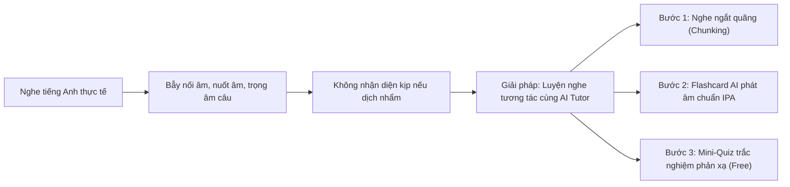

> **Tóm tắt nhanh (TL;DR):** Theo lộ trình đổi mới dạy và học ngoại ngữ của Đề án Ngoại ngữ Quốc gia và Chương trình GDPT 2018, kỹ năng **Nghe (Listening)** ngày càng được chú trọng trong các kỳ thi đánh giá năng lực, thi học sinh giỏi và chuẩn đầu ra đại học (VSTEP B1–B2). Tuy nhiên, hầu hết học sinh Việt Nam vẫn gặp phải tình trạng "điếc tiếng Anh" khi nghe người bản xứ nói nhanh hoặc nuốt âm. Bài viết này hướng dẫn phương pháp luyện nghe tiếng Anh bằng **công cụ AI miễn phí (free)** giúp bạn nâng trình phản xạ chỉ sau 4 tuần.

---

## 1. 3 Rào Cản Lớn Nhất Khiến Học Sinh Việt Nam Sợ Kỹ Năng Nghe

Nhiều bạn học sinh thuộc rất nhiều từ vựng và ngữ pháp khi đọc sách nhưng khi nghe lại không hiểu gì. Nguyên nhân chính bao gồm:

1. **Hiện tượng nối âm và biến âm (Connected Speech):** Người bản ngữ không phát âm từng từ rời rạc mà thường nối phụ âm với nguyên âm (như *pick it up* $\rightarrow$ /pɪkɪtʌp/), nuốt âm (*next door* $\rightarrow$ /neks dɔː/) hoặc giảm âm (Weak forms).
2. **Thiếu vốn từ vựng phát âm chuẩn (Acoustic Representation):** Não bộ bạn lưu trữ mặt chữ nhưng không có "dấu vân tay âm thanh" tương ứng của từ đó, dẫn đến việc khi âm thanh lướt qua tai, não bộ không kịp nhận diện.
3. **Thói quen dịch nhẩm sang tiếng Việt:** Khi vừa nghe vừa cố dịch từng từ sang tiếng mẹ đẻ, bạn sẽ bị bỏ lỡ các câu tiếp theo do tốc độ nói tự nhiên (150–180 từ/phút).

---

## 2. So Sánh Phương Pháp Luyện Nghe Truyền Thống vs. Luyện Nghe Cùng AI QuizKen

| Phương pháp | Luyện nghe truyền thống qua băng đĩa | Luyện nghe tương tác cùng AI QuizKen (Free) |
| :--- | :--- | :--- |
| **Tốc độ điều chỉnh** | Tốc độ cố định, quá nhanh đối với người mới bắt đầu | Tùy chỉnh tốc độ từ $0.75x$ đến $1.25x$ theo trình độ cá nhân |
| **Transcript & Lời dịch** | Phải lật cuối sách xem đáp án sau khi nghe xong | Transcript song ngữ chạy đồng bộ từng từ theo thời gian thực |
| **Tự động bắt lỗi sai** | Tự đối chiếu đáp án thủ công, không rõ vì sao mình nghe nhầm | AI chỉ ra chính xác từ ngữ bạn nghe nhầm do hiện tượng đồng âm |
| **Chi phí đầu tư** | Mua giáo trình và khóa học luyện nghe đắt tiền | Hệ thống luyện nghe tích hợp **AI miễn phí (free)** trên web & mobile |

---

## 3. Lộ Trình 4 Bước Chinh Phục Điểm 9+ Listening Cùng QuizKen Free

### Bước 1: Nghe bắt ý chính (Gist Listening)
Nghe lần đầu ở tốc độ bình thường ($1.0x$) mà không nhìn transcript. Mục tiêu là nắm được bối cảnh cuộc trò chuyện: Ai đang nói? Họ đang ở đâu? Chủ đề chính là gì?

### Bước 2: Bóc tách chi tiết cùng Flashcard từ vựng
Tải các đoạn audio ngắn hoặc đoạn hội thoại VSTEP B1 lên QuizKen. Hệ thống sẽ tự động lọc ra các cụm từ mới (Collocations) và phát âm chuẩn giọng Anh - Mỹ để bạn ôn qua thẻ Flashcard thông minh.

### Bước 3: Làm bài kiểm tra trắc nghiệm phản xạ
Sau khi nghe, QuizKen AI sẽ khởi tạo bài trắc nghiệm 5 câu hỏi dạng Đúng/Sai hoặc chọn đáp án đúng để kiểm tra độ hiểu sâu của bạn về các chi tiết cụ thể trong bài nói.

### Bước 4: Kỹ thuật nhại giọng (Shadowing)
Bật lại audio câu ngắn, nghe và nhắc lại ngay sau người bản xứ với đúng ngữ điệu, nhấn nhá trọng âm câu để cải thiện đồng thời cả phát âm và phản xạ nghe.

👉 **Bắt đầu luyện ngay:** [Luyện nghe tiếng Anh format mới cùng AI miễn phí trên QuizKen](https://quizken.com) ngay hôm nay!

---

## Câu hỏi thường gặp (FAQ)

### 1. Trình độ mới bắt đầu (A2) có luyện nghe bằng QuizKen được không?
Có. Nền tảng hỗ trợ lọc các bài nghe từ cấp độ cơ bản A1–A2 đến chuyên sâu B1–B2 theo khung chuẩn châu Âu CEFR.

### 2. Luyện nghe trên QuizKen có mất phí không?
Hoàn toàn **miễn phí (free)**. Học sinh có thể truy cập kho bài nghe, từ vựng và câu hỏi trắc nghiệm tương tác mỗi ngày mà không tốn chi phí.

### 3. Có thể dùng QuizKen để luyện nghe thi VSTEP và IELTS được không?
Có. Các chủ đề bài nghe trên QuizKen bám sát các dạng bài hội thoại ngắn, bài giảng học thuật (Lecture) thường xuất hiện trong đề thi VSTEP và IELTS Listening.
