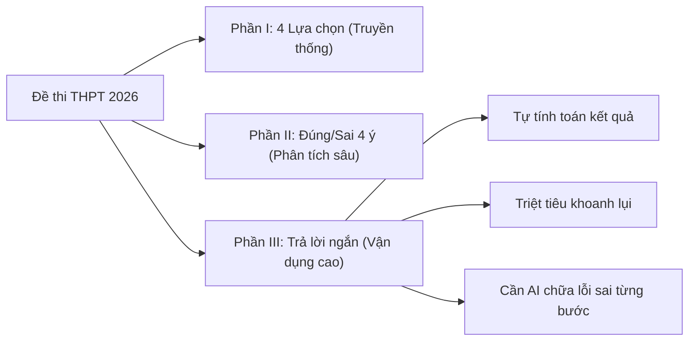

> **Tóm tắt nhanh (TL;DR):** Trong cấu trúc đề thi tốt nghiệp THPT từ năm 2025–2026 của Bộ GD&ĐT, **Phần III – Câu hỏi trắc nghiệm dạng trả lời ngắn** là phần thi mang tính phân loại thí sinh cao nhất. Không còn 4 phương án A-B-C-D để khoanh bừa, thí sinh phải tự tính toán ra kết quả số chính xác. Bài viết này hướng dẫn phương pháp sử dụng nền tảng **AI luyện đề miễn phí (free)** giúp học sinh rèn phản xạ tư duy và kiểm soát sai số hiệu quả.

---

## 1. Bản Chất Phần Thi Trắc Nghiệm Trả Lời Ngắn Trong Đề Thi THPT 2026

Theo quy chế và cấu trúc định dạng đề thi của Bộ Giáo dục và Đào tạo, bài thi trắc nghiệm các môn Toán, Vật lý, Hóa học, Sinh học được cấu trúc thành 3 phần rõ rệt:

* **Phần I:** 12–18 câu trắc nghiệm nhiều phương án (chọn 1 trong 4).
* **Phần II:** 4 câu trắc nghiệm dạng Đúng/Sai (mỗi câu gồm 4 lệnh hỏi con a, b, c, d).
* **Phần III:** 6 câu trắc nghiệm dạng **Trả lời ngắn** (đối với môn Toán) và 4–6 câu (với các môn Khoa học tự nhiên).

Khác biệt cốt tử của dạng câu hỏi này là thí sinh phải tự điền đáp số vào khung tô (ví dụ: `12`, `-3.5`, `0.75`). Tỷ lệ may rủi bị triệt tiêu về mức 0%, đòi hỏi tư duy giải quyết vấn đề trọn vẹn từ đầu đến cuối.

---

## 2. Những Cạm Bẫy Phổ Biến Khiến Thí Sinh Mất Điểm Ở Phần III

| Cạm bẫy thường gặp | Nguyên nhân chủ yếu | Giải pháp khắc phục cùng AI |
| :--- | :--- | :--- |
| **Sai quy tắc làm tròn số** | Đề bài yêu cầu lấy đến chữ số thập phân thứ hai nhưng học sinh làm tròn sớm ở các bước trung gian | Dùng QuizKen AI kiểm tra độ nhạy số và cảnh báo bước làm tròn sai |
| **Nhầm lẫn đơn vị đo** | Đổi từ $cm^3$ sang $m^3$, $kJ$ sang $J$, hoặc góc độ ($^{\circ}$) sang radian ($rad$) | AI tự động highlight các đại lượng vật lý/hóa học cần đồng bộ đơn vị |
| **Thiếu điều kiện xác định** | Bỏ quên điều kiện bài toán khiến nghiệm thực tế bị loại | AI đưa ra câu hỏi gợi ý phản biện để học sinh tự tìm ra nghiệm ngoại lai |

---

## 3. Cách Tận Dụng Công Cụ AI Miễn Phí (Free) Để Luyện Đề Chuẩn Xác

Để luyện tập hàng trăm câu hỏi trả lời ngắn mà không tốn chi phí mua sách tham khảo đắt tiền, học sinh có thể áp dụng quy trình 4 bước hoàn toàn **miễn phí** với QuizKen AI:

### Bước 1: Số hóa kho tài liệu chuyên đề
Tải các file bài tập PDF chuyên đề Toán, Lý, Hóa (như Khảo sát hàm số, Hình học không gian Oxyz, Dòng điện xoay chiều, Hóa học hữu cơ) lên QuizKen.

### Bước 2: Yêu cầu AI sinh câu hỏi Phần III dạng Short-Answer
Hệ thống AI tích hợp công nghệ xử lý công thức KaTeX sẽ quét toàn bộ lý thuyết và tự động khởi tạo các câu hỏi yêu cầu điền kết quả số thực tế, bám sát mức độ Vận dụng và Vận dụng cao.

### Bước 3: Kiểm tra đáp số và nhận phản hồi tức thì (Formative Feedback)
Khi bạn điền kết quả, QuizKen AI không chỉ thông báo Đúng/Sai mà còn hiển thị biểu đồ phân tích phương pháp giải tối ưu nhất, chỉ ra thời gian trung bình cần dành cho mỗi câu.

### Bước 4: Khắc phục điểm mù tư duy với AI Tutor Free
Nếu kết quả tính toán bị sai, thay vì xem ngay lời giải mẫu, hãy bấm nút trò chuyện với **AI Tutor miễn phí** để nhận gợi ý từng bước (Scaffolding hints) giúp não bộ ghi nhớ sâu bản chất.

👉 **Thử ngay:** [Luyện trắc nghiệm trả lời ngắn THPT 2026 free trên QuizKen](https://quizken.com) để tự tin làm chủ mọi dạng toán biến ảo!

---

## 4. Chiến Thuật Phân Bổ Thời Gian Phòng Thi Đạt Điểm 8+ Môn Toán

1. **20 phút đầu:** Giải quyết dứt điểm Phần I (12 câu nhận biết - thông hiểu).
2. **30 phút tiếp theo:** Xử lý Phần II (4 câu Đúng/Sai, chú ý lập luận chắc chắn ở từng ý nhỏ).
3. **35 phút dành cho Phần III:** Dành khoảng 5-6 phút cho mỗi câu trả lời ngắn; câu nào chắc chắn làm trước, kiểm tra lại phép tính 2 lần trước khi tô vào phiếu trả lời.
4. **5 phút cuối:** Soát lại toàn bộ mã đề, số báo danh và quy cách tô ô số học.

---

## Câu hỏi thường gặp (FAQ)

### 1. Dạng câu hỏi trắc nghiệm trả lời ngắn có khó hơn trắc nghiệm 4 lựa chọn không?
Chắc chắn khó hơn vì thí sinh không có các phương án gợi ý để thử lại. Dạng này đòi hỏi bạn phải giải trọn vẹn bài toán và có kỹ năng tính toán chuẩn xác.

### 2. Sử dụng QuizKen để tạo câu hỏi trả lời ngắn có mất tiền không?
Không. QuizKen cung cấp tính năng tạo đề trắc nghiệm bằng **AI miễn phí (free)** hàng ngày cho mọi tài khoản học sinh, giúp bạn thoải mái luyện tập trước kỳ thi lớn.

### 3. Làm thế nào để tránh sai số khi tô đáp án phần III?
Hãy làm quen với mẫu phiếu trả lời trắc nghiệm chuẩn của Bộ GD&ĐT từ sớm, đồng thời luôn tính toán bằng phân số chính xác trước khi làm tròn số theo yêu cầu của đề bài ở bước cuối cùng.
