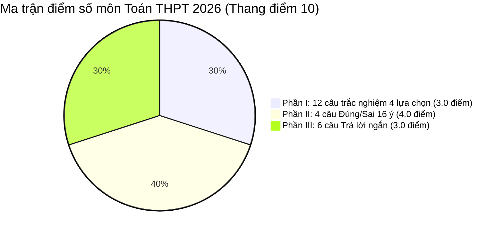

> **Tóm tắt nhanh (TL;DR):** Kỳ thi tốt nghiệp THPT năm 2026 đánh dấu năm thứ hai triển khai định dạng đề thi mới toàn diện theo Chương trình GDPT 2018. Khác với đề thi 50 câu trắc nghiệm 4 lựa chọn trước đây, bài thi môn Toán gồm **3 phần phân hóa mạnh mẽ** đòi hỏi thí sinh phải có tư duy thực chất và kỹ năng tự tính toán cao. Bài viết giới thiệu **mẫu đề thi tốt nghiệp THPT môn Toán 2026** chuẩn mực kèm hệ thống hỗ trợ giải chi tiết bằng **AI miễn phí (free)**.

---

## 1. Phân Tích Ma Trận Cấu Trúc Đề Thi Tốt Nghiệp THPT Môn Toán 2026

Theo công bố chính thức từ Bộ Giáo dục và Đào tạo, bài thi trắc nghiệm môn Toán có thời gian làm bài **90 phút**, gồm tổng cộng **22 câu hỏi (34 ý hỏi)** được chia thành 3 phần:

* **Phần I (12 câu - 3.0 điểm):** Kiểm tra kiến thức nền tảng thuộc mức độ *Nhận biết* và *Thông hiểu*. Thí sinh chỉ cần chọn 1 trong 4 phương án $A, B, C, D$. Mỗi câu đúng được $0,25$ điểm.
* **Phần II (4 câu - 4.0 điểm):** Dạng thức trắc nghiệm Đúng/Sai. Mỗi câu hỏi gắn liền với một mô hình toán học hoặc bài toán thực tế kèm 4 ý hỏi $a, b, c, d$. Áp dụng quy tắc tính điểm lũy tiến (đúng 1 ý được 0,1đ; đúng 2 ý được 0,25đ; đúng 3 ý được 0,5đ; đúng 4 ý được 1,0đ).
* **Phần III (6 câu - 3.0 điểm):** Dạng thức trắc nghiệm trả lời ngắn. Thí sinh phải tự tính ra kết quả số cụ thể và điền vào khung trả lời. Mỗi câu đúng được $0,5$ điểm, không có xác suất đoán mò.

---

## 2. 5 Dạng Toán Thực Tế Chiếm Sóng Trong Đề Thi Toán 2026

Khác với chương trình cũ thiên về biến đổi đại số phức tạp, đề thi GDPT 2018 tập trung sâu vào ứng dụng giải quyết các bài toán đời sống:

| Mảng kiến thức | Bài toán ứng dụng thực tế trong đề thi | Cấp độ tư duy |
| :--- | :--- | :--- |
| **Ứng dụng đạo hàm & Khảo sát hàm số** | Tối ưu hóa chi phí sản xuất, tìm dung tích bể chứa lớn nhất, vận tốc chuyển động | Vận dụng & Vận dụng cao |
| **Hàm số Mũ & Logarit** | Bài toán lãi suất ngân hàng kép, sự phân rã phóng xạ, cường độ địa chấn Richter | Thông hiểu & Vận dụng |
| **Nguyên hàm & Tích phân** | Tính diện tích thửa ruộng có đường biên cong, quãng đường vật thể di chuyển | Vận dụng |
| **Phương pháp tọa độ Oxyz** | Định vị quỹ đạo bay của máy bay, mô phỏng góc chiếu của ánh sáng mặt trời | Vận dụng & Vận dụng cao |
| **Xác suất có điều kiện & Biến cố độc lập** | Phân tích rủi ro trong y tế (xét nghiệm bệnh), xác suất thống kê thị trường | Thông hiểu & Vận dụng |

---

## 3. Cách Luyện Đề Chuẩn 3 Phần Cùng QuizKen AI (Free)

Để không bị bỡ ngỡ trước áp lực thời gian 90 phút phòng thi, các sĩ tử 2026 có thể tận dụng bộ giải pháp thông minh trên **QuizKen**:

1. **Thi thử có đồng hồ bấm giờ áp lực:** Tự động đếm ngược 90 phút, hỗ trợ giao diện tô phiếu trả lời điện tử chuẩn mẫu phiếu của Bộ GD&ĐT.
2. **Hiển thị công thức KaTeX sắc nét:** Toàn bộ bảng biến thiên, tích phân, hình vẽ Oxyz được hiển thị rõ ràng trên mọi thiết bị.
3. **Chẩn đoán điểm mù sau khi nộp bài:** AI phân tích xem bạn đang mất điểm ở phần nào nhiều nhất (Phần II Đúng/Sai hay Phần III Trả lời ngắn) để gợi ý bộ bài tập bổ trợ khắc phục dứt điểm hoàn toàn **miễn phí (free)**.

👉 **Thi thử ngay:** [Làm bài thi thử Toán tốt nghiệp THPT 2026 AI miễn phí trên QuizKen](https://quizken.com) để tự tin bứt phá điểm 8+!

---

## Câu hỏi thường gặp (FAQ)

### 1. Học sinh chỉ làm đúng phần I thì được tối đa bao nhiêu điểm?
Nếu chỉ làm đúng toàn bộ 12 câu ở Phần I, học sinh chỉ đạt tối đa 3,0 điểm. Để đạt điểm trung bình (5 điểm) hoặc khá giỏi (7-8 điểm), bạn bắt buộc phải làm tốt Phần II và Phần III.

### 2. QuizKen có cung cấp lời giải chi tiết cho từng câu hỏi không?
Có. Toàn bộ các câu hỏi trong đề thi mẫu đều đi kèm lời giải chi tiết từng bước, phân tích vì sao mệnh đề Đúng hoặc Sai, và cách tính toán nhanh số học.

### 3. Đề thi Toán trên QuizKen có được cập nhật theo đề minh họa mới nhất của Bộ GD&ĐT không?
Có. Đội ngũ QuizKen liên tục cập nhật ngân hàng đề thi theo các thông báo và đề minh họa chuẩn mới nhất của Bộ Giáo dục và Đào tạo cho kỳ thi 2026.
