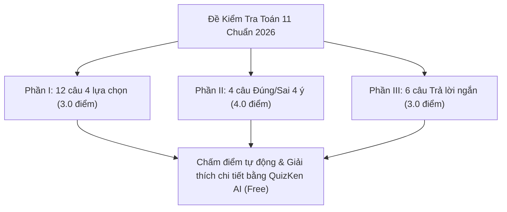

> **Tóm tắt nhanh (TL;DR):** Chương trình Toán lớp 11 theo Chương trình GDPT 2018 chứa nhiều mảng kiến thức trọng tâm mang tính nền tảng cho kỳ thi tốt nghiệp THPT như Hàm số lượng giác, Cấp số cộng – Cấp số nhân, Giới hạn và Đạo hàm, Hình học không gian quan hệ song song & vuông góc. Bài viết chia sẻ **mẫu đề thi trắc nghiệm Toán lớp 11 chuẩn format mới 2026** gồm 3 phần câu hỏi, tích hợp công cụ giải và chữa bài chi tiết bằng **AI hoàn toàn miễn phí (free)**.

---

## 1. Cấu Trúc Đề Kiểm Tra Toán Lớp 11 Format Mới Năm 2026

Bám sát định hướng ra đề của Bộ Giáo dục và Đào tạo, bài kiểm tra định kỳ (giữa kỳ và học kỳ) môn Toán lớp 11 được thiết kế theo cấu trúc 3 phần chuẩn hóa:

* **Phần I (12 câu - 3.0 điểm):** Câu hỏi trắc nghiệm nhiều phương án lựa chọn (chọn 1 trong 4). Đánh giá mức độ *Nhận biết* và *Thông hiểu* các công thức cơ bản.
* **Phần II (4 câu - 4.0 điểm):** Câu hỏi trắc nghiệm dạng Đúng/Sai. Mỗi câu gồm 4 lệnh hỏi $a, b, c, d$ xoay quanh một bài toán hình học hoặc hàm số thực tế. Chấm điểm lũy tiến từ 0.1 đến 1.0 điểm.
* **Phần III (6 câu - 3.0 điểm):** Câu hỏi trắc nghiệm dạng trả lời ngắn. Thí sinh tự tính toán và điền đáp số là số nguyên hoặc số thập phân (ví dụ: tính góc giữa hai đường thẳng, giá trị đạo hàm tại một điểm).

---

## 2. Các Chuyên Đề Toán 11 Chiếm Tỷ Trọng Điểm Cao Nhất

| Chuyên đề trọng tâm | Dạng câu hỏi thường gặp | Cạm bẫy học sinh hay mắc phải |
| :--- | :--- | :--- |
| **Hàm số & Phương trình lượng giác** | Tìm tập xác định, giải phương trình lượng giác cơ bản | Quên chu kỳ tuần hoàn $k2\pi$ hoặc $k\pi$, nhầm đơn vị radian |
| **Cấp số cộng – Cấp số nhân** | Bài toán thực tế về lãi kép, tăng trưởng dân số, tính tổng $S_n$ | Nhầm lẫn công thức số hạng tổng quát $u_n = u_1 + (n-1)d$ |
| **Giới hạn & Hàm số liên tục** | Khử dạng vô định $\frac{0}{0}$, $\infty - \infty$ | Sai dấu khi đưa biến $x$ ra ngoài dấu căn bậc hai |
| **Đạo hàm & Tiếp tuyến** | Viết phương trình tiếp tuyến của đồ thị hàm số | Nhầm lẫn giữa "tiếp tuyến tại điểm" và "tiếp tuyến đi qua điểm" |
| **Hình học không gian (Quan hệ vuông góc)** | Tính góc giữa đường thẳng và mặt phẳng, khoảng cách giữa 2 đường chéo nhau | Xác định sai hình chiếu vuông góc lên mặt phẳng đáy |

---

## 3. Cách Luyện Đề Toán 11 Hiệu Quả Cùng QuizKen AI (Free)

Thay vì phải tìm kiếm đề thi giải tay trôi nổi trên mạng với nguy cơ sai sót đáp số, học sinh lớp 11 có thể ôn luyện trực tiếp trên **QuizKen**:

1. **Làm đề trực tuyến có bấm giờ:** Giao diện thi tương thích 100% với màn hình điện thoại và máy tính, công thức toán hiển thị bằng công nghệ **KaTeX** chuẩn mực không bị lỗi font.
2. **Chữa bài chi tiết từng bước:** Mỗi câu hỏi làm sai đều có lời giải giải thích cặn kẽ phương pháp, kèm các công thức bổ trợ cần nhớ.
3. **Chat trực tiếp với AI Tutor:** Nếu không hiểu một phép biến đổi nào trong lời giải, bạn chỉ cần bấm nút "Hỏi gia sư AI" để được giải thích tường tận hoàn toàn **miễn phí (free)**.

👉 **Luyện đề ngay:** [Làm bài thi thử Toán lớp 11 format mới AI miễn phí trên QuizKen](https://quizken.com) để tự tin bứt phá điểm 9+!

---

## Câu hỏi thường gặp (FAQ)

### 1. Đề thi Toán lớp 11 trên QuizKen có bám sát cả 3 bộ sách mới không?
Có. Hệ thống AI của QuizKen tổng hợp kiến thức giao thoa chuẩn chuẩn GDPT 2018 của cả 3 bộ sách giáo khoa: Kết nối tri thức, Cánh diều và Chân trời sáng tạo.

### 2. Học sinh có thể xuất đề thi Toán lớp 11 ra file in được không?
Có. Bạn có thể xuất đề thi kèm bảng đáp án chi tiết ra file PDF hoặc Word chất lượng cao hoàn toàn **miễn phí (free)**.

### 3. Làm thế nào để luyện thêm đề Toán lớp 10 và 12?
Bạn có thể tham khảo thêm bài viết [Đề Thi Trắc Nghiệm Toán Lớp 10 Online](/blog/de-thi-trac-nghiem-toan-lop-10-online) và bài viết [Mẫu Đề Thi Tốt Nghiệp THPT Môn Toán 2026](/blog/mau-de-thi-tot-nghiep-thpt-mon-toan-2026-chuan-3-phan-ai-free) trên hệ thống QuizKen.
