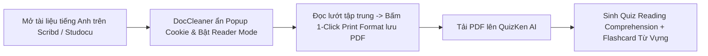

> **TL;DR (Tóm tắt nhanh):**  
> Để **học tài liệu Scribd tiếng Anh** và giáo trình chuyên ngành hiệu quả gấp 3 lần, hãy kết hợp **DocCleaner** (bật Reader Mode sạch sẽ, ẩn popup cookie, xuất PDF với 1-Click Print Format) cùng **[QuizKen English Hub](https://app.quizken.com)** để chuyển đổi nội dung tiếng Anh thành bộ **Flashcard lặp lại ngắt quãng** và **Quiz đọc hiểu AI** hoàn toàn miễn phí (free)!

---

# Combo DocCleaner + QuizKen: Cách Đọc & Nuốt Trọn Tài Liệu Tiếng Anh Trên Scribd

Khi học các môn chuyên ngành bằng tiếng Anh (English-taught programs) hoặc luyện thi IELTS, TOEFL, VSTEP, **Scribd** là nguồn tài nguyên tuyệt vời với hàng loạt sách tham khảo, đề thi mẫu và tài liệu học thuật quốc tế.

Tuy nhiên, việc **học tài liệu Scribd tiếng Anh** thường gặp hai rào cản lớn:
1. **Rào cản giao diện:** Vừa đọc tiếng Anh đã đòi hỏi sự tập trung cao độ, lại thêm banner nổi và hộp thoại cookie che màn hình khiến mắt rất nhanh mỏi.
2. **Rào cản ghi nhớ:** Đọc xong 20 trang tài liệu tiếng Anh nhưng đến hôm sau gần như quên sạch từ vựng học thuật lẫn ý chính.

Sự kết hợp giữa tiện ích **[DocCleaner - Better Studocu & Scribd Reader](https://chromewebstore.google.com/detail/doccleaner-better-studocu/fnhdoegoihnkgggnaiemommemdejhbkb?hl=vi)** và nền tảng **[QuizKen](https://app.quizken.com)** sẽ giải quyết trọn vẹn cả hai khâu: **Đọc sạch** và **Nhớ sâu**.

---

## 1. Quy Trình 3 Bước Học Tài Liệu Tiếng Anh Từ Scribd Hiệu Quả Nhất

### Bước 1: Dọn sạch giao diện Scribd bằng DocCleaner Reader Mode
Sau khi cài đặt miễn phí từ Chrome Web Store, bạn chỉ cần mở tài liệu tiếng Anh trên `scribd.com` (hoặc tài liệu quốc tế trên `studocu.com`).
* DocCleaner tự động ẩn popup cookie và các banner gây nhiễu.
* Giao diện popup song ngữ **English / Tiếng Việt** cho phép bạn thao tác thuận tiện dù đang học bằng ngôn ngữ nào.
* Bộ **Smart Page Formatter** giúp các trang sách/giáo trình dài hiển thị liền mạch, không bị gián đoạn bởi khoảng trắng.

### Bước 2: Lưu trích đoạn hoặc toàn bộ tài liệu thành PDF
Khi gặp một chương sách hay hoặc bộ đề Reading chất lượng, nhấn vào nút nổi **1-Click Print Format** của DocCleaner, chọn **Save as PDF** trong hộp thoại Chrome Print để lưu bản sạch về máy tính.

### Bước 3: Biến PDF thành bài luyện đọc & từ vựng trên QuizKen
Thay vì chỉ đọc lướt một lần rồi cất đi, hãy đưa file PDF đó vào **[QuizKen](https://app.quizken.com)**:
* **Tạo câu hỏi Reading Comprehension tự động:** AI đọc văn bản tiếng Anh và sinh câu hỏi kiểm tra khả năng hiểu ý chính, suy luận ngữ cảnh (Inference) tương tự format IELTS/VSTEP.
* **Xây dựng bộ Flashcard từ vựng chuyên ngành:** Ôn tập các thuật ngữ khó theo thuật toán **Spaced Repetition** trên QuizKen English Hub để nhớ lâu dài mà không cần học vẹt.

---

## 2. So Sánh Cách Đọc Tài Liệu Tiếng Anh Truyền Thống Vs. Combo DocCleaner + QuizKen

| Tiêu chí | Đọc Scribd thông thường | Combo DocCleaner + QuizKen |
| :--- | :--- | :--- |
| **Mức độ tập trung khi đọc** | Dễ bị phân tâm bởi banner & popup | **Reader Mode tối giản**, tập trung 100% |
| **Tốc độ xử lý trang dài** | Có thể bị khựng hoặc trắng trang | **Smart Page Formatter pre-render mượt** |
| **Khả năng ghi nhớ từ vựng** | Rất thấp (đọc xong dễ quên) | **Ôn bằng Flashcard & Quiz AI chủ động** |
| **Chi phí** | Phải tự ghi chép thủ công | **Cả 2 công cụ đều có bản Free mạnh mẽ** |

---

## 3. Mẹo Nhỏ Giúp Tăng Tốc Độ Đọc Giáo Trình Tiếng Anh Trên Trình Duyệt

* **Bật DocCleaner kết hợp từ điển tra nhanh:** Khi giao diện Scribd đã gọn gàng nhờ DocCleaner, việc bôi đen tra nghĩa từ mới trở nên cực kỳ dễ dàng, không bị click nhầm vào các lớp overlay quảng cáo.
* **Chia nhỏ mỗi phiên học 15–20 trang:** Xuất phần kiến thức cần học trong ngày ra PDF, nạp vào QuizKen làm nhanh một bài quiz 10 câu để chốt lại kiến thức trước khi nghỉ giải lao.

---

## 4. Câu Hỏi Thường Gặp (FAQ)

### 1. DocCleaner có hỗ trợ giao diện tiếng Anh cho người quen dùng trình duyệt tiếng Anh không?
Có. Trong popup của DocCleaner trên thanh công cụ, bạn có thể chuyển đổi linh hoạt giữa giao diện **English** và **Tiếng Việt** chỉ bằng 1 click.

### 2. DocCleaner có làm lỗi font chữ hoặc ký hiệu phiên âm IPA trong tài liệu tiếng Anh trên Scribd không?
Không. Tiện ích giữ nguyên toàn bộ nội dung gốc, font chữ và ký hiệu học thuật bên trong tài liệu, chỉ làm sạch phần giao diện thừa bên ngoài.

### 3. Sau khi lưu PDF từ DocCleaner, tôi có thể up trực tiếp lên QuizKen không?
Có. File PDF xuất qua nút **1-Click Print Format** của DocCleaner kết hợp Chrome `Save as PDF` có cấu trúc sạch, rất lý tưởng để QuizKen AI phân tích và tạo câu hỏi.

---

**Bắt đầu ngay hôm nay:** Cài miễn phí **[DocCleaner trên Chrome Web Store](https://chromewebstore.google.com/detail/doccleaner-better-studocu/fnhdoegoihnkgggnaiemommemdejhbkb?hl=vi)** và mở **[QuizKen](https://app.quizken.com)** để biến mỗi trang tài liệu tiếng Anh thành điểm cộng ngoại ngữ vững chắc!
