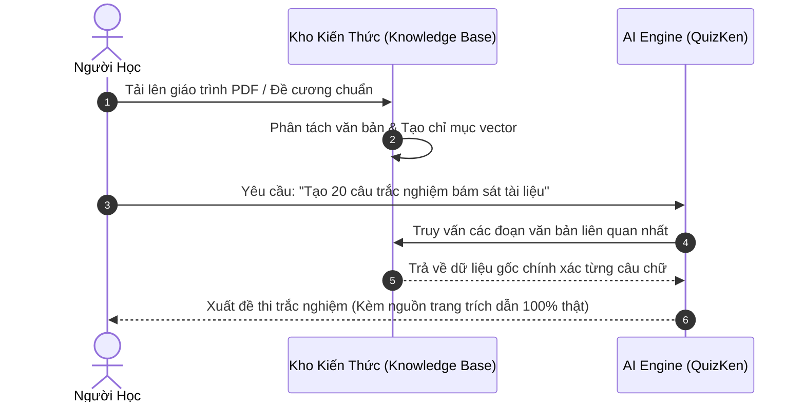

> **TL;DR (Tóm tắt nhanh):**  
> Khi nhờ các chatbot AI thông thường (như ChatGPT, Copilot hay Gemini) giải đề thi hoặc tóm tắt giáo trình, học sinh rất dễ gặp phải hiện tượng **"Ảo giác AI" (AI Hallucination)** – hiện tượng AI tự tin bịa ra các điều luật không có thật, công thức sai lệch hoặc trích dẫn nguồn sách giả mạo. Để triệt tiêu hoàn toàn rủi ro này, phương pháp chuẩn mực năm 2026 là áp dụng kiến trúc **RAG (Retrieval-Augmented Generation)** thông qua tính năng **Kho Kiến Thức (Knowledge Base)** trên **QuizKen**: AI chỉ được phép đọc và trích xuất câu hỏi trực tiếp từ tài liệu do chính bạn tải lên, đảm bảo độ chính xác học thuật 100%!

---

# Mẹo Dùng AI Ôn Thi Không Bị Ảo Giác (Hallucination) Với Kho Kiến Thức RAG (2026)

Trí tuệ nhân tạo tạo sinh (Generative AI) đã tạo ra một cuộc cách mạng trong việc tự học của học sinh, sinh viên. Tuy nhiên, đằng sau sự tiện lợi ấy là một "cạm bẫy" vô cùng nguy hiểm mà rất nhiều bạn trẻ đã phải trả giá bằng điểm số trong kỳ thi: **Hiện tượng Ảo giác AI (AI Hallucination)**.

Đã bao giờ bạn nhờ AI tìm giúp một điều luật trong Bộ luật Dân sự, hoặc giải thích một định lý Kinh tế vi mô, và AI trả lời cực kỳ trôi chảy, tự tin nhưng khi nộp bài cho giảng viên thì bị chấm 0 điểm vì **điều luật hay định lý đó hoàn toàn do AI tự... bịa ra**?

Bài viết này sẽ phân tích nguyên nhân khoa học của hiện tượng này và hướng dẫn bạn cách "thuần hóa" AI, đảm bảo mọi đề thi và kiến thức ôn tập luôn chuẩn xác 100% bằng công nghệ **RAG**.

---

## 1. Vì Sao AI Lại Hay "Bịa Chuyện" Khi Ôn Thi?

Các mô hình ngôn ngữ lớn (LLM) không phải là cơ sở dữ liệu tra cứu sự thật; về bản chất, chúng là các **cỗ máy dự đoán từ tiếp theo có xác suất cao nhất**:
1. **Khoảng trống dữ liệu nội bộ:** Giáo trình của trường đại học bạn học, đề thi thử nội bộ của thầy cô hay thông tư mới nhất của Bộ GD&ĐT thường không nằm trong dữ liệu huấn luyện công khai của các mô hình AI nước ngoài.
2. **Xu hướng làm hài lòng người dùng:** Khi không biết câu trả lời chính xác, thay vì nói "Tôi không biết", mô hình AI có xu hướng xâu chuỗi các mảnh thông tin rời rạc để tạo ra một câu trả lời nghe có vẻ hợp lý và thuyết phục nhất.
3. **Mất liên kết nguồn gốc:** Các chatbot tự do không thể dẫn chiếu chính xác đến từng trang sách cụ thể mà bạn đang học.

---

## 2. Công Nghệ RAG – "Thuốc Giải Độc" Cho Ảo Giác AI

Để giải quyết vấn đề này, các kỹ sư phần mềm giáo dục đã phát triển kiến trúc **RAG (Retrieval-Augmented Generation - Tạo sinh tăng cường truy xuất)**:

Thay vì để AI tự do nhớ lại kiến thức mơ hồ trong quá khứ, RAG buộc AI phải **"mở sách ra đọc đoạn văn bản cụ thể"** trước khi đưa ra câu hỏi và đáp án. Nhờ đó:
* **Loại bỏ 100% thông tin bịa đặt:** Đáp án đúng chỉ được công nhận nếu có dẫn chứng nằm trong tài liệu của bạn.
* **Bám sát đề thi của trường:** Đề thi được tạo ra mang đúng văn phong và nội dung mà giảng viên trên lớp đã dạy.

---

## 3. Cách Sử Dụng Tính Năng Kho Kiến Thức Trên QuizKen

Trên nền tảng **QuizKen**, tính năng RAG đã được tích hợp sẵn dưới dạng **Kho Kiến Thức (Knowledge Base)** cực kỳ trực quan:

1. **Bước 1: Tải tài liệu chuẩn vào Kho Kiến Thức:**
   * Truy cập vào [app.quizken.com](https://app.quizken.com).
   * Mở bảng **Kho Kiến Thức (Knowledge Base)**.
   * Tải lên các tệp giáo trình PDF, bài giảng slide hoặc đề cương Word chuẩn của nhà trường.
2. **Bước 2: Chọn tài liệu tham chiếu:**
   * Khi tạo bài kiểm tra, bạn chỉ cần tích chọn các tệp tài liệu cụ thể mà mình muốn ôn tập (ví dụ: *Chương 3 - Pháp luật Đại cương.pdf*).
3. **Bước 3: Nhận đề thi chuẩn xác kèm trích dẫn:**
   * Bấm nút **Tạo Đề Thi**. AI của QuizKen sẽ quét trực tiếp qua chỉ mục vector của tệp bạn đã chọn.
   * Mọi câu hỏi trắc nghiệm và lời giải thích đáp án đều trích dẫn chính xác định nghĩa từ tài liệu bạn tải lên, hoàn toàn không có bất kỳ thông tin ngoại lai nào bị thêm thắt vào.

---

## 4. Bảng So Sánh Ôn Thi Bằng AI Tự Do vs AI RAG QuizKen

| Tiêu chí | Dùng Chatbot AI thông thường | Dùng Kho Kiến Thức RAG QuizKen |
| :--- | :--- | :--- |
| **Độ chính xác học thuật** | 60 - 75% (Dễ bị ảo giác bịa luật, bịa số liệu) | **100% Chuẩn xác theo giáo trình của bạn** |
| **Khả năng bám sát đề cương** | Chung chung, lan man | **Trích xuất chính xác theo từng chương bài học** |
| **Trích dẫn nguồn gốc** | Thường không có hoặc bịa tên sách | **Trích dẫn trực tiếp từ file bạn đã tải lên** |
| **Định dạng câu hỏi** | Đoạn chat dài dòng khó theo dõi | **Chuẩn đề thi trắc nghiệm A, B, C, D có chấm điểm** |

---

## 5. 💡 Lời Khuyên Dành Cho Mùa Ôn Thi Đại Học & Cao Đẳng

* **Luôn cung cấp dữ liệu đầu vào chuẩn (Ground Truth):** Trước khi hỏi AI bất kỳ bài tập nào, hãy cung cấp cho AI tài liệu gốc bằng cách nạp file vào QuizKen.
* **Kiểm tra chéo lời giải thích:** Đọc kỹ phần giải thích đáp án của QuizKen để hiểu sâu nguyên lý vì sao phương án đó đúng thay vì chỉ học vẹt đáp án A, B, C.
* **Tận dụng tính năng xuất PDF:** Xuất đề thi ra bản in giấy để luyện thói quen làm bài trong không gian phòng thi thực tế không có máy tính hỗ trợ.

> 🛡️ **Học tập an toàn & chuẩn xác:** [Trải nghiệm tính năng Kho Kiến Thức RAG tạo đề thi AI không ảo giác trên QuizKen ngay!](https://app.quizken.com)

---

## Câu hỏi thường gặp về ảo giác AI và công nghệ RAG

### Làm sao tôi biết một câu trả lời của AI có bị ảo giác hay không?
Dấu hiệu nhận biết ảo giác AI là văn phong câu trả lời cực kỳ tự tin, chau chuốt nhưng khi bạn tra cứu tên các tác giả, số hiệu điều luật hay công thức cụ thể trong sách giáo khoa chính thống thì hoàn toàn không tồn tại.

### Kho Kiến Thức của QuizKen có bảo mật tài liệu của tôi không?
Tài liệu tải lên Kho Kiến Thức của bạn được mã hóa an toàn và chỉ phục vụ duy nhất cho phiên học tập cá nhân của bạn, không bao giờ bị rò rỉ ra ngoài hoặc chia sẻ cho bên thứ ba.

### Tôi có thể tải nhiều tài liệu khác nhau vào Kho Kiến Thức cùng lúc không?
Hoàn toàn được! Bạn có thể lưu trữ toàn bộ giáo trình các môn học trong học kỳ vào QuizKen để AI tổng hợp đề thi liên môn hoặc kiểm tra kiến thức tổng hợp bất cứ lúc nào.
