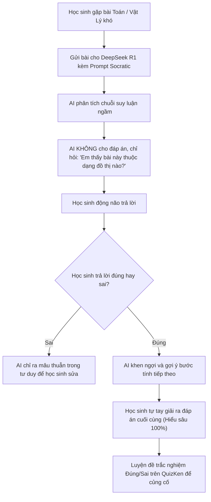

> **TL;DR (Tóm tắt nhanh):**  
> Việc lạm dụng AI để "chép lời giải có sẵn" là nguyên nhân hàng đầu khiến học sinh bị điểm liệt khi bước vào phòng thi THPT Quốc gia theo chương trình mới GDPT 2018. Bằng cách áp dụng mô hình suy luận chuỗi tư duy (Chain-of-Thought) của **DeepSeek R1 giải toán miễn phí** kết hợp **kỹ thuật Prompt Socratic (Phương pháp gợi mở)**, AI sẽ đóng vai trò như một gia sư 1-1: chỉ đưa ra câu hỏi gợi ý, hướng dẫn bạn từng bước tự tìm ra công thức mà không bao giờ lộ đáp án trước. Khi đã hiểu bản chất, bạn có thể luyện tập đề thi thử thực chiến trên **QuizKen** với đầy đủ định dạng Đúng/Sai 4 ý và Trả lời ngắn!

---

# Mẹo Sử Dụng DeepSeek R1 Tự Học Toán & STEM Theo Phương Pháp Socratic 2026

Kỳ thi Tốt nghiệp THPT Quốc gia từ năm 2026 đã chính thức áp dụng hoàn toàn theo chương trình GDPT 2018 với ma trận đề thi 3 phần hoàn toàn mới:
1. **Phần I:** Trắc nghiệm 4 lựa chọn truyền thống (12 câu).
2. **Phần II:** Trắc nghiệm Đúng/Sai 4 ý (4 câu, đòi hỏi tư duy phân tích toàn diện).
3. **Phần III:** Trắc nghiệm Trả lời ngắn (6 câu, không có phương án gợi ý để đánh lụi).

Với cấu trúc đề thi này, thói quen "quét ảnh bài tập đưa cho AI giải từ A đến Z rồi chép vào vở" sẽ khiến bạn hoàn toàn mất khả năng phản xạ trong phòng thi. Bạn nghĩ mình đã hiểu bài, nhưng thực chất chỉ đang **hiểu cách AI giải**.

Mô hình mã nguồn mở **DeepSeek-R1** ra đời với khả năng suy luận logic toán học vượt trội nhờ cơ chế học tăng cường (RL - Reinforcement Learning) và chuỗi suy nghĩ minh bạch (`<think>...</think>`). Dưới đây là phương pháp biến DeepSeek R1 thành gia sư cá nhân đỉnh cao mà không tốn một đồng chi phí!

---

## 1. Phương Pháp Socratic Là Gì & Vì Sao Là "Khắc Tinh" Của Học Vẹt?

Phương pháp Socratic (đặt theo tên nhà triết học Hy Lạp Socrates) là kỹ thuật sư phạm đỉnh cao: **Người dạy không bao giờ đưa ra câu trả lời trực tiếp, mà liên tục đặt các câu hỏi phản biện gợi mở để người học tự khám phá ra chân lý**.



---

## 2. Bộ Prompt Chuẩn Socratic Cho DeepSeek R1

Khi sử dụng DeepSeek R1 (trên web `chat.deepseek.com` hoặc ứng dụng di động), đừng chỉ dán đề bài và hỏi *"Giải bài này giúp em"*. Hãy dán đoạn **System Prompt Socratic** độc quyền dưới đây trước khi gửi bài tập:

```text
Bạn là một Giáo viên dạy Toán STEM xuất sắc theo phương pháp Socratic. 
Nhiệm vụ của bạn là giúp tôi tự giải được bài toán này. 
QUY TẮC BẮT BUỘC:
1. TUYỆT ĐỐI KHÔNG giải bài toán giúp tôi, không đưa ra đáp số cuối cùng hoặc toàn bộ các bước giải cùng một lúc.
2. Hãy bắt đầu bằng cách hỏi tôi về giả thiết của bài toán hoặc kiến thức nền tảng cần dùng.
3. Mỗi lần phản hồi, bạn chỉ được phép đặt DUY NHẤT MỘT câu hỏi gợi ý hoặc đưa ra 1 gợi ý nhỏ.
4. Nếu tôi trả lời sai, hãy kiên nhẫn chỉ ra điểm mâu thuẫn trong lập luận của tôi và đặt một câu hỏi dễ hơn.
5. Chỉ khi tôi tự mình nói ra đáp án đúng, bạn mới tổng kết lại phương pháp giải tối ưu cho dạng bài này.

Đề bài của tôi là: [DÁN ĐỀ BÀI HOẶC ẢNH CÔNG THỨC VÀO ĐÂY]
```

### Ví dụ thực tế một phiên học Socratic cùng DeepSeek R1:
* **Học sinh:** *Cho hàm số $y = x^3 - 3x^2 + 2$. Tìm điểm cực đại của đồ thị hàm số.*
* **DeepSeek R1 (Thinking Mode):** `<think>Học sinh cần tìm điểm cực đại. Bước 1 là tính đạo hàm y'. Tôi không được tính hộ. Tôi sẽ hỏi học sinh điều kiện cần để hàm số đạt cực trị.</think>`
* **DeepSeek R1 phản hồi:** *"Chào em! Để tìm điểm cực trị của một hàm số bậc ba, bước đầu tiên em cần làm đối với hàm số này là gì? Em hãy nhắc lại mối liên hệ giữa cực trị và đạo hàm $y'$ nhé!"*
* **Học sinh:** *Dạ em cần tính đạo hàm $y'$ rồi cho nó bằng 0 ạ.*
* **DeepSeek R1:** *"Chính xác! Em hãy tính giúp thầy đạo hàm $y'$ của hàm số $x^3 - 3x^2 + 2$ xem ra kết quả bao nhiêu nào?"*

Nhờ chu trình tương tác liên tục này, não bộ của học sinh buộc phải làm việc, kích hoạt mạng lưới liên kết nơ-ron và ghi nhớ công thức vĩnh viễn.

---

## 3. So Sánh: Xem Lời Giải Có Sẵn vs Tự Học Socratic

| Tiêu chí | Chép lời giải AI thông thường | Tự học Socratic với DeepSeek R1 |
| :--- | :--- | :--- |
| **Thời gian làm xong bài** | 30 giây (Rất nhanh) | 10 - 15 phút (Cần kiên nhẫn) |
| **Mức độ hiểu bản chất** | Dưới 20% (Chỉ nhớ mang máng) | **Trên 95% (Tự mình giải ra)** |
| **Khả năng biến hóa khi đổi số** | Thất bại nếu đề đổi bẫy | **Làm tốt mọi bài toán tương tự** |
| **Phù hợp phần thi** | Chỉ đối phó bài tập về nhà | **Bắt buộc cho phần thi Trả lời ngắn & Đúng/Sai** |

---

## 4. Cầu Nối QuizKen: Kiểm Tra Ma Trận Đề Thi GDPT 2018 Thực Chiến

Sau khi DeepSeek R1 đã giúp bạn thông suốt phương pháp giải của một chuyên đề (ví dụ: *Hình học không gian tọa độ Oxyz* hay *Bài toán tối ưu kinh tế*), bạn cần một "sân tập" để đo lường tốc độ phản xạ:

1. **Truy cập [QuizKen](https://quizken.com):** Đăng nhập nền tảng tạo đề và thi thử thông minh chuẩn chương trình mới.
2. **Chọn chuyên đề cần luyện:** QuizKen sở hữu ngân hàng câu hỏi phân hóa từ Nhận biết, Thông hiểu đến Vận dụng cao chuẩn thang đo Bloom.
3. **Thực chiến với định dạng Đúng/Sai 4 ý & Trả lời ngắn:** Làm bài thi dưới áp lực đồng hồ đếm ngược để rèn luyện tâm lý phòng thi vững vàng.
4. **Kích hoạt AI Tutor của QuizKen:** Ngay trong giao diện làm bài, nếu gặp câu chưa hiểu, bạn có thể bấm **Hỏi AI Tutor** để nhận gợi ý Socratic tức thì mà không cần chuyển đổi ứng dụng.

Kết hợp tư duy gợi mở của **DeepSeek R1** cùng ngân hàng đề thi chuẩn của **QuizKen** chính là công thức vàng giúp bạn chinh phục điểm 9+ môn Toán và các môn STEM trong kỳ thi THPT Quốc gia 2026!
