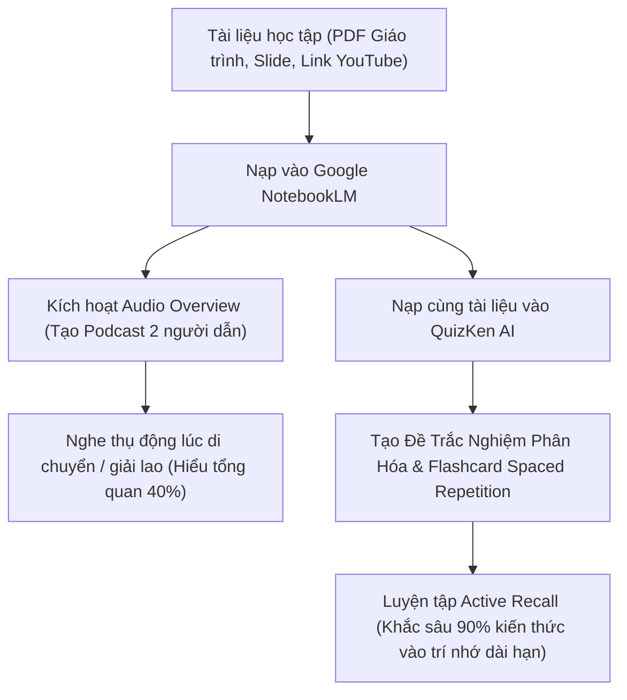

> **TL;DR (Tóm tắt nhanh):**  
> Tính năng **Audio Overview** trên nền tảng **Google NotebookLM ôn thi miễn phí** (`notebooklm.google.com`) cho phép sinh viên nạp hàng trăm trang slide, giáo trình PDF hay link video bài giảng để AI tự động chuyển hóa thành một **tập podcast thảo luận 2 người (Deep Dive Discussion)** cực kỳ lôi cuốn. Phương pháp này giúp bạn nắm bắt 40% bức tranh tổng quan khi đang đi xe bus hoặc tập gym. Tuy nhiên, để biến thông tin vừa nghe thành điểm số 9 - 10 trong bài thi, bạn cần kết hợp kiểm tra chủ động (Active Recall) bằng cách nạp cùng tài liệu đó vào **QuizKen** để AI sinh bộ câu hỏi trắc nghiệm đánh giá điểm mù kiến thức!

---

# Mẹo Dùng Google NotebookLM Biến Giáo Trình Thành Podcast Ôn Thi Cực Đỉnh 2026

Đọc hàng trăm trang sách giáo trình dày cộp hay những tệp slide bài giảng chi chít chữ vào lúc 1 giờ sáng là "cơn ác mộng" của hầu hết sinh viên mùa thi cử. Mắt bạn mỏi, não bạn từ chối tiếp nhận thêm các khối văn bản khô khan, và việc học thuộc lòng thụ động khiến kiến thức nhanh chóng "bay màu" chỉ sau 24 giờ.

Năm 2026, sự bùng nổ của **Google NotebookLM** (trợ lý nghiên cứu cá nhân do Google DeepMind phát triển chạy trên mô hình Gemini thế hệ mới) đã tạo nên một cuộc cách mạng trong phương pháp học tập. Thay vì bắt bạn phải đọc, NotebookLM có thể biến toàn bộ tài liệu ôn thi thành một cuộc trò chuyện podcast truyền thanh giữa 2 chuyên gia AI vô cùng tự nhiên.

Dưới đây là cẩm nang thực chiến giúp bạn khai thác triệt để công cụ **Google NotebookLM ôn thi miễn phí** và quy trình phối hợp cùng QuizKen để đạt điểm A+ mọi môn học!

---

## 1. Google NotebookLM & Audio Overview Hoạt Động Như Thế Nào?

Khác với các chatbot thông thường (như ChatGPT hay Claude) dễ bị "ảo giác" (Hallucination) do lấy dữ liệu từ toàn bộ Internet, **NotebookLM là một hệ thống RAG (Retrieval-Augmented Generation) khép kín**:

* **Chỉ trả lời dựa trên tài liệu bạn tải lên:** NotebookLM chỉ phân tích các nguồn dữ liệu bạn đã chọn (PDF, Slide thuyết trình, Google Docs, link video YouTube hoặc trang web học thuật).
* **Trích dẫn minh bạch 100% (Grounded Citations):** Mọi luận điểm AI đưa ra đều có số thứ tự trích dẫn; khi bạn nhấp vào, màn hình sẽ nhảy ngay đến đúng đoạn văn bản trong trang sách gốc.
* **Tính năng Audio Overview:** Hai người dẫn chuyện ảo (1 nam, 1 nữ) sẽ phân tích các khái niệm phức tạp trong tài liệu của bạn, đưa ra các ví dụ đời thường sinh động, tranh luận phản biện và tóm tắt những bài học then chốt.

---

## 2. Quy Trình 4 Bước Tạo Podcast Ôn Thi Bằng NotebookLM Miễn Phí

### Bước 1: Gom tài liệu vào một "Notebook" chuyên đề
1. Truy cập trang chính thức: `https://notebooklm.google.com` (Đăng nhập bằng tài khoản Google bất kỳ).
2. Bấm **New Notebook** và đặt tên theo môn học (ví dụ: *Kinh tế vi mô Chương 3-5* hoặc *Lịch sử Đảng Cuối Kỳ*).
3. Tải lên tối đa 50 nguồn tài liệu khác nhau: tệp PDF giáo trình, tệp slide PowerPoint (hoặc Google Slides), và link video bài giảng trên YouTube.

### Bước 2: Tạo bản ghi Audio Overview
1. Ở cột bên phải màn hình (Studio Guide), tìm mục **Audio Overview**.
2. Nhấn nút **Generate (Tạo)**: Hệ thống AI sẽ phân tích toàn bộ tài liệu trong khoảng 3 đến 5 phút và xuất ra một file podcast âm thanh chất lượng phòng thu dài từ 8 đến 15 phút.
3. Bạn có thể bấm nghe trực tiếp hoặc tải file `.wav` / `.m4a` về điện thoại để nghe offline khi đang tập thể dục, rửa bát hay di chuyển trên xe bus.

### Bước 3: Tùy chỉnh phong cách thảo luận (Prompt Customization)
Các bản cập nhật mới nhất cho phép bạn nhấn nút **Customize** trước khi bấm Generate:
* **Yêu cầu tập trung vào phần khó:** *"Hãy tập trung giải thích sâu về sự khác biệt giữa Chính sách tài khóa và Chính sách tiền tệ, kèm theo các ví dụ thực tế tại Việt Nam."*
* **Chế độ phản biện (Critique Mode):** Hướng dẫn 2 AI tranh luận về các ưu nhược điểm của một lý thuyết kinh tế hoặc mô hình quản trị.

> [!TIP]
> **Mẹo ngôn ngữ:** Mặc dù NotebookLM đọc hiểu tài liệu tiếng Việt rất tốt, tính năng giọng nói Audio Overview đạt độ tự nhiên và giàu cảm xúc nhất bằng tiếng Anh. Nếu bạn học các môn chuyên ngành tiếng Anh, IELTS hay VSTEP, đây là công cụ luyện nghe (Listening) học thuật số 1 hiện nay!

---

## 3. So Sánh: Nghe Podcast NotebookLM vs Luyện Đề QuizKen

Nhiều bạn lầm tưởng: *"Chỉ cần nghe podcast vài lần là sẽ nhớ hết bài thi."* Đây là một sai lầm phổ biến về mặt nhận thức! Hãy xem bảng so sánh khoa học nhận thức dưới đây:

| Tiêu chí | Nghe Podcast NotebookLM | Luyện Đề & Flashcard QuizKen |
| :--- | :--- | :--- |
| **Bản chất học tập** | Học tập thụ động (Passive Learning) | Học tập chủ động (Active Recall) |
| **Mục đích phù hợp** | Nắm bắt bức tranh tổng quan, khái niệm nhập môn | Kiểm tra chi tiết từng công thức, số liệu, mẹo làm bài |
| **Tỷ lệ giữ lại kiến thức (Sau 1 tuần)** | Khoảng 30% - 40% | **Lên tới 85% - 90%** (nhờ lặp lại ngắt quãng) |
| **Khả năng phát hiện điểm mù** | Khó nhận ra mình quên phần nào | **Phát hiện ngay lập tức** qua thống kê câu làm sai |
| **Thời điểm nên áp dụng** | Giai đoạn làm quen môn học hoặc nghe giải lao | Giai đoạn ôn thi nước rút và luyện phản xạ phòng thi |

---

## 4. Chu Trình Ôn Thi Đột Phá: NotebookLM + QuizKen

Để đạt hiệu quả tối đa mà không bị kiệt sức, hãy kết hợp hai công cụ này theo chu trình **"Nghe Tổng Quan - Luyện Chủ Động"**:

1. **Khởi động (30 phút):** Tải tài liệu vào NotebookLM, tạo Audio Overview và nghe tập trung 1 lần để não bộ định hình mạch kiến thức và các thuật ngữ quan trọng.
2. **Khai thác sâu (15 phút):** Dùng khung Chat của NotebookLM để hỏi chi tiết các câu trích dẫn: *"Giải thích công thức ở trang 45 dựa vào nguồn số 2."*
3. **Thực chiến cùng [QuizKen](https://quizken.com) (45 phút):**
   * Kéo thả cùng file PDF giáo trình đó vào QuizKen.
   * Chọn tạo 40 câu trắc nghiệm bao gồm: Trắc nghiệm 4 lựa chọn, Đúng/Sai 4 ý và Câu hỏi trả lời ngắn theo đúng ma trận đề thi chuẩn.
   * Làm bài kiểm tra có tính giờ để kích hoạt phản xạ phòng thi.
   * Đưa các câu trả lời sai vào tính năng **Spaced Repetition Flashcard** của QuizKen để lặp lại ngắt quãng cho đến khi nhớ nhuần nhuyễn.

Sự kết hợp giữa trí tuệ nhân tạo của Google NotebookLM và nền tảng đánh giá thực chiến QuizKen sẽ giúp bạn biến những môn học khó nhằn nhất thành những điểm 10 rực rỡ!
