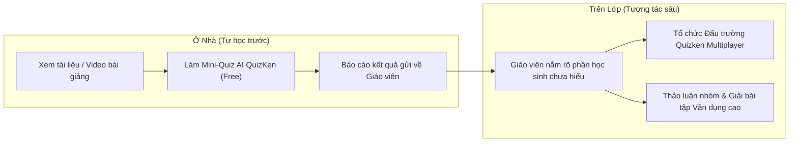

> **Tóm tắt nhanh (TL;DR):** **Mô hình Lớp học đảo ngược (Flipped Classroom)** đang trở thành trọng tâm trong phong trào đổi mới phương pháp giảng dạy theo định hướng của Bộ GD&ĐT (tiêu biểu tại **Công văn 5588/BGDĐT-GDPT**). Thay vì nghe giảng thụ động 45 phút trên lớp, học sinh tự nghiên cứu bài học trước ở nhà và dành thời gian trên lớp để thảo luận sâu. Bài viết này hướng dẫn giáo viên cách sử dụng công cụ **AI miễn phí (free)** để tự động hóa khâu kiểm tra chuẩn bị bài và quản lý lớp học đảo ngược thông minh.

---

## 1. Bản Chất Mô Hình Lớp Học Đảo Ngược Năm 2026

Trong mô hình dạy học truyền thống:
* **Trên lớp:** Giáo viên dành 80% thời gian để thuyết giảng truyền thụ kiến thức lý thuyết cơ bản (Nhận biết).
* **Ở nhà:** Học sinh tự vật lộn một mình với các bài tập vận dụng khó mà không có sự trợ giúp kịp thời.

Mô hình Lớp học đảo ngược thực hiện cuộc cách mạng đảo chiều:
* **Ở nhà (Trước giờ học):** Học sinh xem video bài giảng ngắn (Microlearning), đọc tài liệu và hoàn thành một bài trắc nghiệm nhanh để tự đánh giá mức độ hiểu bài.
* **Trên lớp (Trong giờ học):** Giáo viên không dạy lại lý thuyết từ đầu mà tổ chức các hoạt động tranh biện, làm việc nhóm, thực hành thí nghiệm và giải quyết các câu hỏi hóc búa.

---

## 2. Vì Sao Nhiều Giáo Viên Thất Bại Khi Triển Khai Lớp Học Đảo Ngược?

Trở ngại lớn nhất của thầy cô khi áp dụng Flipped Classroom theo cách thủ công:
1. **Học sinh không đọc bài trước ở nhà:** Giáo viên không có công cụ để giám sát xem học sinh đã thực sự chuẩn bị bài hay chưa.
2. **Quá tải khâu chấm chữa:** Mất hàng giờ để chấm bài kiểm tra chuẩn bị bài của 40–45 học sinh trước mỗi tiết lên lớp.
3. **Chi phí phần mềm LMS quốc tế quá cao:** Các nền tảng Canvas, Blackboard hay phần mềm EdTech ngoại nhập thường có chi phí vượt quá ngân sách trường công lập.

---

## 3. Giải Pháp Tự Động Hóa Flipped Classroom Cùng QuizKen AI (Free)

| Thách thức của giáo viên | Giải pháp tự động hóa trên QuizKen (Free) |
| :--- | :--- |
| Mất thời gian soạn câu hỏi kiểm tra bài cũ | Tải file giáo án lên, AI sinh ngay 10 câu trắc nghiệm chuẩn bị bài chỉ sau **30 giây** |
| Không biết học sinh yếu phần nào trước khi lên lớp | **Dashboard phân tích trực quan:** Báo cáo tỷ lệ hiểu bài của cả lớp hiển thị ngay trước giờ vào tiết |
| Không khí lớp học trầm lắng | Khởi động 5 phút đầu giờ bằng **Đấu trường trắc nghiệm Multiplayer** tương tác sôi động |
| Vấn đề kinh phí nhà trường | QuizKen cung cấp gói giáo dục **hoàn toàn miễn phí (free)** |

---

## 4. Quy Trình 3 Bước Triển Khai Tiết Học Đảo Ngược Thành Công

### Bước 1: Giao bài đọc và Quiz AI trước giờ học
Thầy cô tải tài liệu bài học lên QuizKen, hệ thống tự động trích xuất một bài trắc nghiệm nhanh 5–7 câu hỏi nhận biết cơ bản. Gửi đường link cho học sinh hoàn thành trước 20h00 tối hôm trước.

### Bước 2: Xem báo cáo "Điểm mù kiến thức" của lớp
Trước giờ lên lớp 15 phút, thầy cô mở QuizKen Dashboard:
* Biết ngay em nào đã làm bài, em nào chưa làm.
* Nắm bắt chính xác câu hỏi số mấy có nhiều học sinh chọn sai nhất để tập trung giải thích trọng tâm.

### Bước 3: Khởi động lớp học bằng Đấu trường Multiplayer QuizKen
5 phút đầu tiết học, thầy cô chiếu mã PIN phòng chơi lên máy chiếu. Cả lớp dùng điện thoại hoặc máy tính bảng tham gia thi đấu trực tiếp. Không khí lớp học lập tức trở nên hào hứng, xua tan sự mệt mỏi thụ động.

👉 **Nâng tầm tiết dạy:** [Ứng dụng mô hình lớp học đảo ngược cùng QuizKen AI miễn phí](https://quizken.com) ngay hôm nay!

---

## Câu hỏi thường gặp (FAQ)

### 1. Học sinh không có điện thoại riêng thì có tham gia lớp học đảo ngược được không?
Có. Học sinh có thể làm bài chuẩn bị bài ở nhà trên máy tính để bàn của gia đình, và trên lớp giáo viên có thể tổ chức thi đấu theo nhóm 3–4 em dùng chung một thiết bị.

### 2. Tạo phòng đấu trắc nghiệm nhiều người chơi trên QuizKen có giới hạn số lượng không?
QuizKen hỗ trợ phòng đấu Multiplayer **miễn phí (free)** cho các lớp học quy mô từ 30 đến hơn 100 học sinh cùng truy cập đồng thời mà không bị giật lag.

### 3. Nền tảng có hỗ trợ xuất kết quả làm bài của học sinh ra file Excel không?
Có. Thầy cô có thể dễ dàng xuất toàn bộ bảng điểm chi tiết ra file Excel để lưu hồ sơ đánh giá thường xuyên theo quy định của Bộ GD&ĐT.
