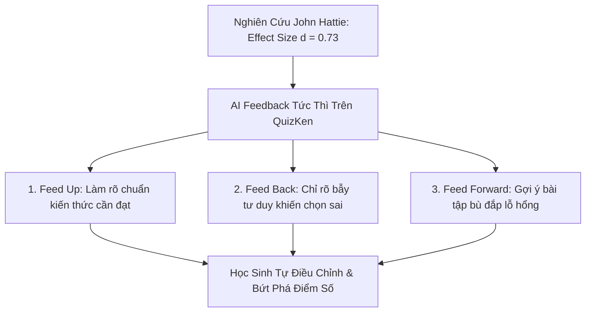

> **Tóm tắt nhanh (TL;DR):** Trong công trình tổng hợp hơn 800 phân tích tổng lượng (Meta-analyses) nổi tiếng thế giới mang tên *"Visible Learning"*, Giáo sư **John Hattie** cùng cộng sự **Helen Timperley (2007)** đã chỉ ra rằng: **Phản hồi giáo dục (Feedback)** là một trong những nhân tố có tác động mạnh mẽ nhất đến kết quả học tập với độ lớn hiệu ứng (*Effect Size*) đạt mức khổng lồ **$d = 0.73 - 0.79$** (vượt xa mức trung bình $0.40$). Khi ứng dụng trí tuệ nhân tạo trên nền tảng **QuizKen**, học sinh không chỉ biết mình đúng hay sai mà nhận được phản hồi phân tích chi tiết ngay trong tích tắc (tức thì sau 0.5 giây), giúp xóa bỏ lỗ hổng tư duy ngay khi nó vừa xuất hiện.

---

## 1. Nghiên Cứu Visible Learning (John Hattie) & 3 Câu Hỏi Cốt Lõi Của Feedback

Theo mô hình của Hattie & Timperley (2007), một phản hồi hiệu quả không chỉ đơn thuần là lời khen (*"Em làm tốt lắm"*) hay một con điểm số (*"8/10"*), mà phải trả lời được **3 câu hỏi chiến lược**:

1. **Where am I going? (Feed Up - Mục tiêu của tôi là gì?):** Giúp học sinh hiểu rõ tiêu chuẩn của một bài làm hoàn hảo.
2. **How am I going? (Feed Back - Tôi đang làm như thế nào?):** Phân tích xem học sinh đã đạt được phần nào và đang mắc kẹt ở đâu so với mục tiêu.
3. **Where to next? (Feed Forward - Bước tiếp theo tôi cần làm gì?):** Đưa ra chỉ dẫn hành động cụ thể để cải thiện kỹ năng.

---

## 2. Bảng So Sánh: Phản Hồi Chậm Truyền Thống vs Phản Hồi Tức Thì AI

| Tiêu chí so sánh | Chấm bài & Trả bài giấy truyền thống | Phản hồi tức thì bằng AI QuizKen |
| :--- | :--- | :--- |
| **Độ trễ thời gian** | Mất 3 - 7 ngày giáo viên mới chấm và trả bài | **0.5 giây** ngay sau khi học sinh bấm chọn đáp án |
| **Bản chất phản hồi** | Chỉ có dấu $\checkmark$ (đúng) hoặc $\times$ (sai) kèm điểm số | Phân tích cặn kẽ nguyên nhân vì sao phương án đó sai |
| **Trạng thái tâm lý** | Học sinh đã quên mất logic suy nghĩ lúc làm bài | Học sinh còn nhớ nguyên vẹn tư duy, dễ dàng tiếp thu |
| **Hành động khắc phục** | Học sinh xem điểm xong cất vở, không sửa sai | Hệ thống đưa ra ngay 2 câu hỏi tương tự để làm lại |
| **Độ lớn hiệu ứng (d)** | Thấp ($d \approx 0.20$) do bị đứt gãy mạch nhận thức | **Rất cao ($d \ge 0.73$)** theo chuẩn John Hattie |

---

## 3. 4 Cấp Độ Phản Hồi Giáo Dục Được AI QuizKen Triển Khai

1. **Cấp độ nhiệm vụ (Task Level):** Thông báo kết quả đúng/sai kèm lời giải toán học hoặc dịch nghĩa chuẩn xác.
2. **Cấp độ quy trình (Process Level):** Giải thích quy trình tư duy từng bước (ví dụ: *Bước 1: Tìm điều kiện xác định ➔ Bước 2: Đặt ẩn phụ ➔ Bước 3: Giải phương trình bậc hai*).
3. **Cấp độ tự điều chỉnh (Self-Regulation Level):** Hướng dẫn học sinh cách tự kiểm tra lại các bẫy thường gặp trước khi nộp bài.
4. **Cấp độ cá nhân hóa lộ trình (Feed Forward):** Tự động tổng hợp các lỗi sai lặp lại để xây dựng kế hoạch ôn tập riêng biệt cho từng em.

---

## 4. Hướng Dẫn Tận Dụng Tính Năng Phản Hồi AI Trên QuizKen

### Bước 1: Kích hoạt chế độ "Xem Giải Thích Tức Thì"
Khi tham gia làm bài tập tự luyện trên [QuizKen](https://quizken.com), học sinh bật chế độ phản hồi ngay sau mỗi câu hỏi.

### Bước 2: Đọc kỹ phần phân tích bẫy (Distractor Breakdown)
Nếu chọn sai đáp án, hãy dành 30 giây đọc kỹ phần phân tích của AI để hiểu rõ vì sao phương án gây nhiễu đó lại đánh lừa được bạn.

### Bước 3: Bấm nút "Luyện Câu Tương Tự"
Hệ thống AI sẽ lập tức sinh ra một câu hỏi mới cùng dạng kiến thức để bạn kiểm tra lại xem mình đã thực sự hiểu bài hay chưa.

---

## 5. Câu Hỏi Thường Gặp (FAQ)

### Phản hồi tức thì có làm học sinh lười suy nghĩ và ỷ lại vào máy không?
Hoàn toàn không. Trái lại, nghiên cứu của Hattie chứng minh phản hồi tức thì giúp duy trì động lực học tập (*Intrinsic Motivation*) cao nhất, vì học sinh được giải tỏa ngay khúc mắc thay vì chán nản bỏ dở bài tập khi gặp bế tắc.

### Giáo viên có xem được lịch sử phản hồi của học sinh không?
Có. Giáo viên có thể theo dõi toàn bộ báo cáo phân tích lỗi sai phổ biến của lớp học để điều chỉnh bài giảng trên lớp một cách trọng tâm nhất.
