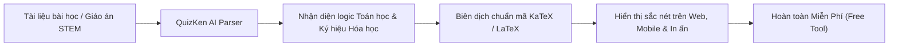

> **Tóm tắt nhanh (TL;DR):** Việc tạo đề thi các môn Khoa học Tự nhiên (STEM) như Toán, Vật lý và Hóa học luôn là "nỗi ác mộng" đối với giáo viên do phải gõ hàng loạt công thức phức tạp, tích phân, ma trận hay phương trình phản ứng. Với sự hỗ trợ của công nghệ **AI tạo đề thi miễn phí (free)** tích hợp bộ thư viện render công thức toán học **KaTeX**, thầy cô giờ đây có thể tạo đề thi chuẩn mực chỉ trong 1 phút mà không lo bị lỗi font hay nhòe hình ảnh.

---

## 1. Rào Cản Khi Soạn Đề Thi Trắc Nghiệm Môn STEM Theo Cách Truyền Thống

Trong Chương trình GDPT 2018, các môn thuộc lĩnh vực Khoa học Tự nhiên đòi hỏi bài kiểm tra phải tăng cường tính thực tiễn và tư duy mô hình hóa toán học. Tuy nhiên, khâu kỹ thuật gặp phải những bất cập dai dẳng:

* **Equation Editor / MathType lỗi thời:** Khi chép đề giữa các phiên bản Microsoft Word hoặc đưa lên các website trắc nghiệm trực tuyến thông thường, công thức rất dễ bị vỡ hạt, mất ký hiệu căn bậc hai ($\sqrt{x}$), tích phân ($\int$), phân số hoặc chỉ số hóa học ($H_2SO_4$).
* **Mất thời gian gõ lại:** Muốn có 20 câu hỏi trắc nghiệm Toán giải tích, giáo viên thường phải mất từ 2 đến 3 tiếng chỉ để căn chỉnh thụt dòng và chèn công thức.
* **Chi phí phần mềm chuyên dụng đắt đỏ:** Nhiều nền tảng quản lý ngân hàng câu hỏi thu phí hàng triệu đồng mỗi năm, tạo gánh nặng tài chính cho giáo viên và nhà trường.

---

## 2. Ưu Điểm Đột Phá Của Bộ Công Cụ KaTeX Kết Hợp AI QuizKen

**KaTeX** là công cụ kết xuất toán học nhanh nhất thế giới hiện nay, được phát triển nhằm thay thế các định dạng ảnh chụp công thức mờ nhạt. Khi tích hợp cùng mô hình ngôn ngữ lớn trên QuizKen:

| Tiêu chuẩn kỹ thuật | Phương pháp chụp ảnh công thức cũ | Công nghệ AI + KaTeX trên QuizKen (Free) |
| :--- | :--- | :--- |
| **Tốc độ hiển thị** | Tải chậm, tốn băng thông dung lượng web | **Hiển thị tức thì (< 5ms)**, tải mượt mà trên mọi thiết bị |
| **Độ phân giải & In ấn** | Bị nhòe vỡ hạt khi phóng to hoặc in ra giấy A4 | **Độ phân giải vector vô hạn**, in sắc nét chuẩn tài liệu nhà xuất bản |
| **Khả năng chỉnh sửa** | Muốn sửa 1 số phải xóa cả ảnh rồi gõ lại từ đầu | Dễ dàng sửa đổi trực tiếp từng tham số hoặc biến số toán học |
| **Chi phí sử dụng** | Cần phần mềm vẽ đồ thị hoặc mua plugin | **Miễn phí 100% (Free)** tích hợp sẵn trong nền tảng QuizKen |

---

## 3. Hướng Dẫn Giáo Viên Tạo Đề STEM Toán - Lý - Hóa Chỉ Với 3 Bước

### Bước 1: Chuẩn bị nội dung kiến thức
Thầy cô chỉ cần sao chép một đoạn văn bản lý thuyết hoặc tải file tài liệu Word/PDF chứa nội dung bài giảng (ví dụ: Chuyên đề Tọa độ trong không gian Oxyz, Dao động cơ học, Este - Lipit).

### Bước 2: Chọn cấu trúc đề thi mong muốn
* Chọn số lượng câu hỏi và tỷ lệ phân bổ: Nhận biết, Thông hiểu, Vận dụng, Vận dụng cao.
* Chọn định dạng: Trắc nghiệm 4 lựa chọn, Đúng/Sai 4 ý hoặc Trả lời ngắn theo format đề thi THPT 2026.

### Bước 3: AI tự động nhận diện và xuất bản
Thuật toán AI của QuizKen sẽ tự động phân tích và bọc toàn bộ các biểu thức toán học trong mã chuẩn KaTeX (như `$f'(x) = 3x^2 - 6x$`, `$\vec{u} = (1; -2; 3)$`). Thầy cô có thể:
* Cho học sinh làm trực tiếp trên điện thoại/máy tính để xem điểm số tức thì.
* Nhấp nút **"Xuất file PDF / Word"** để in đề thi kèm bảng đáp án chi tiết.

👉 **Tối ưu việc giảng dạy:** [Tạo đề thi STEM Toán Lý Hóa bằng AI miễn phí cùng QuizKen](https://quizken.com) ngay hôm nay!

---

## 4. Mẹo Nhỏ Giúp Đề Thi STEM Trực Quan Và Hấp Dẫn Hơn

1. **Kết hợp tình huống thực tế:** Yêu cầu AI đưa vào bài toán các bối cảnh đời thực (ví dụ: tính toán lưu lượng nước qua đập thủy điện, bài toán tối ưu chi phí bao bì, nồng độ pH trong nông nghiệp).
2. **Khai thác câu hỏi trả lời ngắn:** Đưa các câu hỏi tính toán đòi hỏi kết quả bằng số thực tế vào Phần III để đánh giá chính xác kỹ năng tính toán của học sinh.

---

## Câu hỏi thường gặp (FAQ)

### 1. Học sinh làm bài trắc nghiệm Toán trên điện thoại có thấy rõ công thức không?
Có. Nhờ công nghệ KaTeX, công thức toán và phản ứng hóa học tự động co giãn vừa vặn với kích thước màn hình điện thoại, máy tính bảng mà không bao giờ bị tràn lề hay méo chữ.

### 2. Giáo viên có thể tự gõ thêm công thức bằng tay vào đề do AI tạo không?
Hoàn toàn được. QuizKen cung cấp trình soạn thảo trực quan hỗ trợ cả ký hiệu trực tiếp và mã LaTeX chuyên nghiệp cho thầy cô.

### 3. QuizKen có giới hạn số lượng đề thi STEM được tạo miễn phí không?
QuizKen duy trì chính sách hỗ trợ giáo dục với gói tạo đề **AI miễn phí (free)** hàng ngày, đáp ứng đầy đủ nhu cầu kiểm tra 15 phút, 1 tiết định kỳ của giáo viên.
