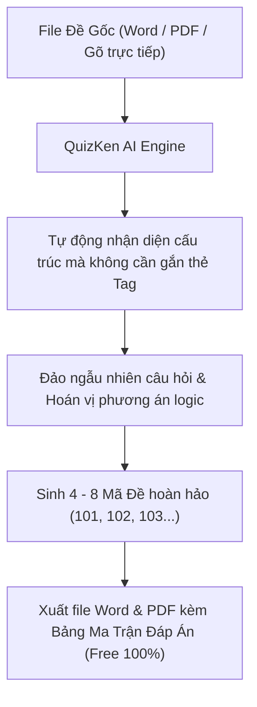

> **Tóm tắt nhanh (TL;DR):** Khâu trộn đề và đảo ngẫu nhiên câu hỏi để tạo thành 4 đến 8 mã đề khác nhau trong mỗi kỳ kiểm tra học kỳ luôn là công việc tốn nhiều thời gian và dễ nhầm lẫn đáp án của thầy cô giáo. Các phần mềm trộn đề kiểu cũ (như McMIX hay TestPro) thường bị lỗi vỡ công thức Toán, lệch bảng biểu hoặc bắt buộc định dạng phức tạp. Bài viết hướng dẫn cách dùng **phần mềm trộn đề thi trắc nghiệm bằng AI miễn phí (free)** trên QuizKen với tốc độ xuất bản tức thì.

---

## 1. Nỗi Khổ Khi Trộn Đề Bằng Các Phần Mềm Offline Truyền Thống

Trong nhiều năm qua, giáo viên Việt Nam đã quen thuộc với các phần mềm trộn đề cài trên máy tính Windows. Tuy nhiên, khi chuyển sang chương trình GDPT 2018 với cấu trúc câu hỏi phức tạp (có câu Đúng/Sai 4 ý, câu trả lời ngắn, công thức KaTeX/LaTeX), các công cụ cũ đã lộ rõ sự bất cập:

* **Bắt buộc gắn thẻ tag kỳ quặc:** Giáo viên phải mất hàng giờ định dạng lại file Word bằng cách chèn các ký tự như ` `, `[ ]`, `*A*`, `#Đúng#`... Nếu gõ sai một dấu cách, phần mềm sẽ báo lỗi ngay lập tức.
* **Lỗi vỡ công thức MathType:** Khi đảo đề, các công thức toán học rất dễ bị biến thành hình ảnh đen xì hoặc nhảy lung tung sang câu hỏi khác.
* **Không hỗ trợ trộn đề Đúng/Sai 4 ý:** Các tool cũ chỉ hỗ trợ dạng 4 lựa chọn cổ điển, hoàn toàn bó tay trước dạng bài Phần II mới của Bộ GD&ĐT.

---

## 2. Ưu Điểm Đột Phá Khi Trộn Đề Bằng AI QuizKen (Free)

| Tiêu chuẩn so sánh | Phần mềm trộn đề cũ (Offline) | Công nghệ AI QuizKen (Free Online) |
| :--- | :--- | :--- |
| **Cài đặt & Thiết bị** | Phải cài trên máy tính Windows, không dùng được trên Mac/Điện thoại | Chạy trực tiếp trên nền tảng Web, dùng được trên mọi máy tính và iPad |
| **Xử lý định dạng** | Đòi hỏi gõ chuẩn font VNI/Unicode, gắn mã quy định | **Chấp nhận file Word tự nhiên**, AI tự hiểu cấu trúc câu hỏi |
| **Hỗ trợ format GDPT 2018** | Không hỗ trợ câu Đúng/Sai 4 ý và Trả lời ngắn | **Tối ưu 100% cho cấu trúc 3 phần** của Bộ GD&ĐT 2026 |
| **Tự động xuất bảng ma trận đáp án** | Phải dò tay bảng đáp án từng mã đề | Xuất file Excel/PDF bảng đáp án của tất cả mã đề chỉ với 1 click |
| **Chi phí bản quyền** | Mua key bản quyền hoặc dùng bản crack lỗi | **Miễn phí (free)** cho các thầy cô phục vụ công tác giảng dạy |

---

## 3. Quy Trình 3 Bước Trộn Đề Ra 4 Mã Đề Chuẩn In Ấn

### Bước 1: Tải file đề thi gốc lên hệ thống
Thầy cô chỉ cần truy cập trang QuizKen và tải lên file Word (.docx) chứa đề thi gốc (kèm đáp án hoặc không có đáp án).

### Bước 2: Tùy chỉnh tham số đảo đề
* Chọn số lượng mã đề mong muốn: 2 mã đề, 4 mã đề hoặc 8 mã đề.
* Chọn cơ chế đảo: Chỉ đảo thứ tự câu hỏi, hoặc vừa đảo câu hỏi vừa đảo vị trí các phương án $A, B, C, D$.
* Đối với câu hỏi Đúng/Sai 4 ý: AI sẽ giữ nguyên ngữ cảnh bài đọc và chỉ hoán đổi vị trí các ý $a, b, c, d$ một cách hợp lý.

### Bước 3: Xuất file hoàn chỉnh
Sau khoảng 20 giây, hệ thống sẽ kết xuất:
* Từng file đề thi riêng biệt có tiêu đề trường, lớp, mã đề và khung ghi họ tên học sinh chuẩn in ấn.
* File tổng hợp bảng đáp án ma trận của tất cả các mã đề để giáo viên chấm điểm nhanh chóng.

👉 **Trải nghiệm ngay:** [Trộn đề thi trắc nghiệm bằng AI miễn phí cùng QuizKen](https://quizken.com) để tiết kiệm thời gian chấm bài!

---

## Câu hỏi thường gặp (FAQ)

### 1. File Word đề thi chứa nhiều hình ảnh vẽ đồ thị thì khi trộn có bị mất hình không?
Không. Thuật toán AI của QuizKen sẽ tự động khóa cứng (anchor) hình ảnh đồ thị hoặc sơ đồ thí nghiệm đi kèm với đúng câu hỏi của nó, không bao giờ bị nhảy nhầm vị trí.

### 2. Giáo viên có thể dùng đề đã trộn để tổ chức thi online trên lớp luôn không?
Có. Ngoài việc xuất file in ra giấy, thầy cô có thể tạo mã phòng thi trực tuyến để học sinh làm bài ngay trên điện thoại hoặc máy tính.

### 3. Phần mềm trộn đề QuizKen có giới hạn số lần trộn miễn phí không?
QuizKen cung cấp tính năng trộn đề và sinh mã đề **AI miễn phí (free)** hàng ngày, đáp ứng đầy đủ cho các bài kiểm tra thường xuyên và định kỳ của giáo viên.
