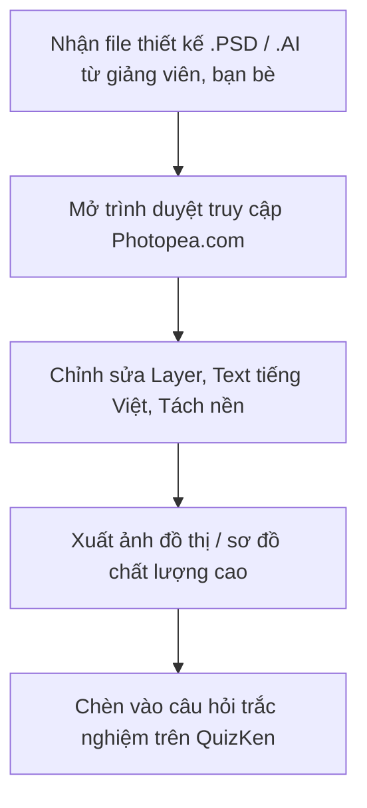

> **TL;DR (Tóm tắt nhanh):**  
> Bản quyền phần mềm Adobe Photoshop quá đắt đỏ đối với túi tiền của học sinh, sinh viên, trong khi việc tải các bản Photoshop "crack" trôi nổi trên mạng tiềm ẩn nguy cơ nhiễm virus mã hóa tống tiền (Ransomware) và làm chậm máy tính. **Photopea** là ứng dụng đồ họa chạy hoàn toàn trên trình duyệt web (Web-based), giao diện và hệ thống phím tắt giống Photoshop đến 95%. Bạn có thể mở, chỉnh sửa và xuất file `.psd`, `.ai`, `.xd`, `.sketch`, `.pdf` miễn phí 100% trên bất kỳ chiếc laptop cấu hình yếu nào mà không cần cài đặt!

---

# Photopea: Cách Chỉnh Sửa File PSD & Thiết Kế Đồ Họa Miễn Phí Không Cần Cài Đặt

Trong đời sống học đường, nhu cầu thiết kế và xử lý ảnh xuất hiện ở khắp mọi nơi:
* Cần chỉnh sửa một banner poster cho sự kiện câu lạc bộ trường.
* Giảng viên hoặc bạn cùng nhóm gửi cho bạn một tệp mẫu thiết kế đuôi `.psd` (Photoshop) hoặc `.ai` (Illustrator) nhưng máy bạn không cài Adobe.
* Cần cắt phông nền (tách nền), chỉnh sửa kích thước ảnh minh họa để đưa vào slide thuyết trình bài tập lớn hoặc đề thi trắc nghiệm.

Trước khi nghĩ đến việc bỏ tiền mua bản quyền hoặc mạo hiểm cài bản bẻ khóa, hãy mở trình duyệt lên và truy cập vào **Photopea**.

---

## 1. Bảng So Sánh Chi Tiết: Photopea vs Adobe Photoshop

| Tiêu chí | Adobe Photoshop (Bản quyền / Crack) | Photopea (Trình duyệt Web) |
| :--- | :--- | :--- |
| **Chi phí** | Đắt đỏ (~$22.99/tháng). Bản crack dễ dính virus đánh cắp mật khẩu. | **Hoàn toàn miễn phí 100%**. |
| **Yêu cầu cài đặt** | Nặng 4GB - 8GB, cài đặt phức tạp, kén phiên bản Windows/Mac. | **Không cần cài đặt gì cả**. Mở web là dùng ngay trong 1 giây. |
| **Cấu hình máy tính** | Đòi hỏi RAM tối thiểu 8GB - 16GB, có card đồ họa rời để mượt. | **Chạy mượt trên mọi máy tính**: MacBook chip cũ, Laptop văn phòng, Chromebook. |
| **Định dạng file hỗ trợ** | PSD, PSB, TIFF, RAW, JPG, PNG... | **Mở và lưu chuẩn xác:** `.psd`, `.ai`, `.xd`, `.sketch`, `.pdf`, `.svg`, `.png`... |
| **Quyền riêng tư & Bảo mật** | Dữ liệu cục bộ hoặc Adobe Cloud. | **Chạy bằng WebGL cục bộ trên máy của bạn**: Ảnh không bị tải lên máy chủ ngoài. |

---

## 2. Các Tính Năng Đỉnh Cao Trên Photopea Sinh Viên Cực Thích

1. **Hỗ trợ đầy đủ hệ thống Layer và Layer Mask:** Bạn có thể hòa trộn lớp, chỉnh độ mờ đục (Opacity), thêm hiệu ứng đổ bóng (Drop Shadow) hay viền chữ y hệt như trên Photoshop xịn.
2. **Kho phông chữ tiếng Việt khổng lồ:** Tích hợp sẵn hàng ngàn font chữ Google Fonts có dấu đầy đủ, giúp bạn thỏa sức sáng tạo tiêu đề bài tập mà không lo bị lỗi gõ chữ.
3. **Công cụ tách nền ma thuật (Magic Cut & Object Selection):** Tự động nhận diện chủ thể và tách người/vật phẩm ra khỏi hậu cảnh chỉ trong vài cú click chuột.

---

## 3. Cách Mở Và Lưu File Trên Photopea

1. Mở trình duyệt (Chrome, Safari, Edge hoặc Brave) và gõ địa chỉ: `photopea.com`.
2. Bấm vào **Open from Computer (Mở từ máy tính)** và chọn tệp `.psd` hoặc ảnh bạn muốn sửa.
3. Chỉnh sửa theo ý muốn bằng các phím tắt quen thuộc (`Ctrl + T` để phóng to thu nhỏ, `Ctrl + J` để nhân đôi layer, `V` để di chuyển...).
4. Vào **File > Save as PSD** để lưu lại file dự án, hoặc **File > Export as > PNG/JPG/PDF** để lấy ảnh chất lượng cao.

---

## 4. Tích Hợp Đồ Họa Vào Đề Thi Trắc Nghiệm QuizKen

Hình ảnh minh họa trực quan giúp các câu hỏi kiểm tra trở nên sinh động và kích thích trí não ghi nhớ tốt hơn gấp nhiều lần so với đề thi chỉ toàn chữ:
1. Dùng Photopea để thiết kế hoặc cắt các sơ đồ thí nghiệm, biểu đồ thống kê kinh tế.
2. Xuất ảnh định dạng PNG sắc nét.
3. Tải lên hệ thống [https://app.quizken.com](https://app.quizken.com) khi tạo đề thi trắc nghiệm để học sinh cả lớp cùng tham gia thi đấu tương tác!

Khám phá thế giới khảo thí thông minh cùng QuizKen tại: [https://app.quizken.com](https://app.quizken.com).
