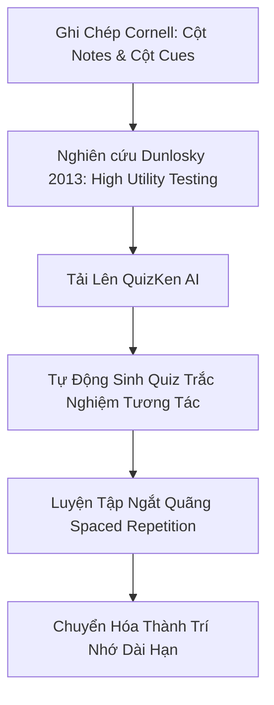

> **Tóm tắt nhanh (TL;DR):** Trong công trình nghiên cứu kinh điển công bố trên tạp chí *Psychological Science in the Public Interest*, nhóm nhà khoa học dẫn đầu bởi **Giáo sư John Dunlosky (2013)** đã đánh giá 10 kỹ thuật học tập phổ biến và kết luận: **Practice Testing (Gợi nhớ chủ động - Active Recall)** và **Distributed Practice (Lặp lại ngắt quãng)** là 2 kỹ thuật duy nhất đạt mức hiệu quả tối đa (*High Utility*). Khi tích hợp phương pháp ghi chú **Cornell** với công cụ **Quiz AI trên QuizKen**, bạn sẽ tự động hóa 100% quy trình tạo đề kiểm tra đối soát, giúp tăng hơn 200% khả năng ghi nhớ dài hạn.

---

## 1. Căn Cứ Khoa Học: Vì Sao Đọc Lại Sách Vở Thường Thất Bại?

Nghiên cứu của **Dunlosky et al. (2013)** chứng minh rằng hai phương pháp học tập mà đa số học sinh sinh viên thường dùng nhất:
- Đọc đi đọc lại (*Rereading*)
- Tô màu ghi chú (*Highlighting / Underlining*)

...đều bị xếp vào nhóm **Hiệu quả thấp (Low Utility)** vì chúng tạo ra "ảo tưởng hiểu biết" (*Illusion of Competence*). Học sinh cảm thấy bài học rất quen thuộc khi nhìn vào trang sách, nhưng khi vào phòng thi não bộ lại không thể tự truy xuất thông tin.

Ngược lại, **Active Recall** (ép não bộ tự truy xuất câu trả lời) kích hoạt các liên kết synapse thần kinh, tạo nên vết khắc ghi nhớ vĩnh viễn.

---

## 2. Bảng Xếp Hạng 10 Kỹ Thuật Học Tập Theo Nghiên Cứu Dunlosky Et Al. (2013)

| Kỹ thuật học tập | Đánh giá hiệu quả (Utility) | Cơ chế tác động |
| :--- | :---: | :--- |
| **Practice Testing (Tự kiểm tra / Active Recall)** | **HIGH (Cao nhất)** | Ép não bộ truy xuất thông tin từ bộ nhớ trong |
| **Distributed Practice (Lặp lại ngắt quãng)** | **HIGH (Cao nhất)** | Ôn tập ngắt quãng theo chu kỳ thời gian (Spaced Repetition) |
| **Elaborative Interrogation (Tự hỏi vì sao)** | Moderate (Trung bình) | Đặt câu hỏi bản chất nguyên nhân hiện tượng |
| **Self-Explanation (Tự giải thích bài học)** | Moderate (Trung bình) | Tự diễn giải lại bài học theo cách hiểu riêng |
| **Interleaved Practice (Học xen kẽ dạng bài)** | Moderate (Trung bình) | Đổi dạng bài tập để rèn luyện tư duy phân biệt |
| **Summarization (Viết tóm tắt)** | Low (Thấp) | Tóm tắt dễ bị chép lại máy móc |
| **Highlighting (Gạch chân / Tô màu)** | Low (Thấp) | Không kích hoạt hoạt động tư duy sâu |
| **Rereading (Đọc lại tài liệu nhiều lần)** | Low (Thấp) | Gây ảo giác quen mắt nhưng mau quên |

---

## 3. Cấu Trúc Hệ Thống Ghi Chú Cornell Chuẩn Đại Học Cornell

Phương pháp Cornell do Giáo sư Walter Pauk phát triển chia trang giấy thành 3 phần:
1. **Notes (70% bên phải):** Ghi chép bài giảng theo gạch đầu dòng, từ viết tắt.
2. **Cues (30% bên trái):** Đặt các câu hỏi trọng tâm ứng với từng đoạn ghi chép.
3. **Summary (Đáy trang):** 2-3 câu văn ngắn tóm tắt cốt lõi bài học.

---

## 4. Quy Trình 4 Bước Kết Hợp Cornell & QuizKen AI

### Bước 1: Ghi chép bài học theo mẫu Cornell
Hoàn thành phần ghi chú và tự đặt câu hỏi ở cột Cues bên trái ngay sau giờ học.

### Bước 2: Tải nội dung lên QuizKen AI
Truy cập [QuizKen Tạo Đề Trắc Nghiệm](https://quizken.com), dán nội dung ghi chú hoặc tải ảnh chụp sổ tay lên hệ thống.

### Bước 3: AI tự động sinh bài kiểm tra Practice Testing
Dựa trên nguyên lý của Dunlosky, AI của QuizKen sẽ quét các câu hỏi ở cột Cues để tạo:
- Bộ câu hỏi trắc nghiệm 4 lựa chọn khách quan.
- Câu hỏi Đúng/Sai phản biện thông tin.
- Giải thích chi tiết đáp án tại sao đúng, tại sao sai.

### Bước 4: Lặp lại ngắt quãng (Distributed Practice)
Thực hiện bài kiểm tra vào Ngày 1, Ngày 3 và Ngày 7. Hệ thống tự động lưu trữ các câu làm sai để nhắc bạn làm lại ở vòng tiếp theo.

👉 **Nâng cấp phương pháp học:** Áp dụng ngay kỹ thuật Active Recall chuẩn khoa học cùng [QuizKen AI](https://quizken.com) hoàn toàn miễn phí!

---

## 5. Câu Hỏi Thường Gặp (FAQ)

### Nghiên cứu của Dunlosky có áp dụng cho học sinh phổ thông Việt Nam không?
Có. Nghiên cứu của Dunlosky et al. được thực nghiệm trên hàng chục nghìn học sinh, sinh viên thuộc nhiều lứa tuổi và các môn học khác nhau (Toán, Lịch sử, Ngoại ngữ, Khoa học), cho thấy hiệu quả vượt trội đồng nhất.

### Dùng QuizKen để tạo bài test có mất nhiều thời gian không?
Không. Bạn chỉ mất 3 giây để hệ thống AI phân tích văn bản ghi chú và xuất ra bộ Quiz trọn vẹn kèm đáp án.
