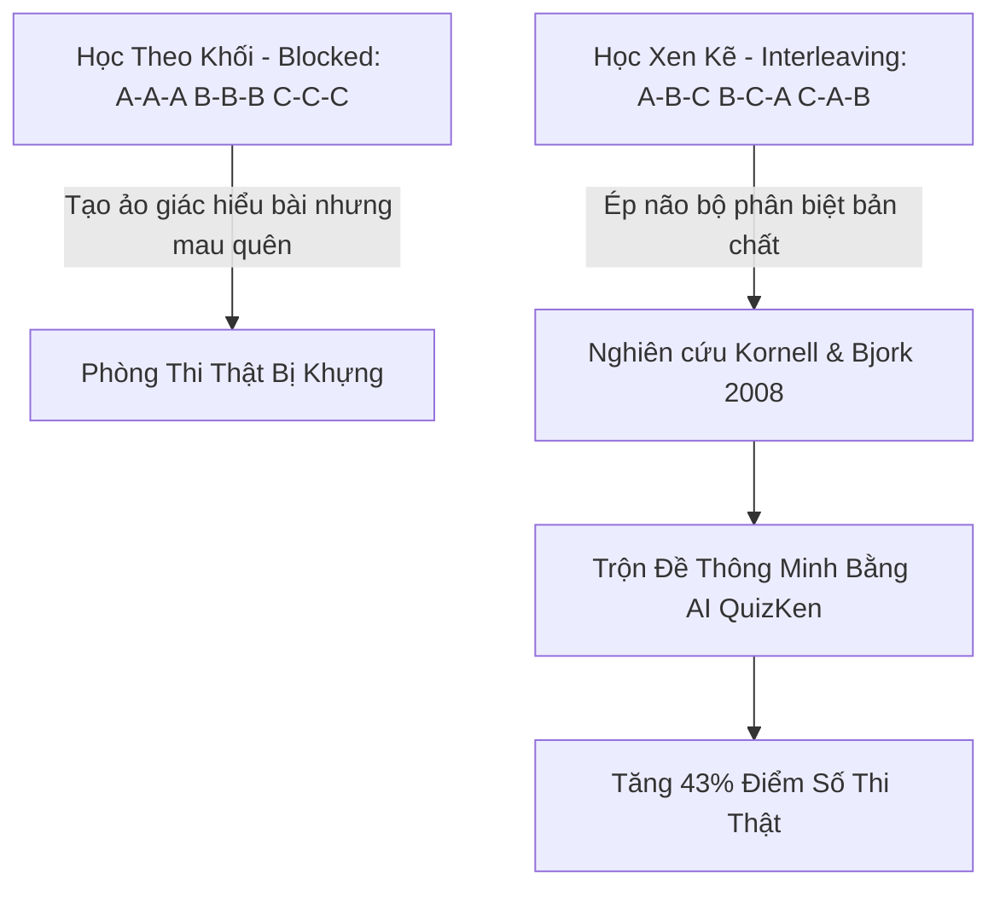

> **Tóm tắt nhanh (TL;DR):** Trong công trình nghiên cứu kinh điển công bố trên tạp chí *Psychological Science*, hai nhà tâm lý học nhận thức **Nate Kornell & Robert A. Bjork (2008)** đã chứng minh: Phương pháp học xen kẽ các dạng bài (**Interleaving Practice - ABCABC**) giúp người học nâng cao khả năng phân biệt bản chất vấn đề và đạt điểm thi thực tế cao hơn tới **43%** so với phương pháp học tập trung từng khối đơn điệu (**Blocked Practice - AAA BBB CCC**). Nền tảng **QuizKen AI** ứng dụng thuật toán xáo trộn câu hỏi thông minh giúp học sinh thoát khỏi cái bẫy "học vẹt theo mẫu" và phản xạ linh hoạt trước mọi dạng đề thi phân hóa.

---

## 1. Nghiên Cứu Kornell & Bjork (2008) Về "Khó Khăn Mong Muốn" (Desirable Difficulties)

Hầu hết học sinh khi ôn thi thường có thói quen làm bài theo từng dạng riêng biệt (ví dụ: làm liền một mạch 30 câu phương trình mũ, rồi mới chuyển sang 30 câu logarit). Phương pháp này gọi là **Blocked Practice (Học theo khối)**:
- **Ưu điểm ngắn hạn:** Tạo cảm giác làm bài rất mượt mà và trôi chảy (*Sense of Fluency*).
- **Hạn chế chí mạng:** Học sinh không cần suy nghĩ xem *đây là dạng toán gì*, chỉ cần áp dụng một công thức duy nhất vừa học. Khi bước vào phòng thi thật nơi các câu hỏi bị đảo lộn ngẫu nhiên, não bộ rơi vào trạng thái bối rối vì không biết nhận diện dạng bài.

Nghiên cứu của **Kornell & Bjork (2008)** chỉ ra rằng: Việc xen kẽ các chủ đề khác nhau tạo ra một mức độ "khó khăn có chủ đích" (*Desirable Difficulty*). Não bộ buộc phải liên tục thực hiện 2 thao tác tư duy cấp cao:
1. **Phân biệt (Discrimination):** Nhận diện xem bài toán này thuộc quy luật nào.
2. **Truy xuất (Retrieval):** Tìm kiếm công thức và chiến lược giải phù hợp từ bộ nhớ dài hạn.

---

## 2. Bảng So Sánh Chi Tiết: Blocked Practice vs Interleaving Practice

| Yếu tố so sánh | Học tập trung theo khối (Blocked Practice) | Học xen kẽ linh hoạt (Interleaving Practice) |
| :--- | :--- | :--- |
| **Cấu trúc luyện tập** | Làm hết Dạng A ➔ Dạng B ➔ Dạng C | Xen kẽ ngẫu nhiên: A ➔ B ➔ C ➔ B ➔ A |
| **Cảm giác khi học** | Cảm thấy rất dễ dàng, làm bài nhanh | Cảm thấy khó hơn, đòi hỏi tập trung cao độ |
| **Kỹ năng nhận diện dạng bài** | Rất yếu (vì đã biết trước dạng bài) | Cực kỳ sắc bén (phản xạ nhận biết bài toán trong 3 giây) |
| **Độ bền của kiến thức** | Mau quên sau khi chuyển sang chủ đề khác | Khắc sâu vào trí nhớ dài hạn, duy trì nhiều tháng |
| **Ứng dụng trên QuizKen** | Làm đề theo từng bài học đơn lẻ | Dùng tính năng *Trộn Đề Tổng Hợp Đa Chuyên Đề* |

---

## 3. Quy Trình 4 Bước Ứng Dụng Interleaving Cùng QuizKen AI

### Bước 1: Tạo các bộ đề thành phần
Sử dụng công cụ [AI Tạo Đề QuizKen](https://quizken.com) để tạo các bộ câu hỏi từ các chương bài học khác nhau (ví dụ: *Chương 1 Hàm số, Chương 2 Hình học không gian, Chương 3 Tích phân*).

### Bước 2: Kích hoạt chế độ trộn đề thông minh (Smart Interleaving)
Tạo một bài thi tổng hợp bằng cách gộp các chuyên đề lại và kích hoạt tính năng **Đảo ngẫu nhiên dạng thức**. Hệ thống sẽ tự động phân bổ câu hỏi xen kẽ không theo thứ tự tuyến tính.

### Bước 3: Luyện tập giải đề trong áp lực thời gian
Khi làm bài, hãy rèn luyện thói quen tự hỏi 2 câu hỏi trước khi đặt bút giải:
- *Bài toán này thuộc chủ đề/khái niệm nào?*
- *Dấu hiệu đặc trưng nào phân biệt nó với các bài toán tương tự?*

### Bước 4: Xem phân tích phổ điểm theo từng nhánh chuyên đề
Sau khi nộp bài, QuizKen sẽ phân tích chi tiết:
- Tỉ lệ làm đúng ở từng chuyên đề xen kẽ.
- Cảnh báo các cặp kiến thức bạn hay bị nhầm lẫn phương pháp giải.

---

## 4. Lời Khuyên Dành Cho Sĩ Tử Ôn Thi Chuyển Cấp & THPT Quốc Gia

1. **Không nên áp dụng Interleaving khi kiến thức còn quá mới:** Hãy học nắm vững khái niệm cơ bản trước khi bắt đầu luyện đề xen kẽ.
2. **Kết hợp các môn học tương đồng:** Bạn có thể xen kẽ các bài tập Toán đại số với Hình học, hoặc xen kẽ bài đọc hiểu Tiếng Anh với bài tập Ngữ pháp.
3. **Duy trì thói quen luyện đề tổng hợp hàng tuần:** Giúp não bộ luôn ở trạng thái sẵn sàng chiến đấu trước mọi cấu trúc đề thi bất ngờ.

👉 **Bứt phá tư duy giải đề:** Trải nghiệm ngay chế độ luyện thi xen kẽ với [QuizKen Exam Engine](https://quizken.com) hoàn toàn miễn phí!

---

## 5. Câu Hỏi Thường Gặp (FAQ)

### Học xen kẽ có làm học sinh bị loạn kiến thức không?
Không. Các nghiên cứu nhận thức chứng minh rằng việc xen kẽ chính là cách tốt nhất giúp não bộ tìm ra sự khác biệt tinh tế giữa các khái niệm dễ gây nhầm lẫn, từ đó loại bỏ hoàn toàn hiện tượng "râu ông nọ cắm cằm bà kia".

### QuizKen có hỗ trợ trộn đề thi từ nhiều môn học khác nhau không?
Có. Giáo viên và học sinh có thể dễ dàng tạo bài thi tổ hợp liên môn (KHTN hoặc KHXH) chỉ trong vài thao tác đơn giản.
