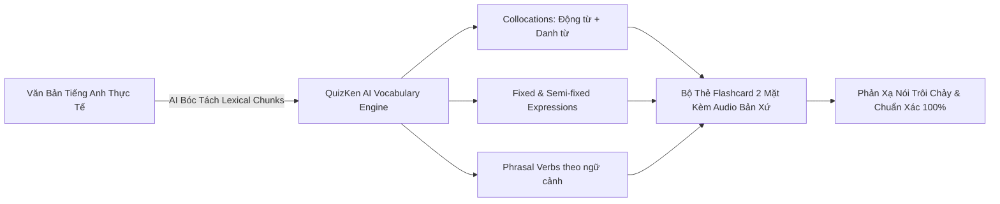

> **Tóm tắt nhanh (TL;DR):** Trong cuốn sách kinh điển *"The Lexical Approach: The State of ELT and a Way Forward"* (1993), nhà ngôn ngữ học **Michael Lewis** đã đưa ra một tuyên ngôn mang tính cách mạng: *"Ngôn ngữ không phải là ngữ pháp được từ vựng hóa, mà là từ vựng được ngữ pháp hóa" (Language consists of grammaticalised lexis, not lexicalised grammar)*. Thay vì học các từ vựng đơn lẻ rồi ghép nối theo quy tắc ngữ pháp cứng nhắc, phương pháp **Lexical Approach** tập trung vào việc học theo các khối cụm từ tự nhiên (**Lexical Chunks & Collocations**). Với sự trợ giúp của **QuizKen AI**, người học có thể tự động bóc tách hàng nghìn cụm Collocation từ ngữ cảnh thực tế và ghi nhớ vĩnh viễn nhờ bộ thẻ Flashcard thông minh.

---

## 1. Bản Chất Đột Phá Của Phương Pháp Lexical Approach (Michael Lewis 1993)

Nghiên cứu của Michael Lewis chỉ ra rằng hơn **70% giao tiếp hàng ngày của người bản xứ** được cấu thành từ các khối ngôn ngữ định sẵn (*Prefabricated Chunks*), bao gồm:
1. **Collocations (Kết hợp từ tự nhiên):** *make a decision* (không nói *do a decision*), *heavy rain* (không nói *strong rain*).
2. **Fixed Expressions (Thành ngữ cố định):** *by the way*, *as far as I know*, *out of the blue*.
3. **Semi-fixed Expressions (Khung mẫu linh hoạt):** *Could you please pass me the...?*, *Would you mind if I...?*
4. **Phrasal Verbs (Cụm động từ):** *look forward to*, *run out of*, *come up with*.

Học sinh học theo lối ngữ pháp truyền thống thường nghĩ từ tiếng Việt rồi dịch từng chữ (*word-by-word translation*), dẫn đến những câu nói gượng gạo và phản xạ giao tiếp chậm chạp.

---

## 2. Bảng So Sánh: Học Từ Đơn Lẻ vs Phương Pháp Lexical Approach

| Tiêu chí | Học từ vựng đơn lẻ truyền thống | Phương pháp Lexical Approach (Michael Lewis) |
| :--- | :--- | :--- |
| **Đơn vị học tập** | Từng từ riêng lẻ: *heavy*, *rain*, *decision* | Khối cụm từ: *heavy rain*, *make a crucial decision* |
| **Quy trình nói** | Nghĩ từ ➔ Nhớ quy tắc ngữ pháp ➔ Ghép câu | Kích hoạt nguyên khối cụm từ có sẵn trong trí nhớ |
| **Tốc độ phản xạ** | Bị khựng, mất 3-5 giây để dịch thầm | Phản xạ tức thì trong 0.5 giây |
| **Độ tự nhiên** | Dễ mắc lỗi dịch thô theo tiếng Việt (*Vietlish*) | Chuẩn xác 100% ngữ điệu và thói quen bản xứ |
| **Hiệu quả IELTS/VSTEP** | Điểm tiêu chí Lexical Resource chỉ ở mức 5.0 - 6.0 | Dễ dàng đạt Band 7.5 - 8.5+ cho tiêu chí Lexical Resource |

---

## 3. Quy Trình 4 Bước Làm Chủ Collocations Cùng QuizKen AI

### Bước 1: Thu thập ngữ liệu tiếng Anh thực tế
Đọc các bài báo (BBC, The Guardian, TED) hoặc các bài đọc Cambridge IELTS trên [QuizKen English Hub](https://quizken.com).

### Bước 2: AI tự động phân tích và trích xuất Lexical Chunks
Dán đoạn văn bản vào QuizKen. Công nghệ Xử lý ngôn ngữ tự nhiên (NLP) sẽ tự động:
- Đánh dấu các cặp Collocation (Tính từ + Danh từ, Động từ + Trạng từ).
- Phân tích tần suất sử dụng thực tế của cụm từ theo kho ngữ liệu Corpus chuẩn quốc tế.

### Bước 3: Tạo bộ thẻ Flashcard tương tác
Chuyển đổi các khối từ thành Flashcard hai mặt:
- Mặt trước: Cụm từ khuyết thiếu trong ngữ cảnh (ví dụ: *She made a substantial ______ [contribute] to the project*).
- Mặt sau: Cụm Collocation hoàn chỉnh (*make a substantial contribution to*), phiên âm IPA và audio phát âm bản xứ.

### Bước 4: Ôn luyện theo chu trình Spaced Repetition
Hệ thống QuizKen tự động lên lịch kiểm tra ngắt quãng, giúp các cụm từ ăn sâu vào vùng ngôn ngữ tiềm thức của não bộ.

---

## 4. 3 Lời Khuyên Khi Học Collocations Hàng Ngày

1. **Luôn ghi chép cả cụm 3-4 từ:** Tuyệt đối không chỉ ghi chép 1 từ vựng cô lập vào sổ tay.
2. **Chú ý đến giới từ đi kèm:** Ghi nhớ chính xác giới từ gắn liền với động từ và tính từ (ví dụ: *depend on*, *keen on*, *capable of*).
3. **Thực hành đặt câu cá nhân hóa:** Dùng chính các cụm từ vừa học để viết về trải nghiệm của bản thân.

👉 **Bứt phá khả năng giao tiếp:** Trải nghiệm ngay công cụ học cụm từ thông minh với [QuizKen Collocation Builder](https://quizken.com) hoàn toàn miễn phí!

---

## 5. Câu Hỏi Thường Gặp (FAQ)

### Có cần học thuộc toàn bộ từ điển Collocations không?
Không cần thiết. Bạn chỉ cần tập trung làm chủ khoảng 1.000 - 1.500 cụm Collocations phổ biến nhất trong các chủ đề học thuật và đời sống hàng ngày để tự tin giao tiếp trôi chảy.

### Phương pháp Lexical Approach có giúp cải thiện điểm thi IELTS Writing không?
Rất lớn. Sử dụng linh hoạt các Collocations học thuật tự nhiên là yếu tố quyết định giúp bạn đạt điểm tối đa ở tiêu chí *Lexical Resource* và *Cohesion & Coherence* trong bài thi IELTS Writing Task 2.
