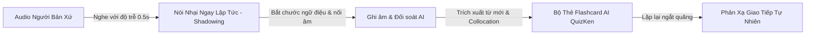

> **Tóm tắt nhanh (TL;DR):** Phương pháp **Shadowing** (nói nhại theo người bản xứ) là kỹ thuật luyện ngữ điệu, nối âm và ngữ điệu câu hiệu quả hàng đầu thế giới. Khi kết hợp cùng tính năng **Flashcard AI Spaced Repetition** trên nền tảng **QuizKen**, người học không chỉ bắt chước phát âm chuẩn xác mà còn tự động ghi nhớ từ vựng học thuật, cụm Collocation tự nhiên trong ngữ cảnh thực tế mà không cần ghi nhớ vẹt.

---

## 1. Phương Pháp Shadowing Là Gì? Vì Sao Lại Hiệu Quả Đột Phá?

**Shadowing** là kỹ thuật luyện nói tiếng Anh được khởi xướng bởi Giáo sư Alexander Arguelles. Nguyên lý hoạt động vô cùng đơn giản: Bạn lắng nghe một đoạn audio/video của người bản xứ và **lặp lại ngay lập tức (độ trễ khoảng 0.5 giây)** chính xác những gì bạn vừa nghe, bắt chước từ âm tiết, ngữ điệu, chỗ nhấn nhá đến nhịp thở.

Thay vì dịch từng từ trong đầu từ tiếng Việt sang tiếng Anh trước khi nói, Shadowing tạo nên **phản xạ cơ miệng (Muscle Memory)** và rèn luyện kết nối thần kinh trực tiếp giữa tai và miệng.

---

## 2. Bảng So Sánh: Học Nói Truyền Thống vs Shadowing Kết Hợp Flashcard AI

| Yếu tố so sánh | Học phát âm truyền thống | Shadowing + Flashcard AI QuizKen |
| :--- | :--- | :--- |
| **Cách tiếp cận** | Học thuộc bảng phiên âm IPA & từ vựng đơn lẻ | Nhại lại toàn bộ câu trong ngữ cảnh giao tiếp tự nhiên |
| **Ngữ điệu & Nối âm** | Rời rạc, phát âm chuẩn từ nhưng nói câu bị cứng | Tự nhiên, có trọng âm câu, intonation chuẩn bản xứ |
| **Khả năng ghi nhớ từ vựng** | Dễ quên sau 2-3 ngày nếu không dùng thường xuyên | Ghi nhớ vĩnh viễn nhờ thuật toán Spaced Repetition |
| **Phản xạ nói** | Bị khựng do dịch thầm từ tiếng Việt sang tiếng Anh | Phản xạ tức thì không qua bước chuyển dịch trung gian |
| **Công cụ hỗ trợ** | Sách giáo khoa, ghi chép tay | Trợ lý Flashcard AI trích xuất từ & chấm phát âm |

---

## 3. Quy Trình 4 Bước Luyện Shadowing Chuẩn Quốc Tế Cùng QuizKen

Để đạt hiệu quả tối đa sau 30 ngày luyện tập, bạn hãy áp dụng quy trình 4 bước tinh gọn sau:

### Bước 1: Chọn tài liệu phù hợp trình độ CEFR
Lựa chọn đoạn hội thoại ngắn (1-2 phút) thuộc trình độ A2, B1, B2 hoặc C1 tùy năng lực. Nguồn bài nghe lý tưởng bao gồm: Podcast giáo dục, bản tin BBC 6 Minute English, TED Talks hoặc thư viện đề nghe trên [QuizKen English Hub](https://quizken.com).

### Bước 2: Nghe hiểu và phân tích văn bản (Transcript)
Đọc lướt văn bản để hiểu nghĩa tổng thể. Đánh dấu các hiện tượng ngữ âm đặc biệt:
- Nối âm (*linking sounds*): *Check it out* ➔ */tʃek-ɪ-taʊt/*
- Nuốt âm (*elision*): *Next door* ➔ */neks-dɔːr/*
- Trọng âm câu (*sentence stress*): Nhấn vào các từ mang nội dung chính (Danh từ, Động từ, Tính từ).

### Bước 3: Thực hành Shadowing 3 cấp độ
1. **Cấp độ 1 (Nhìn Transcript):** Vừa nhìn phụ đề vừa nói đuổi theo giọng đọc mẫu.
2. **Cấp độ 2 (Không nhìn Transcript):** Tắt phụ đề, chỉ dùng tai lắng nghe và phát âm bám sát người đọc.
3. **Cấp độ 3 (Ghi âm đối soát):** Tự ghi âm lại giọng của mình và đối chiếu để sửa các âm bị nuốt hoặc sai trọng âm.

### Bước 4: Tạo bộ Flashcard AI để củng cố từ vựng
Tải đoạn văn bản bài nghe lên **QuizKen**. Tính năng AI sẽ tự động:
- Trích xuất toàn bộ từ vựng then chốt và cụm Collocation ăn điểm.
- Tạo bộ Flashcard tương tác hai mặt có kèm phát âm chuẩn, phiên âm IPA và câu ví dụ sinh động.
- Lên lịch ôn tập tự động theo chu trình Spaced Repetition (1 ngày - 3 ngày - 7 ngày - 14 ngày).

---

## 4. Những Sai Lầm Phổ Biến Khi Luyện Shadowing Cần Tránh

1. **Chọn bài nghe quá dài hoặc quá khó:** Bắt đầu với bài nói quá nhanh sẽ khiến bạn nhanh chóng nản chí. Hãy bắt đầu với tốc độ 0.75x hoặc 1.0x của các đoạn hội thoại ngắn.
2. **Chỉ nói thì thầm trong cổ họng:** Hãy mở rộng khẩu hình miệng và nói to rõ ràng để cơ hàm làm quen với khẩu hình tiếng Anh.
3. **Bỏ qua bước ôn tập từ vựng:** Shadowing giúp phát âm trôi chảy, nhưng nếu không lưu từ vào Flashcard, bạn sẽ không thể chủ động vận dụng những cụm từ đó vào bài thi Speaking IELTS hay VSTEP.

👉 **Bắt đầu ngay hôm nay:** Trải nghiệm kho thẻ học thông minh và luyện phát âm cùng [Flashcard AI QuizKen](https://quizken.com) hoàn toàn miễn phí!

---

## 5. Câu Hỏi Thường Gặp (FAQ)

### Mỗi ngày nên luyện Shadowing bao nhiêu phút là hiệu quả?
Thời lượng lý tưởng là **15 - 25 phút mỗi ngày**. Tính nhất quán quan trọng hơn thời lượng dài: Luyện 20 phút mỗi ngày trong 30 ngày sẽ mang lại hiệu quả vượt trội so với việc học dồn 3 tiếng vào cuối tuần.

### Người mới bắt đầu mất gốc có áp dụng được phương pháp Shadowing không?
Có. Người mới bắt đầu nên chọn các đoạn hội thoại giao tiếp cơ bản tốc độ chậm (A1-A2), nghe kỹ từng câu 2-3 lần trước khi bắt đầu nói nhại theo.
