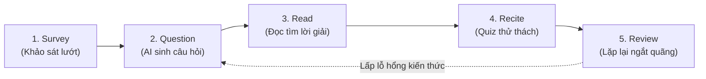

> **TL;DR (Tóm tắt nhanh):**  
> Đọc đi đọc lại một cuốn sách giáo trình hay tài liệu ôn thi mà không có sự tương tác chủ động là cách học tốn thời gian và kém hiệu quả nhất (chỉ nhớ được dưới 20% sau 48 giờ). Phương pháp **SQ3R (Khảo sát - Đặt câu hỏi - Đọc - Tự thuật - Ôn tập)** do nhà tâm lý giáo dục Francis P. Robinson sáng tạo đã được chứng minh giúp tăng gấp 3 lần khả năng ghi nhớ dài hạn. Khi kết hợp cùng **QuizKen AI**, bước "Đặt câu hỏi" (Question) và "Tự thuật" (Recite) được tự động hóa hoàn toàn, biến việc đọc tài liệu thụ động thành một trải nghiệm giải đố tương tác thông minh!

---

# Phương Pháp SQ3R Kết Hợp Quiz AI: Chiến Lược Đọc Hiểu Sâu Ôn Thi Cấp Tốc

Trong các kỳ thi chuyển cấp, thi học sinh giỏi hay thi tốt nghiệp THPT, khối lượng kiến thức lý thuyết các môn Ngữ văn (phần Đọc hiểu ngoài SGK), Lịch sử, Địa lý, Giáo dục Kinh tế & Pháp luật hay Sinh học là vô cùng đồ sộ. 

Rất nhiều bạn học sinh rơi vào cái bẫy **"Ảo tưởng về sự thấu hiểu" (Illusion of Competence)**: Đọc một trang sách thấy hiểu và quen thuộc, nhưng khi gấp sách lại hoặc đối diện với đề thi trắc nghiệm thì hoàn toàn không nhớ được chi tiết.

Phương pháp **SQ3R** chính là chiếc chìa khóa vàng giúp bạn bẻ khóa mọi tập tài liệu dày cộp. Khi được nâng cấp bởi công nghệ AI của **QuizKen**, SQ3R trở nên mạnh mẽ hơn bao giờ hết.

---

## 1. Bản Chất 5 Bước Của Phương Pháp SQ3R

SQ3R là viết tắt của 5 giai đoạn tiếp cận tài liệu một cách khoa học:

| Viết tắt | Bước thực hiện | Mục tiêu cốt lõi | Cách làm truyền thống | Cách làm đột phá cùng QuizKen AI |
| :--- | :--- | :--- | :--- | :--- |
| **S** | **Survey** *(Khảo sát)* | Nắm bức tranh tổng thể cấu trúc bài học. | Đọc lướt tiêu đề lớn, mục lục, biểu đồ, câu mở đầu và kết luận. | Tải file PDF lên QuizKen để AI tóm tắt sơ đồ tư duy (Mindmap) các luận điểm chính trong 3 giây. |
| **Q** | **Question** *(Đặt câu hỏi)* | Kích hoạt sự tò mò và định hướng tư duy não bộ. | Tự biến các tiêu đề bài học thành câu hỏi: *"Tại sao...?", "Như thế nào...?"*. | QuizKen AI tự động quét đề mục và sinh ra bộ 5 - 10 câu hỏi cốt lõi dẫn dắt việc đọc. |
| **R1** | **Read** *(Đọc có mục đích)* | Tìm câu trả lời cho các câu hỏi đã đặt ra ở bước Q. | Đọc kỹ từng đoạn văn, gạch chân các dữ liệu trả lời câu hỏi. | Đọc tài liệu kết hợp đối chiếu trực tiếp với gợi ý từ khóa của AI. |
| **R2** | **Recite / Retrieve** *(Tự thuật)* | Buộc não bộ chủ động nhớ lại (Active Recall). | Gấp sách lại, tự nói to hoặc ghi chép ra giấy những gì vừa đọc. | Làm bài trắc nghiệm trắc nghiệm nhanh 4 lựa chọn hoặc Đúng/Sai do QuizKen sinh ra ngay lập tức. |
| **R3** | **Review** *(Ôn tập lặp lại)* | Củng cố trí nhớ vào vùng nhớ dài hạn. | Ôn lại sau 1 ngày, 3 ngày, 1 tuần theo đường cong quên lãng Ebbinghaus. | Hệ thống Spaced Repetition của QuizKen tự động nhắc nhở ôn lại các câu hỏi học sinh làm sai. |

---

## 2. Vì Sao SQ3R Kết Hợp AI Lại Vượt Trội?

Hạn chế lớn nhất khiến học sinh thường bỏ dở phương pháp SQ3R truyền thống là **ở bước Q (Question) và R2 (Recite)**:
* Nhiều bạn không biết cách tự đặt câu hỏi hay, thường chỉ đặt những câu hỏi quá đơn giản hoặc đi lệch trọng tâm đề thi.
* Khi tự thuật (Recite), việc tự kiểm tra lại đáp án của chính mình thường thiếu tính khách quan và dễ nảy sinh tâm lý lười biếng.

**QuizKen giải quyết hoàn hảo nút thắt này:**
1. **AI đặt câu hỏi chuẩn khảo thí:** Thay vì hỏi chung chung, AI tự động tạo các câu hỏi phân loại theo thang nhận thức Bloom (Nhận biết, Thông hiểu, Vận dụng).
2. **Kiểm tra phản xạ tức thì:** Học sinh được thử thách với các câu hỏi trắc nghiệm khách quan, câu hỏi Đúng/Sai và điền khuyết số liệu. Hệ thống chấm điểm tự động và chỉ ra điểm mù kiến thức ngay tại chỗ.

---

## 3. Hướng Dẫn Thực Hành SQ3R 15 Phút Cùng QuizKen

Giả sử bạn cần ôn tập một bài học dài 10 trang môn Địa lý 12 về *"Vấn đề phát triển kinh tế biển ở Duyên hải Nam Trung Bộ"*:

### Phút 1 - 3 (Survey & Question):
1. Tải tài liệu bài học lên [https://app.quizken.com](https://app.quizken.com).
2. Đọc nhanh bản tóm tắt các nhánh nội dung chính do AI cung cấp: Tiềm năng phát triển du lịch biển, cảng nước sâu, nghề cá và muối, khai thác khoáng sản.
3. Xem trước danh sách các câu hỏi cốt lõi mà QuizKen gợi ý.

### Phút 4 - 10 (Read):
1. Mở tài liệu ra đọc kỹ từng mục với tâm thế đi tìm đáp án cho từng câu hỏi.
2. Não bộ lúc này như một "thám tử" đang chủ động truy vết thông tin thay vì đọc trong trạng thái buồn ngủ.

### Phút 11 - 15 (Recite & Review):
1. Đóng sách giáo khoa lại.
2. Bấm vào nút **Làm Quiz kiểm tra** trên QuizKen.
3. Hoàn thành 10 câu trắc nghiệm trong 4 phút. Xem ngay phân tích giải thích đáp án chi tiết của AI cho từng câu đúng và câu sai.

---

## 4. Lời Khuyên Dành Cho Các Bạn 2k8, 2k9 Mùa Thi Cử

Đừng lãng phí thời gian vào việc chép lại nguyên văn tài liệu vào sổ tay hay ngồi tô highlight kín trang sách (đã được chứng minh là một trong những thói quen học tập lãng phí nhất). Hãy chuyển sang học tập chủ động với **Phương pháp SQ3R** được tối ưu hóa bởi công nghệ AI.

Khởi động buổi học năng suất đầu tiên của bạn tại: [https://app.quizken.com](https://app.quizken.com).
