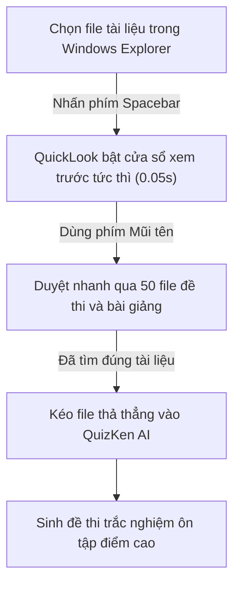

> **TL;DR (Tóm tắt nhanh):**  
> Một trong những tính năng đáng ghen tị nhất của người dùng macOS đối với người dùng Windows chính là **Quick Look**: Chỉ cần bấm một lần vào phím **Spacebar (Phím cách)**, nội dung của bất kỳ tập tin nào (từ file Word, PDF, Excel, ảnh Photoshop, video cho đến file nén `.zip`) đều hiển thị tức thì trên màn hình mà không cần phải mở phần mềm tương ứng. **QuickLook** là ứng dụng mã nguồn mở miễn phí trên Microsoft Store, mang nguyên vẹn tính năng tuyệt vời này lên Windows 10 & 11, giúp bạn duyệt qua hàng trăm tài liệu ôn thi với tốc độ "xé gió"!

---

# QuickLook: Xem Trước Mọi File Bằng Phím Cách Trên Windows 11 Cực Tiện

Khi bạn tải về một thư mục chứa 50 tệp tin đề thi và bài giảng được đặt tên kiểu `De_1.pdf`, `De_2.pdf`, `Baitap_chuong3.docx`... bạn thường phải làm gì để biết bên trong nó có gì?
* Nhấp đúp chuột để mở từng file lên.
* Chờ ứng dụng Microsoft Word hoặc Adobe Acrobat Reader nặng nề khởi động mất 5 - 10 giây.
* Thấy không đúng tài liệu cần tìm, lại bấm dấu `X` tắt đi và nhấp đúp vào file tiếp theo.

Quy trình này làm lãng phí hàng chục phút quý báu mỗi ngày và khiến máy tính bị tiêu tốn bộ nhớ RAM vô ích.

**QuickLook** chính là câu trả lời mang lại trải nghiệm duyệt file mượt mà tựa như trên máy Mac.

---

## 1. Trải Nghiệm "Phép Màu" Phím Cách Của QuickLook

Ngay sau khi cài đặt **QuickLook**, bạn chỉ cần mở Windows Explorer:
1. Nhấp chuột vào bất kỳ file tài liệu nào.
2. Nhấn phím **Spacebar (Phím cách)** trên bàn phím.
3. Ngay lập tức, một cửa sổ xem trước đẹp mắt và thanh lịch hiện ra ở giữa màn hình:
   * **Với file PDF & Word:** Bạn có thể cuộn chuột đọc trực tiếp nội dung các trang tài liệu.
   * **Với file Excel:** Xem trước các bảng tính, số liệu và sheet tính toán.
   * **Với file ảnh & video:** Xem ảnh độ phân giải gốc hoặc phát video có âm thanh mà không cần mở trình phát media.
   * **Với file mã nguồn (.js, .py, .html, .cpp):** Tô màu cú pháp (Syntax Highlighting) cực kỳ rõ ràng.
4. Muốn đóng lại? Chỉ cần nhấn lại phím **Spacebar** hoặc phím **ESC**.
5. Muốn duyệt file tiếp theo? Dùng các phím **Mũi tên lên / xuống / trái / phải**, cửa sổ QuickLook sẽ tự động cập nhật nội dung file tiếp theo trong chớp mắt!

---

## 2. Hướng Dẫn Cài Đặt QuickLook Miễn Phí Từ Microsoft Store

1. Mở ứng dụng **Microsoft Store** có sẵn trên máy tính Windows 10/11 của bạn.
2. Tìm kiếm từ khóa: `QuickLook` (do tác giả Paddy Xu phát triển).
3. Bấm **Get (Nhận)** hoặc **Install (Cài đặt)**.
4. Mở ứng dụng lần đầu tiên, biểu tượng chiếc kính lúp nhỏ sẽ xuất hiện ở khay hệ thống (System Tray). Ứng dụng sẽ tự động chạy ngầm cùng Windows mà hầu như không tiêu tốn tài nguyên máy tính.

> [!TIP]
> Bạn có thể cài thêm các Plugin mở rộng của QuickLook (như xem trước file 3D, file font chữ, file nén ePub/cbr) hoàn toàn miễn phí từ trang GitHub của dự án: `github.com/QL-Win/QuickLook`.

---

## 3. Tăng Tốc Quy Trình Ôn Thi Cùng QuickLook và QuizKen

Khi bạn chuẩn bị cho kỳ thi học kỳ hoặc thi tốt nghiệp THPT:
1. Dùng **QuickLook** lướt qua một lượt các tệp PDF đề cương để chọn ra phần kiến thức trọng tâm nhất.
2. Kéo thả file PDF đó vào [https://app.quizken.com](https://app.quizken.com).
3. QuizKen AI sẽ trích xuất ma trận câu hỏi và tạo phòng thi trắc nghiệm trực tuyến để bạn luyện đề ngay lập tức!

Trải nghiệm học tập năng suất cùng QuizKen tại: [https://app.quizken.com](https://app.quizken.com).
