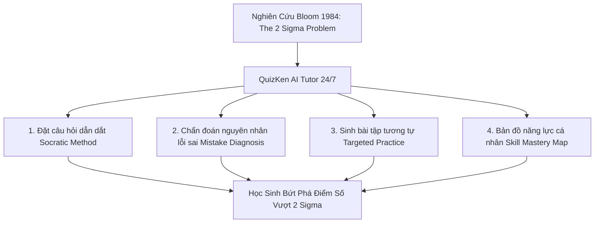

> **Tóm tắt nhanh (TL;DR):** Trong công trình nghiên cứu nổi tiếng *"The 2 Sigma Problem: The Search for Methods of Group Instruction as Effective as One-to-One Tutoring"* (Educational Researcher, 1984), nhà giáo dục học lỗi lạc **Benjamin Bloom** đã chứng minh: Học sinh được kèm 1-on-1 đạt kết quả học tập vượt trội **2 độ lệch chuẩn (2 Sigma - tương đương 98% học sinh trong lớp đại trà)**. Lấy cảm hứng từ nghiên cứu này, **QuizKen** chính thức ra mắt tính năng **AI Tutor 24/7** – Trợ lý gia sư ảo thông minh giúp giải thích bản chất từng lỗi sai theo phương pháp Socratic và cá nhân hóa lộ trình học tập cho từng học sinh.

---

## 1. Cơ Sở Lý Thuyết: Nghiên Cứu "The 2 Sigma Problem" Của Benjamin Bloom (1984)

Giáo sư **Benjamin Bloom (1984)** đã phát hiện ra rằng: Phương pháp giảng dạy truyền thống trên lớp (1 giáo viên dạy 40-45 học sinh) luôn gặp giới hạn lớn vì không thể giải đáp cặn kẽ mọi khúc mắc của từng cá nhân. Ngược lại, khi có một gia sư kèm cặp 1-kèm-1:
- Học sinh tiến bộ nhảy vọt từ mức điểm trung bình lên nhóm xuất sắc nhất (*98th percentile*).
- Học sinh không bị bỏ lại phía sau khi gặp phải các lỗ hổng kiến thức căn bản.

Sự phát triển vượt bậc của Mô hình ngôn ngữ lớn (LLM) và AI Sư phạm trên **QuizKen** đã lần đầu tiên hiện thực hóa mô hình gia sư 1-on-1 cho mọi học sinh với chi phí bằng 0.

---

## 2. Bảng So Sánh: Tra Sách Giải Cũ vs Trợ Lý AI Tutor QuizKen

| Tiêu chí | Tra sách giải / Google lời giải có sẵn | Trợ lý gia sư AI Tutor 24/7 QuizKen |
| :--- | :--- | :--- |
| **Mô hình sư phạm** | Cung cấp sẵn lời giải hoàn chỉnh (học sinh chép lại) | Dẫn dắt từng bước suy luận theo phương pháp Socratic |
| **Phân tích lỗi sai** | Không có (học sinh chỉ biết mình làm sai) | Chỉ rõ bẫy tư duy và lý do phương án lựa chọn bị sai |
| **Củng cố kiến thức** | Học sinh tự tìm bài tập tương tự | Tự động sinh ngay 3 câu hỏi rèn luyện cùng dạng |
| **Theo dõi tiến độ** | Rời rạc, không có số liệu | Tự động xây dựng bản đồ năng lực cá nhân |
| **Thời gian hỗ trợ** | Bị động | Phản hồi tương tác 24/7 trong 1 giây |

---

## 3. 4 Điểm Đột Phá Của AI Tutor QuizKen Bạn Cần Trải Nghiệm

### 1. Phương pháp gợi mở tư duy Socratic
AI Tutor không đưa ngay đáp án cuối cùng mà đặt các câu hỏi gợi mở để kích thích học sinh tự suy nghĩ:
- *"Em hãy quan sát xem trong phản ứng này chất nào là chất oxi hóa?"*
- *"Công thức tính đạo hàm của hàm hợp có quy tắc nào cần lưu ý?"*

### 2. Chẩn đoán nguyên nhân chọn sai (Mistake Diagnosis)
Khi bạn chọn sai một phương án trong bài trắc nghiệm, AI Tutor sẽ phân tích chính xác bạn đang hiểu nhầm ở bước nào.

### 3. Tự động sinh câu hỏi tương tự (Targeted Practice)
Sau khi giải thích rõ một bài toán khó, AI Tutor sinh ngay 2-3 bài tập có cấu trúc tương tự với số liệu khác để bạn thực hành lại và nắm vững phương pháp.

### 4. Bản đồ năng lực cá nhân (Skill Mastery Map)
Tổng hợp toàn bộ quá trình làm bài và hỏi đáp thành bản đồ trực quan, chỉ ra chính xác các chủ đề bạn đã làm chủ (*Mastered*) và các phần cần ôn tập thêm.

---

## 4. Hướng Dẫn Kích Hoạt Tính Năng AI Tutor Trên QuizKen

1. Truy cập nền tảng [QuizKen](https://quizken.com).
2. Khi làm bất kỳ đề trắc nghiệm hoặc bộ Flashcard nào, nhấp vào biểu tượng **"Hỏi AI Tutor"** bên cạnh câu hỏi.
3. Đặt câu hỏi thắc mắc và nhận sự hỗ trợ tận tình từ gia sư ảo 24/7!

👉 **Trải nghiệm ngay:** Nâng cao thành tích học tập với [Trợ Lý Gia Sư Ảo AI Tutor QuizKen](https://quizken.com) hoàn toàn miễn phí ngay hôm nay!

---

## 5. Câu Hỏi Thường Gặp (FAQ)

### Tính năng AI Tutor có hỗ trợ các môn xã hội như Lịch sử, Địa lý không?
Có. AI Tutor hỗ trợ toàn diện tất cả các môn học: Toán, Tiếng Anh, Vật lí, Hóa học, Sinh học, Lịch sử, Địa lí, GDCD và Tin học.

### Phụ huynh có thể theo dõi quá trình con học với AI Tutor không?
Có. QuizKen cung cấp báo cáo tổng hợp tiến độ và các chủ đề học sinh đã khắc phục được gửi định kỳ cho phụ huynh.
