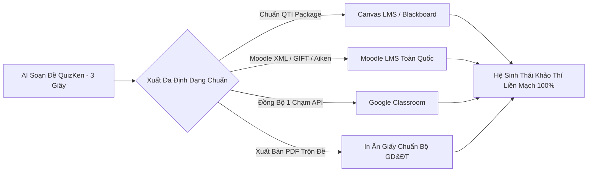

> **Tóm tắt nhanh (TL;DR):** Để đáp ứng nhu cầu đồng bộ hóa dữ liệu của các trường phổ thông và đại học sử dụng hệ thống quản lý học tập (LMS), **QuizKen** vừa chính thức công bố bản cập nhật hỗ trợ xuất khẩu ngân hàng câu hỏi trắc nghiệm theo các chuẩn kỹ thuật quốc tế: **IMS QTI 2.2 / 3.0 (Question and Test Interoperability)**, **Moodle XML / GIFT Format**, **Aiken Format** và đồng bộ 1 chạm với **Google Classroom**. Giờ đây, giáo viên có thể dùng AI QuizKen để tạo đề thi trong 3 giây rồi nhập trực tiếp vào hệ thống LMS của nhà trường mà không cần gõ lại thủ công.

---

## 1. Nhu Cầu Chuẩn Hóa Dữ Liệu Thi Khảo Thí Quốc Tế

Hầu hết các trường đại học và trường phổ thông chất lượng cao tại Việt Nam hiện đang vận hành trên các nền tảng LMS phổ biến:
- **Canvas LMS:** Phổ biến tại các trường đại học quốc tế, trường song ngữ.
- **Moodle:** Hệ sinh thái mã nguồn mở được hơn 80% trường đại học Việt Nam sử dụng.
- **Google Classroom:** Giải pháp phổ cập tại các trường THCS và THPT.

Tuy nhiên, việc nhập liệu hàng nghìn câu hỏi trắc nghiệm kèm công thức toán LaTeX, hình ảnh minh họa và các phương án Đúng/Sai lên LMS thường tốn rất nhiều thời gian và dễ phát sinh lỗi định dạng.

---

## 2. Bảng Hỗ Trợ Định Dạng Tương Thích Của QuizKen

| Định dạng xuất | Nền tảng LMS tương thích | Loại câu hỏi hỗ trợ | Ưu điểm nổi bật |
| :--- | :--- | :--- | :--- |
| **IMS QTI (2.2 / 3.0)** | Canvas, Blackboard, Schoology | 4 lựa chọn, Đúng/Sai, Trả lời ngắn, Ghép đôi | Giữ nguyên hình ảnh, công thức KaTeX và thang điểm |
| **Moodle XML** | Moodle 3.x, 4.x, OpenEdu | Đa lựa chọn, Đúng/Sai 4 ý, Trả lời số | Hỗ trợ đầy đủ lời giải thích chi tiết (*Feedback*) |
| **GIFT Format** | Moodle, Chamilo | Trắc nghiệm, Điền khuyết, Đúng/Sai | Cú pháp văn bản nhẹ, chỉnh sửa nhanh bằng Notepad |
| **Aiken Format** | Moodle, EasyLMS | Trắc nghiệm 4 lựa chọn đơn giản | Định dạng văn bản siêu gọn nhẹ cho đề thi chuẩn |
| **Google Classroom API** | Google Workspace for Education | Bài tập Quiz Form tự động chấm | Giao bài trực tiếp đến từng lớp học chỉ với 1 click |

---

## 3. Hướng Dẫn 3 Bước Xuất Đề Thi Từ QuizKen Sang Moodle / Canvas

### Bước 1: Tạo bộ đề thi trên QuizKen
Sử dụng công cụ [AI Soạn Đề QuizKen](https://quizken.com) để tạo bộ câu hỏi theo ma trận chuyên đề mong muốn.

### Bước 2: Chọn định dạng xuất tương ứng với LMS của bạn
Tại góc phải màn hình chỉnh sửa đề thi, bấm vào nút **"Xuất File LMS"** và chọn:
- Chọn **Canvas / QTI Package (.zip)** nếu trường bạn dùng Canvas.
- Chọn **Moodle XML (.xml)** hoặc **Aiken (.txt)** nếu trường bạn dùng Moodle.
- Chọn **Đồng bộ Google Classroom** để tạo ngay bài tập trên lớp học Google.

### Bước 3: Nhập file vào LMS trong 5 giây
- Trên giao diện Moodle: Truy cập *Ngân hàng câu hỏi (Question Bank)* ➔ Chọn *Nhập (Import)* ➔ Kéo thả file XML từ QuizKen vào.
- Toàn bộ câu hỏi, đáp án đúng và lời giải thích sẽ được đưa vào ngân hàng đề một cách hoàn hảo, không bị lỗi font hay mất công thức toán học.

---

## 4. Lợi Ích Vượt Bậc Của Khả Năng Tương Thích Mở

1. **Không bị "khóa chặt" vào một nền tảng (No Vendor Lock-in):** Dữ liệu câu hỏi thuộc quyền sở hữu 100% của giáo viên, dễ dàng chuyển đổi qua lại giữa các phần mềm.
2. **Tiết kiệm 99% thời gian nhập liệu:** Không còn cảnh giáo viên phải copy-paste từng câu hỏi sang Moodle lúc nửa đêm.
3. **Độ chính xác tuyệt đối:** Đảm bảo công thức toán học và phương án gây nhiễu hiển thị chuẩn xác trên mọi thiết bị của học sinh.

👉 **Trải nghiệm tính năng mới:** Khám phá công cụ xuất đề chuẩn LMS với [QuizKen LMS Bridge](https://quizken.com) hoàn toàn miễn phí ngay hôm nay!

---

## 5. Câu Hỏi Thường Gặp (FAQ)

### Xuất đề sang Moodle có giữ nguyên được công thức toán học LaTeX không?
Hoàn toàn giữ nguyên. QuizKen xuất công thức dưới dạng mã MathJax/KaTeX chuẩn Moodle, giúp công thức hiển thị sắc nét trên cả máy tính và ứng dụng di động Moodle App.

### Tính năng xuất file LMS có giới hạn số lượng câu hỏi mỗi lần xuất không?
Không giới hạn. Giáo viên có thể xuất một đề thi 40 câu hoặc cả một ngân hàng 500 câu hỏi vào một file zip QTI duy nhất.
