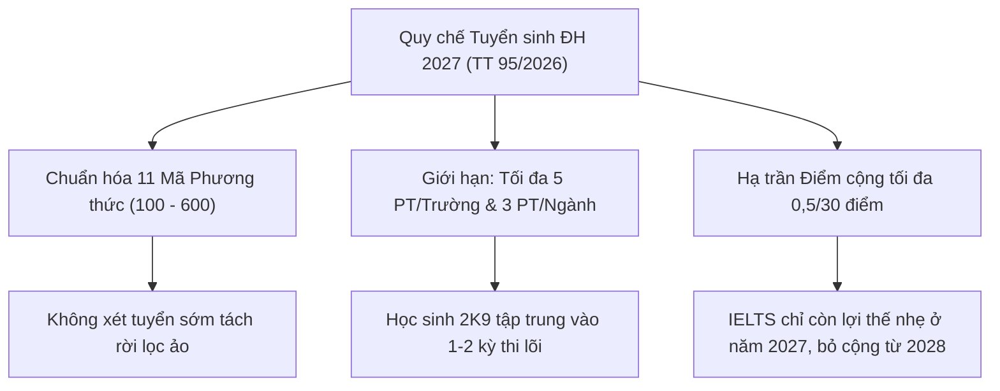

> **Tóm tắt nhanh (TL;DR):** Theo **Thông tư số 95/2026/TT-BGDĐT**, mùa tuyển sinh đại học năm **2027** (dành cho lứa thí sinh 2K9) bước vào giai đoạn siết chặt kỷ luật mạnh mẽ nhất nhiều năm trở lại đây: Bộ GD&ĐT chuẩn hóa toàn hệ thống xuống còn **11 phương thức xét tuyển** (mã `100` đến `600`), giới hạn mỗi trường tối đa **5 phương thức**, mỗi ngành năm 2027 chỉ được dùng **tối đa 3 phương thức** (giảm còn 2 vào năm 2028), đồng thời hạ trần **điểm cộng chứng chỉ ngoại ngữ/giải thưởng xuống tối đa 0,5 điểm** trên thang 30 trước khi bỏ hẳn từ năm 2028.

---

# Quy Chế Tuyển Sinh Đại Học 2027 Mới Nhất: Những Thay Đổi Bước Ngoặt Cho Thế Hệ 2K9

Bước sang năm học 2026–2027, học sinh lớp 12 (thế hệ 2K9) không chỉ đối mặt với đề thi theo Chương trình GDPT 2018 mà còn phải thích nghi ngay với khung quy chế mới tại **Thông tư 95/2026/TT-BGDĐT**. Nếu trước đây nhiều thí sinh có tâm lý "trải thảm" hồ sơ qua hàng chục phương thức xét tuyển sớm tách rời để giữ suất an toàn từ tháng 3, thì từ năm 2027 cuộc chơi đã quay về giá trị thực chất: **điểm thi và năng lực học tập cốt lõi**.

## 1. Chuẩn Hóa Còn 11 Phương Thức & Siết Trần Số Lượng Theo Ngành

Thay vì để tồn tại 19 mã phương thức phân tán như các năm trước, Bộ GD&ĐT đã gộp và quy chuẩn toàn bộ hệ thống xét tuyển cả nước về **11 mã phương thức thống nhất**:

| Mã phương thức | Nội dung xét tuyển chính thức từ năm 2027 | Lưu ý cho thí sinh 2K9 |
| :--- | :--- | :--- |
| **100 / 101** | Kết quả thi tốt nghiệp THPT (`100`) / Trung học nghề (`101`) | Vẫn là phương thức chủ lực có chỉ tiêu cao nhất ở đa số trường. |
| **200 / 201** | Kết quả học tập cấp THPT - Học bạ (`200`) / Trung học nghề (`201`) | Không còn xét tuyển sớm độc lập; phải đưa vào hệ thống lọc ảo chung. |
| **300 / 301** | Xét tuyển thẳng theo Quy chế (`300`) / Đối tượng cử tuyển (`301`) | Không tính vào giới hạn số phương thức tối đa của trường. |
| **401 / 402 / 403** | Thi chung nhiều trường (`401`), thi riêng 1 trường (`402`), thi độc lập (`403`) | Bao gồm các kỳ thi ĐGNL/ĐGTD lớn như HSA, V-ACT, TSA, SPT, V-SAT. |
| **500** | Sử dụng chứng chỉ quốc tế đủ điều kiện | Áp dụng cho các trường/ngành có đề án xét riêng chứng chỉ như SAT, A-Level. |
| **600** | Phương thức xét tuyển kết hợp | Gộp các thành phần (thi THPT, học bạ, chứng chỉ, thi riêng) với tổng trọng số bằng `1.0`. |

Điểm thay đổi mang tính quyết định là **giới hạn trần phương thức**:
* **Cấp cơ sở đào tạo (toàn trường):** Chỉ được dùng **tối đa 5 phương thức tuyển sinh** (không tính tuyển thẳng `300` và cử tuyển `301`).
* **Cấp chương trình/ngành đào tạo:** Năm **2027** mỗi ngành chỉ được sử dụng **tối đa 3 phương thức**, và từ năm **2028** rút xuống chỉ còn **tối đa 2 phương thức**.

Điều này đồng nghĩa những ngành top đầu rất có thể sẽ cắt giảm bớt phương thức xét học bạ thuần túy hoặc thu hẹp các tổ hợp phụ để dồn chỉ tiêu cho điểm thi tốt nghiệp THPT (`100`), kỳ thi ĐGNL/ĐGTD (`401`–`403`) hoặc xét kết hợp (`600`).

---

## 2. Hạ Trần Điểm Cộng Còn Tối Đa 0,5 Điểm — Năm Bản Lề Cuối Cùng

Trong nhiều mùa tuyển sinh trước, sở hữu IELTS 6.5–7.5 hoặc giải thưởng học sinh giỏi cấp tỉnh đôi khi mang lại mức cộng từ `1,5` đến `3,0` điểm trên thang `30`, tạo ra sự chênh lệch lớn giữa thí sinh thành thị và nông thôn. Thông tư 95/2026/TT-BGDĐT đã điều chỉnh mạnh tay:

1. **Năm 2027:** Chỉ những trường từng áp dụng chính sách điểm cộng từ năm 2026 trở về trước mới được cân nhắc tiếp tục sử dụng (kèm giải trình minh bạch trong Đề án tuyển sinh), và **tổng điểm cộng tối đa không vượt quá 0,5 điểm** trên thang điểm `30`.
2. **Từ năm 2028 trở đi:** Toàn bộ các cơ sở đào tạo **không được sử dụng điểm cộng** trong tuyển sinh đại học.

Ngoài ra, thí sinh vẫn chịu sự điều chỉnh của **công thức giảm điểm ưu tiên khu vực/đối tượng** khi tổng điểm đạt từ `22,5` trở lên. Bạn có thể kiểm tra ngay mức điểm cộng ưu tiên thực tế của mình bằng công cụ [Tính điểm cộng ưu tiên Đại học 2027](/cong-cu/tinh-diem-cong-uu-tien-dai-hoc-2027) và thử quy đổi điểm chứng chỉ ngoại ngữ/ĐGNL qua công cụ [Quy đổi điểm IELTS, SAT & ĐGNL 2027](/cong-cu/quy-doi-diem-ielts-dgnl-2027).

---

## 3. Chiến Lược Ôn Tập Thực Tế Cho Thí Sinh 2K9 Ngay Từ Tháng 12/2026

Trước sự thu gọn phương thức và siết chặt điểm cộng, học sinh lớp 12 cần xoay trục chiến lược ôn tập càng sớm càng tốt:

* **Kiểm tra sớm tổ hợp môn và học bạ:** Rà soát điểm 5 học kỳ đầu (lớp 10, lớp 11 và HK1 lớp 12) qua công cụ [Tính điểm Xét Học bạ THPT 2027](/cong-cu/tinh-diem-xet-hoc-ba-thpt-2027) và đối chiếu các tổ hợp mới có Tin học, Công nghệ tại công cụ [Tra cứu Tổ hợp môn & Mã ngành 2027](/cong-cu/tra-cuu-to-hop-mon-ma-nganh-2027).
* **Không bỏ trứng vào một giỏ chứng chỉ:** Nếu đã có IELTS/SAT, hãy tận dụng để quy đổi điểm môn Tiếng Anh (nếu trường cho phép theo phương thức `500` hoặc `600`) nhưng vẫn phải đầu tư tối đa cho **điểm thi Tốt nghiệp THPT** và ít nhất **1 kỳ thi ĐGNL** (như V-ACT, HSA hoặc TSA).
* **Luyện đề đúng chuẩn 3 định dạng GDPT 2018:** Tham khảo bộ đề luyện tập tương tác tại [Ngân hàng Đề thi Đánh giá năng lực 2027](/de-thi/dgnl) hoặc tải đề cương, đề thi thử của trường lên [QuizKen](https://app.quizken.com) để AI tạo phòng thi bấm giờ và phân tích lỗ hổng kiến thức tự động.

---

## Câu hỏi thường gặp (FAQ)

### 1. Năm 2027 các trường đại học còn được xét tuyển sớm học bạ vào tháng 3–4 không?
Không còn mô hình xét tuyển sớm công bố trúng tuyển có điều kiện tách rời hệ thống chung như trước. Mọi phương thức (kể cả học bạ mã `200`) đều phải tuân thủ khung thời gian chung và đưa lên hệ thống lọc ảo toàn quốc của Bộ GD&ĐT.

### 2. Mỗi ngành đại học năm 2027 được dùng tối đa bao nhiêu phương thức xét tuyển?
Theo Thông tư 95/2026/TT-BGDĐT, mỗi chương trình/ngành đào tạo chỉ được sử dụng **tối đa 3 phương thức xét tuyển** trong năm 2027 (và giảm xuống tối đa 2 phương thức từ năm 2028), trong phạm vi tối đa 5 phương thức của toàn trường.

### 3. Có IELTS 7.0 trong năm 2027 được cộng tối đa bao nhiêu điểm?
Nếu trường đại học bạn đăng ký thuộc diện từng áp dụng điểm cộng trước năm 2026 và giữ lại trong Đề án 2027, tổng điểm cộng tối đa (bao gồm cả chứng chỉ và giải thưởng khác) **không được vượt quá 0,5 điểm** trên thang 30.

### 4. Điểm thi tốt nghiệp THPT 2027 vẫn tính theo công thức 50/50 phải không?
Đúng. Điểm xét tốt nghiệp THPT vẫn giữ tỷ lệ 50% điểm các bài thi tốt nghiệp và 50% điểm trung bình các năm học THPT (trọng số 1:2:3). Bạn có thể tính thử ngay tại công cụ [Tính điểm xét tốt nghiệp THPT 2027](/cong-cu/tinh-diem-tot-nghiep-thpt-2027).
