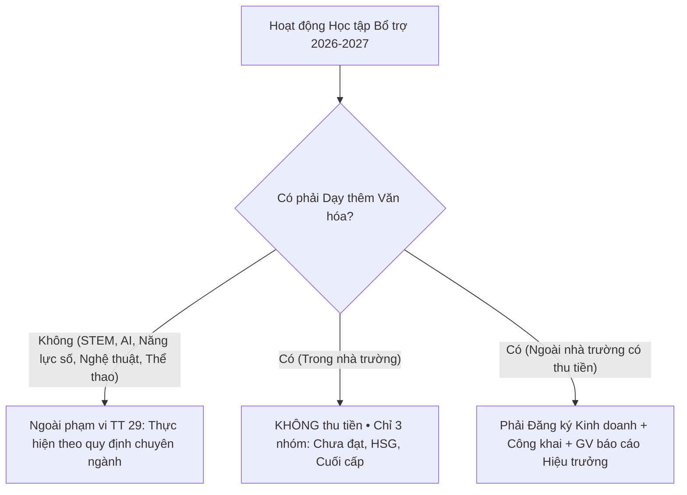

> **Tóm tắt nhanh (TL;DR):** Quy định quản lý dạy thêm, học thêm giai đoạn 2026–2027 được thực hiện theo **Thông tư 29/2024/TT-BGDĐT** (sửa đổi, bổ sung bởi **Thông tư 19/2026/TT-BGDĐT**). Nguyên tắc cốt lõi: **nghiêm cấm thu tiền dạy thêm trong nhà trường** (chỉ bồi dưỡng miễn phí cho 3 nhóm học sinh), siết đăng ký kinh doanh và chống xung đột lợi ích với dạy thêm ngoài trường; đồng thời **làm rõ các hoạt động bổ trợ STEM/STEAM, năng lực số, Trí tuệ nhân tạo (AI), ngoại ngữ tăng cường, nghệ thuật–thể thao KHÔNG thuộc phạm vi điều chỉnh** của quy định cấm dạy thêm.

---

# Cập Nhật Quy Định Dạy Thêm Học Thêm Mới Nhất (Thông Tư 29 & Thông Tư 19/2026/TT-BGDĐT)

Sau gần hai năm triển khai Thông tư 29, đến năm học 2026–2027 Bộ Giáo dục và Đào tạo đã ban hành **Thông tư 19/2026/TT-BGDĐT** nhằm tháo gỡ các điểm vướng mắc thực tiễn tại nhà trường, đặc biệt là việc phân định ranh giới giữa "dạy thêm văn hóa" với các câu lạc bộ giáo dục STEM, kỹ năng số và Trí tuệ nhân tạo (AI).

## 1. Dạy Thêm Trong Nhà Trường: Không Thu Tiền & Chỉ 3 Nhóm Đối Tượng

Theo quy định hiện hành, nhà trường công lập không được tổ chức dạy thêm có thu tiền dưới mọi hình thức. Việc dạy học bổ sung trong nhà trường sử dụng ngân sách nhà nước hoặc nguồn hợp pháp khác và chỉ giới hạn cho **3 đối tượng**:

| Nhóm học sinh | Mục đích & Điều kiện | Thu học phí thêm? |
| :--- | :--- | :--- |
| **Nhóm 1: Học sinh chưa đạt** | Có kết quả học tập môn học cuối học kỳ liền kề ở mức *Chưa đạt*, cần phụ đạo bù hổng kiến thức. | **Không được thu tiền** |
| **Nhóm 2: Bồi dưỡng học sinh giỏi** | Được nhà trường tuyển chọn vào đội tuyển học sinh giỏi các cấp. | **Không được thu tiền** |
| **Nhóm 3: Học sinh cuối cấp (lớp 9 & lớp 12)** | Tự nguyện đăng ký ôn thi tuyển sinh vào lớp 10 hoặc ôn thi tốt nghiệp THPT theo kế hoạch giáo dục của nhà trường. | **Không được thu tiền** |

Điểm thay đổi quan trọng ở **Thông tư 19/2026** là **tách bạch rõ hoạt động giáo dục phát triển năng lực toàn diện**: các hoạt động giáo dục nghệ thuật, thể dục thể thao, ngoại ngữ tăng cường, **STEM/STEAM, năng lực số, Trí tuệ nhân tạo (AI)** và kỹ năng sống theo sở thích/năng khiếu **không bị xếp vào nhóm dạy thêm, học thêm văn hóa**, nên nhà trường và cơ sở giáo dục được phép triển khai theo các quy định chuyên ngành riêng.

---

## 2. Dạy Thêm Ngoài Nhà Trường: Đăng Ký Kinh Doanh & Chống Xung Đột Lợi Ích

Đối với tổ chức, cá nhân mở lớp dạy thêm ngoài nhà trường có thu tiền của học sinh:
* **Bắt buộc đăng ký kinh doanh:** Phải thành lập doanh nghiệp hoặc hộ kinh doanh đúng quy định pháp luật và **công khai trước khi tuyển sinh** (môn học, thời lượng, địa điểm, học phí, danh sách giáo viên).
* **Quy định chặt chẽ với giáo viên công lập:** Giáo viên đang giảng dạy tại trường công không được tham gia quản lý, điều hành việc dạy thêm ngoài nhà trường; nếu tham gia giảng dạy ngoài trường phải **báo cáo với Hiệu trưởng** và tuyệt đối không được dạy thêm có thu tiền đối với học sinh mà mình đang trực tiếp dạy chính khóa trên lớp.
* **Kênh giám sát:** Các Sở GD&ĐT thiết lập đường dây nóng tiếp nhận phản ánh tình trạng ép học sinh đi học thêm hoặc "cắt xén" nội dung chính khóa.

---

## 3. Giải Pháp Chuyển Đổi Số Cho Giáo Viên & Học Sinh Thời Hậu Dạy Thêm

Khi thời lượng dạy thêm trực tiếp bị giới hạn nghiêm ngặt, thầy cô và học sinh cần những công cụ số miễn phí giúp **giao bài tự luyện có phản hồi tức thì tại nhà** mà không phát sinh gánh nặng sổ sách hay chi phí:

1. **Giao bài tập & Thi thử online 0đ:** Thầy cô có thể dùng [QuizKen Teacher Tools](/cong-cu/chuyen-de-word-docx-sang-trac-nghiem) để chuyển đề cương Word/PDF thành bài trắc nghiệm 3 phần chuẩn GDPT 2018 và xuất đường link hoặc mã QR qua [Công cụ tạo mã QR lớp học miễn phí](/cong-cu/tao-ma-qr-lop-hoc-mien-phi) gửi ngay lên nhóm lớp.
2. **Tạo phiếu tô đáp án & trộn mã đề nhanh cho lớp ôn thi cuối cấp:** Với học sinh lớp 9 và lớp 12 ôn thi miễn phí tại trường, giáo viên tiết kiệm hàng giờ chuẩn bị nhờ [Công cụ trộn 4 mã đề online](/cong-cu/tron-de-trac-nghiem-online) và [Tạo phiếu trả lời trắc nghiệm A4 2027](/cong-cu/tao-phieu-tra-loi-trac-nghiem-2027).
3. **Tổ chức hoạt động trên lớp sinh động:** Thay vì kiểm tra bài cũ căng thẳng, thầy cô có thể chiếu [Vòng quay gọi tên học sinh](/cong-cu/vong-quay-goi-ten-hoc-sinh) hoặc [Đồng hồ bấm giờ máy chiếu 15p–90p](/cong-cu/dong-ho-bam-gio-thi-thu-may-chieu) ngay trên trình duyệt.

---

## Câu hỏi thường gặp (FAQ)

### 1. Câu lạc bộ Tin học, lập trình AI và STEM tại trường có bị cấm thu phí theo Thông tư 29 không?
Không. Theo hướng dẫn cập nhật gắn với Thông tư 19/2026/TT-BGDĐT, các hoạt động giáo dục STEM/STEAM, năng lực số, Trí tuệ nhân tạo (AI), nghệ thuật, thể thao và kỹ năng sống **không thuộc phạm vi điều chỉnh** của quy định về dạy thêm, học thêm văn hóa.

### 2. Giáo viên công lập có được dạy thêm ngoài nhà trường không?
Được phép tham gia giảng dạy tại cơ sở dạy thêm ngoài nhà trường đã đăng ký kinh doanh hợp pháp, nhưng **không được tự ý mở cơ sở đứng tên quản lý/điều hành**, phải **báo cáo với Hiệu trưởng**, và **không được thu tiền dạy thêm học sinh lớp chính khóa** của mình.

### 3. Học sinh lớp 12 đăng ký ôn thi tốt nghiệp tại trường có phải đóng tiền không?
Không. Theo Thông tư 29, việc tổ chức ôn thi tốt nghiệp THPT cho học sinh cuối cấp tự nguyện đăng ký trong nhà trường phải hoàn toàn **không thu tiền** của học sinh.

### 4. Giáo viên muốn giao đề luyện tập tự chấm cho học sinh ôn ở nhà mà không thu phí thì dùng công cụ nào?
Thầy cô có thể sử dụng miễn phí [QuizKen](/cong-cu/chuyen-de-word-docx-sang-trac-nghiem) để tạo bài kiểm tra trắc nghiệm kèm giải thích chi tiết bằng AI và gửi link qua Zalo/Classroom cho học sinh tự làm nhiều lần.
