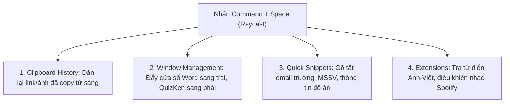

> **TL;DR (Tóm tắt nhanh):**  
> Dù tính năng tìm kiếm **Spotlight** mặc định trên macOS rất tiện lợi, nhưng đối với sinh viên và dân văn phòng cần xử lý khối lượng công việc lớn, Spotlight tỏ ra quá nghèo nàn về tính năng. **Raycast** là tiện ích mở rộng mã nguồn mở miễn phí vĩnh viễn giúp thay thế hoàn toàn Spotlight: Tích hợp sẵn **Bộ quản lý Clipboard** lưu trữ lịch sử copy không giới hạn, tính năng **Window Management** chia cửa sổ bằng phím tắt, công cụ **Snippets** gõ tắt mẫu email/bài tập và hàng ngàn tiện ích mở rộng kết nối trực tiếp với Notion, GitHub, ChatGPT. Kết hợp Raycast để mở nhanh [QuizKen](https://app.quizken.com), bạn sẽ tiết kiệm hàng giờ học tập mỗi ngày!

---

# Raycast vs Spotlight: Tiện Ích Miễn Phí Thay Đổi Cách Dùng Macbook Của Sinh Viên

Khi mới mua một chiếc MacBook (dù là MacBook Air chip M1 hay MacBook Pro chip M4 mới nhất), hầu hết mọi người đều quen nhấn tổ hợp phím **`Command + Space`** để gọi thanh tìm kiếm Spotlight.

Tuy nhiên, câu hỏi đặt ra là: *Tại sao cộng đồng người dùng Mac chuyên nghiệp trên khắp thế giới đang đồng loạt gỡ bỏ Spotlight để chuyển sang **Raycast**?*

Câu trả lời nằm ở khả năng biến thanh tìm kiếm đơn thuần thành một **"Trung tâm điều khiển năng suất tối thượng"**. Hãy cùng so sánh chi tiết và khám phá cách Raycast nâng tầm chiếc máy Mac của bạn.

---

## 1. Bảng So Sánh Toàn Diện: Raycast vs Spotlight Mặc Định

| Tiêu chí | Apple Spotlight (Mặc định) | Raycast (Bản miễn phí 100%) | Đánh giá |
| :--- | :--- | :--- | :---: |
| **Tìm kiếm app & file** | Tốt, tìm nhanh tệp tin trong máy. | Tìm file siêu tốc, mở app kết hợp lệnh tắt. | 🤝 **Ngang sức** |
| **Quản lý Clipboard (Khay nhớ tạm)** | ❌ **Không có** (Phải tải thêm app thứ 3 như Maccy hoặc Paste tốn tiền). | ✅ **Tích hợp sẵn:** Lưu lại lịch sử copy (văn bản, hình ảnh, link, mã code) không giới hạn thời gian. | 🏆 **Raycast áp đảo** |
| **Chia cửa sổ màn hình (Window Tiling)** | Khá rườm rà qua tính năng Split View của Mac. | ✅ **Phím tắt siêu mượt:** Thu phóng nửa trái, nửa phải, chia 3 ô, phóng to toàn màn hình. | 🏆 **Raycast áp đảo** |
| **Gõ tắt văn bản (Snippets)** | Có tính năng Text Replacement cơ bản trong Cài đặt hệ thống. | ✅ **Snippets thông minh:** Tự động chèn ngày tháng hiện tại, mẫu thư xin hoãn nộp bài, mẫu ghi chú. | 🏆 **Raycast thắng** |
| **Kho tiện ích mở rộng (Store Extensions)** | ❌ Hoàn toàn đóng kín, không hỗ trợ plugin. | ✅ **Kho ứng dụng khổng lồ:** Kết nối Notion, Spotify, Google Translate, GitHub, Speedtest. | 🏆 **Raycast áp đảo** |
| **Giao diện & Độ mượt mà** | Giao diện tối giản của Apple. | Thiết kế Dark/Light mode chuẩn gu tối giản sang trọng, siêu nhẹ không tốn pin. | 🏆 **Raycast thắng** |

---

## 2. Top 3 Tính Năng "Cứu Rỗi" Đời Sinh Viên Trên Raycast

### 1. Clipboard History – Không bao giờ sợ "Copy đè làm mất dữ liệu"
Nỗi ám ảnh lớn nhất của sinh viên khi làm bài tập lớn hay tiểu luận là vừa copy một đoạn văn bản dài 3 trang, lỡ tay copy một chữ khác là đoạn văn bản trước đó biến mất hoàn toàn.
* Trong Raycast: Bạn chỉ cần gõ `Clipboard History`, toàn bộ những gì bạn đã copy từ hôm qua, tuần trước (kể cả ảnh chụp màn hình hay bảng số liệu) đều được lưu trữ ngăn nắp kèm tính năng tìm kiếm từ khóa.

### 2. Window Management – Khỏi cần cài thêm Magnet hay Rectangle
Để chia màn hình làm bài kiểm tra:
* Bạn chỉ cần gõ lệnh `Left Half` (hoặc đặt phím tắt riêng), cửa sổ hiện tại sẽ nhảy ngay sang nửa bên trái.
* Gõ `Right Half`, cửa sổ trình duyệt mở [QuizKen](https://app.quizken.com) sẽ bám khít nửa bên phải. Màn hình chia đôi chuẩn từng pixel mà không cần đụng đến chuột.

### 3. Quicklink – Mở thẳng mọi tài liệu và website quan trọng
Bạn có thể tạo một phím tắt Quicklink trong Raycast:
* Chỉ cần gõ `qk` $\rightarrow$ Mở ngay trang tạo đề thi của QuizKen.
* Gõ `tkb` $\rightarrow$ Mở ngay trang Thời khóa biểu trên cổng thông tin sinh viên của trường đại học.

---

## 3. Cách Cài Đặt Raycast Đổi Phím Tắt Thay Thế Spotlight

1. Truy cập trang chủ: `raycast.com` và tải file cài đặt `.dmg` miễn phí về máy.
2. Kéo Raycast vào thư mục **Applications**.
3. Vào **System Settings (Cài đặt hệ thống) > Keyboard (Bàn phím) > Keyboard Shortcuts > Spotlight**: Bỏ chọn phím tắt `Command + Space` của Spotlight.
4. Mở Raycast và gán phím tắt `Command + Space` cho Raycast. Từ nay, mỗi lần nhấn phím cách quen thuộc, giao diện quyền năng của Raycast sẽ xuất hiện!

---

## 4. Tăng Tốc Học Tập Cùng Raycast và QuizKen

Hãy thử tưởng tượng: Trong lúc đọc giáo trình trên máy Mac, bạn copy các đoạn lý thuyết khó hiểu (được lưu tự động trong Raycast Clipboard), sau đó gọi nhanh link [https://app.quizken.com](https://app.quizken.com) để AI tự động chuyển hóa thành bộ đề thi trắc nghiệm giúp bạn kiểm tra trí nhớ.

Tối ưu hóa chiếc MacBook của bạn ngay hôm nay và trải nghiệm cách học tập của tương lai!
