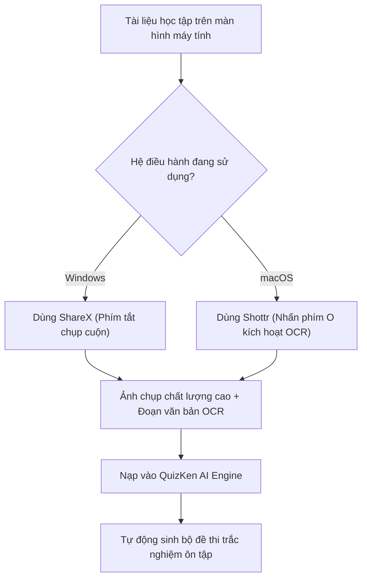

> **TL;DR (Tóm tắt nhanh):**  
> Các công cụ chụp màn hình mặc định như Snipping Tool (trên Windows) hay `Cmd + Shift + 4` (trên Mac) chỉ đáp ứng được các thao tác cắt ảnh cơ bản. Khi sinh viên cần chụp lại một trang web tài liệu dài 5 màn hình (Scrolling Capture), trích xuất văn bản từ ảnh bài giảng bị mờ hoặc che mờ thông tin cá nhân để nộp báo cáo, hai công cụ miễn phí đỉnh cao nhất hiện nay là: **ShareX (dành cho Windows)** và **Shottr (dành cho macOS)**. Cả hai đều hỗ trợ chụp cuộn mượt mà, nhận diện chữ OCR siêu tốc và tích hợp hoàn hảo với **QuizKen** để tạo đề thi từ ảnh chụp!

---

# ShareX & Shottr: Bộ Đôi Chụp Màn Hình & Trích Chữ OCR Miễn Phí Cho Win & Mac

Trong quá trình học tập trực tuyến, ôn thi hay nghiên cứu tài liệu trên internet, chụp ảnh màn hình là thao tác diễn ra hàng chục lần mỗi ngày.

Tuy nhiên, hầu hết người dùng đều gặp phải các tình huống dở khóc dở cười:
* Muốn chụp một bài viết nghiên cứu khoa học hoặc một đề thi thử dài dằng dặc thì phải chụp thành 10 tấm ảnh rời rạc rồi ghép lại thủ công.
* Muốn lấy nội dung chữ trong một bức ảnh sơ đồ tư duy trên slide của giảng viên nhưng không có cách nào copy được.
* Dùng các phần mềm chụp ảnh trả phí nặng nề khiến máy tính bị đơ lag.

Dưới đây là bộ đôi phần mềm chụp ảnh màn hình và trích xuất chữ OCR mã nguồn mở/miễn phí tốt nhất thế giới dành cho hai nền tảng Windows và macOS.

---

## 1. Bảng So Sánh ShareX (Windows) và Shottr (macOS)

| Tiêu chí | ShareX (Dành cho Windows) | Shottr (Dành cho macOS) |
| :--- | :--- | :--- |
| **Bản quyền & Giá cả** | Mã nguồn mở 100% miễn phí, không quảng cáo. | Bản miễn phí đầy đủ tính năng cốt lõi. |
| **Dung lượng & Hiệu năng** | Siêu nhẹ (~15MB), ngốn rất ít RAM. | Viết bằng ngôn ngữ Swift gốc của Apple, siêu mượt và nhẹ chỉ ~2MB. |
| **Chụp cuộn trang (Scrolling Capture)** | Tự động cuộn trang web, tài liệu PDF, đoạn chat dài thành 1 ảnh duy nhất. | Chụp cuộn siêu mượt, tự động ghép nối khớp từng pixel. |
| **Trích xuất ký tự OCR** | Tích hợp OCR nhận diện văn bản đa ngôn ngữ ngay trên ảnh chụp. | Bấm phím **`O`** trên bất kỳ vùng ảnh chụp nào để copy toàn bộ chữ vào Clipboard. |
| **Bảo vệ quyền riêng tư** | Làm mờ (Blur) hoặc Pixelate che thông tin nhạy cảm. | Công cụ Smart Erase xóa chữ/vật thể thừa trên ảnh như phép màu. |
| **Đo lường & Chú thích** | Thêm mũi tên, số thứ tự bước 1, 2, 3, thước đo pixel. | Thước đo khoảng cách giữa các phần tử cực chuẩn xác cho dân thiết kế/code. |

---

## 2. Điểm Nhấn: Chụp Cuộn Tài Liệu Dài & Trích Xuất OCR

### 1. Chụp cuộn trang (Scrolling Capture) – Gom trọn vẹn tài liệu vào 1 tấm ảnh
Thay vì phải lưu 10 tấm ảnh rời rạc vào thư mục:
* Với **ShareX** hoặc **Shottr**: Bạn chỉ cần kích hoạt chế độ Chụp cuộn, lăn con lăn chuột xuống cuối trang tài liệu.
* Thuật toán ghép ảnh thông minh sẽ tự động phân tích các điểm trùng lặp và xuất ra một tệp ảnh dài liền mạch, sắc nét từng câu chữ.

### 2. Trích xuất chữ tức thì (Instant OCR)
* Khi đang xem một buổi livestream ôn thi hoặc video bài giảng trên YouTube, giảng viên chiếu một câu hỏi trắc nghiệm hay:
* Bạn chỉ cần dùng Shottr hoặc ShareX quét qua câu hỏi, nhấn tính năng OCR $\rightarrow$ Toàn bộ chữ tiếng Việt sẽ được copy vào khay nhớ tạm trong vòng 0.5 giây!

---

## 3. Cách Tải Về Miễn Phí

* **Tải ShareX cho Windows:** Tải miễn phí trên trang chủ `getsharex.com`, Steam hoặc Microsoft Store.
* **Tải Shottr cho Mac:** Tải file `.dmg` từ trang chủ `shottr.cc` (Tương thích 100% với macOS Sonoma, Sequoia và các dòng chip Apple Silicon).

---

## 4. Tăng Tốc Ôn Tập Cùng QuizKen

Sau khi chụp cuộn được toàn bộ đề thi mẫu hoặc trích xuất được khối văn bản bài học bằng ShareX/Shottr:
1. Mở trình duyệt và truy cập: [https://app.quizken.com](https://app.quizken.com).
2. Dán đoạn chữ OCR hoặc tải file ảnh lên mục **Tạo Đề Thi Bằng AI**.
3. QuizKen sẽ tự động phân tách câu hỏi, kiểm tra tính đúng sai và tạo phòng thi trắc nghiệm để bạn thử sức ngay lập tức!

Trải nghiệm học tập thông minh ngay tại: [https://app.quizken.com](https://app.quizken.com).
