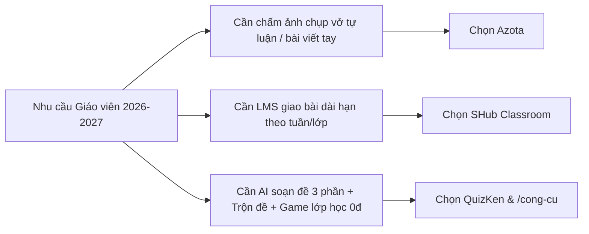

> **Tóm tắt nhanh (TL;DR):** Trong năm học 2026–2027 (đặc biệt sau khi Thông tư 29 và Thông tư 19/2026 siết chặt dạy thêm và đẩy mạnh học bạ số), **Azota**, **SHub Classroom** và **QuizKen** là 3 công cụ phổ biến giúp giáo viên Việt Nam số hóa bài tập và kiểm tra. **Azota** mạnh nhất về chấm phiếu/bài tự luận chụp ảnh; **SHub Classroom** nổi bật ở vai trò LMS quản lý lớp học và biểu đồ tiến độ; còn **QuizKen** vượt trội về **AI tạo đề 3 phần GDPT 2018 từ PDF/Word/Slide, đấu trường live gamification và bộ tiện ích lớp học 0đ** (trộn 4 mã đề, in phiếu tô A4, vòng quay gọi tên, QR lớp học).

---

# Azota vs SHub Classroom vs QuizKen (2026–2027): Đặt Lên Bàn Cân Cho Giáo Viên Việt Nam

Áp lực soạn đề thi theo định dạng mới (Phần I trắc nghiệm 4 lựa chọn, Phần II Đúng/Sai 4 ý, Phần III Trả lời ngắn), kèm yêu cầu giảm hồ sơ giấy khiến nhiều thầy cô băn khoăn không biết nên chọn **Azota**, **SHub Classroom** hay **QuizKen** làm "trợ thủ chính" cho lớp học của mình. Thực tế, mỗi nền tảng giải quyết tốt nhất một khâu khác nhau trong quy trình giảng dạy.

## 1. Bảng So Sánh Chi Tiết Azota, SHub Classroom và QuizKen

| Tiêu chí so sánh | Azota | SHub Classroom | QuizKen |
| :--- | :--- | :--- | :--- |
| **Thế mạnh cốt lõi** | Giao bài tập & **chấm bài tự luận/phiếu tô qua ảnh chụp** cực nhanh. | **Hệ thống LMS thu nhỏ:** quản lý lớp, lịch học Zoom, thống kê tiến độ tuần/tháng. | **AI tạo đề chuẩn GDPT 2018 từ PDF/Word + Đấu trường Live + Bộ tiện ích lớp học 0đ.** |
| **AI tự tạo câu hỏi từ giáo án/PDF** | Tập trung bóc tách file đề Word/PDF đã có sẵn định dạng câu hỏi. | Hỗ trợ giao bài và xuất đáp án/lời giải chi tiết theo ngân hàng lớp. | **Mạnh mẽ:** Tự sinh câu hỏi 3 phần từ giáo án, slide, PDF thô, giữ chuẩn công thức KaTeX. |
| **Trộn mã đề & In phiếu A4** | Có tính năng trộn đề trên hệ thống quản lý bài thi. | Hỗ trợ ngân hàng đề theo lớp học trực tuyến. | **Miễn phí không cần đăng nhập** ngay trên web: [Trộn 4 mã đề](/cong-cu/tron-de-trac-nghiem-online) & [In phiếu A4 2027](/cong-cu/tao-phieu-tra-loi-trac-nghiem-2027). |
| **Tương tác lớp học (Game / Chiếu bảng)** | Thiên về kiểm tra nghiêm túc (cảnh báo chuyển tab). | Thiên về quản lý lớp học và bài tập về nhà. | Có **Live Arena**, [Vòng quay gọi tên](/cong-cu/vong-quay-goi-ten-hoc-sinh), [Đồng hồ máy chiếu](/cong-cu/dong-ho-bam-gio-thi-thu-may-chieu), [Tạo mã QR](/cong-cu/tao-ma-qr-lop-hoc-mien-phi). |
| **Chi phí cho giáo viên** | Freemium (một số tính năng nâng cao cần gói trả phí). | Freemium (gói cơ bản miễn phí, mở rộng cho trung tâm/trường). | **Miễn phí công cụ web & kho đề cốt lõi** trên `quizken.com` và `app.quizken.com`. |

---

## 2. Đánh Giá Thực Tế Từng Nền Tảng Trong Bối Cảnh Lớp Học Việt Nam

### 1. Azota — "Vua chấm bài chụp ảnh" và kiểm tra nghiêm túc
Với hàng trăm nghìn giáo viên phổ thông, **Azota** đã quá quen thuộc ở thao tác up file Word đề thi lên để tạo phòng thi có giám sát chuyển tab, hoặc cho học sinh làm bài tự luận ra giấy rồi chụp ảnh nộp để thầy cô chấm điểm trực tiếp trên màn hình điện thoại/máy tính.
* **Khi nào nên chọn Azota:** Khi bạn dạy các môn cần chấm trình bày tự luận viết tay (Ngữ văn, Toán tự luận) hoặc cần thu bài tập về nhà qua ảnh chụp vở ghi.

### 2. SHub Classroom — Gọn gàng cho mô hình lớp học LMS
**SHub Classroom** hoạt động mượt mà như một lớp học trực tuyến: giáo viên tạo mã lớp, gắn lịch học qua Zoom/Meet, giao bài tập định kỳ kèm lời giải chi tiết và xem biểu đồ tiến độ học tập theo tuần/tháng của từng em.
* **Khi nào nên chọn SHub Classroom:** Khi bạn quản lý nhiều lớp học cố định trong cả học kỳ và cần nhắc lịch nộp bài tự động cho học sinh.

### 3. QuizKen — Tối ưu khâu AI Soạn Đề, In Ấn & Khuấy Động Lớp Học
Khác với Azota hay SHub vốn đòi hỏi nhiều bước thiết lập lớp học và tài khoản quản trị, **QuizKen** giải phóng trực tiếp khâu tốn thời gian nhất của giáo viên: **từ tài liệu thô (PDF sách giáo khoa, slide PowerPoint, file ghi chú) tạo ra ngay bộ đề trắc nghiệm 3 phần chuẩn GDPT 2018 có công thức Toán–Lý–Hóa sắc nét**.
* **Điểm cộng độc quyền trên web 0đ:** Thầy cô không cần cài app hay đăng nhập phức tạp vẫn dùng ngay được trọn bộ tiện ích dạy học ngay tại lớp như [Vòng quay gọi tên học sinh không trùng lặp](/cong-cu/vong-quay-goi-ten-hoc-sinh), [Đồng hồ bấm giờ thi thử toàn màn hình máy chiếu](/cong-cu/dong-ho-bam-gio-thi-thu-may-chieu), [Tạo mã QR đề thi không hết hạn](/cong-cu/tao-ma-qr-lop-hoc-mien-phi) và [Trộn đề 4 mã đề 101–104](/cong-cu/tron-de-trac-nghiem-online).

---

## 3. Gợi Ý Kết Hợp Tối Ưu Cho Thầy Cô Năm Học 2026–2027

Nhiều giáo viên giàu kinh nghiệm không chọn 1 bỏ 2 mà phối hợp rất thông minh:
* **Soạn đề & tạo câu hỏi mới:** Nạp giáo án lên [QuizKen Teacher Tools](/cong-cu/chuyen-de-word-docx-sang-trac-nghiem) để AI sinh nhanh bộ câu hỏi có sẵn đáp án và giải thích chi tiết (giảm 70% thời gian gõ đề).
* **Tổ chức ôn tập trên lớp:** Chiếu [Vòng quay gọi tên](/cong-cu/vong-quay-goi-ten-hoc-sinh) hoặc bật phòng thi Live Game QuizKen để tăng hứng thú tiết ôn tập cuối kỳ.
* **Kiểm tra giấy tại lớp:** Trộn nhanh 4 mã đề và in [Phiếu trả lời trắc nghiệm A4 2027](/cong-cu/tao-phieu-tra-loi-trac-nghiem-2027), sau đó nếu cần thu thêm bài tự luận chụp ảnh thì kết hợp Azota hoặc giao qua LMS lớp.

---

## Câu hỏi thường gặp (FAQ)

### 1. Giáo viên dạy Toán, Lý, Hóa có dùng QuizKen tạo đề chứa công thức LaTeX được không?
Có. QuizKen hỗ trợ đầy đủ hiển thị công thức toán học, hóa học chuẩn KaTeX trong cả giao diện làm bài online lẫn khi xuất đề in ra giấy.

### 2. Dùng bộ công cụ trộn đề và vòng quay gọi tên trên QuizKen có phải tạo tài khoản không?
Không. Toàn bộ các công cụ trong thư mục [Công cụ Giáo viên QuizKen](/cong-cu) chạy trực tiếp trên trình duyệt, miễn phí 100% và không bắt buộc đăng nhập.

### 3. Nền tảng nào tốt nhất cho việc chống gian lận khi thi online ở nhà?
Cả Azota và QuizKen đều có cơ chế trộn thứ tự câu hỏi/đáp án và cảnh báo thoát màn hình làm bài. Tuy nhiên, để đánh giá công bằng tuyệt đối cho bài kiểm tra lấy điểm hệ số cao, thầy cô vẫn nên kết hợp thi trực tiếp tại lớp bằng đề giấy đã trộn mã đề.

### 4. Học sinh muốn tự lấy đề của thầy cô về luyện lại nhiều lần thì làm thế nào?
Thầy cô có thể bật chế độ công khai hoặc chia sẻ link/mã QR đề thi trên [Kho đề cộng đồng QuizKen](/kho-de) để học sinh quét mã bằng điện thoại và tự làm lại bất kỳ lúc nào.
