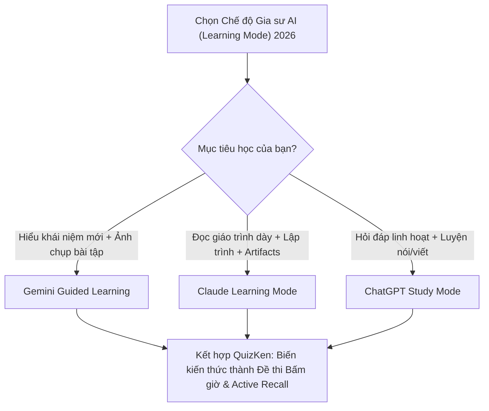

> **Tóm tắt nhanh (TL;DR):** Năm 2026 đánh dấu cuộc dịch chuyển lớn của các ông lớn AI: thay vì làm "máy giải bài tập hộ" khiến học sinh lười tư duy, cả **OpenAI (ChatGPT Study Mode)**, **Google (Gemini Guided Learning)** và **Anthropic (Claude Learning Mode / Claude for Education)** đều tung ra chế độ học tập chuyên biệt theo phương pháp **Socratic** — gợi mở từng bước, đặt câu hỏi kiểm tra mức độ hiểu bài và giải thích trực quan. Nếu **Gemini Guided Learning** nổi trội về tích hợp đa phương tiện/hình ảnh bài tập, **Claude Learning Mode** mạnh ở lập luận sâu và *Artifacts* tương tác, thì **ChatGPT Study Mode** lại cực kỳ linh hoạt cho hỏi đáp bài tập và luyện thi hằng ngày.

---

# So Sánh ChatGPT Study Mode vs Gemini Guided Learning vs Claude Learning Mode (2026)

Trước đây, giáo viên và phụ huynh thường lo ngại học sinh chụp ảnh bài tập gửi AI để chép nguyên lời giải. Để giải quyết triệt để bài toán sư phạm này, ba nền tảng AI hàng đầu thế giới đã đồng loạt chuẩn hóa **"Chế độ Học tập" (Learning Mode)** trong năm 2026. Nhưng đâu mới là trợ lý học tập phù hợp nhất với nhu cầu ôn thi của học sinh, sinh viên Việt Nam?

## 1. Bảng So Sánh Trực Diện 3 Gia Sư AI Hàng Đầu Cuối 2026

| Tiêu chí đánh giá | ChatGPT Study Mode (OpenAI) | Gemini Guided Learning (Google) | Claude Learning Mode (Anthropic) |
| :--- | :--- | :--- | :--- |
| **Triết lý sư phạm** | Dẫn dắt hội thoại từng bước bằng câu hỏi gợi mở (`step-by-step coaching`). | Chia nhỏ logic bài toán, cung cấp giải thích trực quan + `knowledge check` cuối bước. | Nhấn mạnh tư duy phản biện, hướng dẫn lập luận bài luận/code và bảo mật dữ liệu trường học. |
| **Xử lý ảnh chụp & PDF** | Tốt với ảnh chụp đề bài ngắn và đoạn trích văn bản. | **Xuất sắc:** Nhận diện mượt ảnh vở viết tay, sơ đồ hình học, kết nối sâu Google Drive/Workspace. | **Xuất sắc với tài liệu dài:** Đọc giáo trình/paper hàng trăm trang trong Projects rất chính xác. |
| **Tính năng tương tác nổi bật** | Hỏi đáp nhanh tự nhiên, linh hoạt chuyển đổi độ khó theo phản hồi người học. | Gợi ý các bước tiếp theo (*Next steps*) có cấu trúc rõ ràng, phù hợp học khái niệm mới từ đầu. | **Artifacts:** Tự dựng sơ đồ, quiz mini hoặc đoạn code chạy thử ngay ở khung bên cạnh. |
| **Phù hợp nhất cho ai?** | Học sinh THCS/THPT cần luyện hỏi đáp nhanh hằng ngày. | Người học trực quan, cần giải thích từng bước Toán–Lý–Hóa từ ảnh chụp/tài liệu Google. | Sinh viên đại học nghiên cứu tài liệu dày, viết khóa luận, học lập trình & khoa học dữ liệu. |
| **Hạn chế khi ôn thi VN** | Chưa tự động tạo phòng thi 3 phần chuẩn GDPT 2018 hay lưu lịch sử câu sai có chấm điểm. | Chưa có kho đề thi chuẩn ma trận V-ACT, HSA, THPT Việt Nam hay trộn mã đề. | Giới hạn tin nhắn ở bản miễn phí nhanh chạm trần khi hỏi liên tục nhiều bước. |

---

## 2. Phân Tích Chi Tiết Thế Mạnh & Điểm Yếu Từng Nền Tảng

### 1. ChatGPT Study Mode (OpenAI)
OpenAI thiết kế **Study Mode** với hệ thống chỉ dẫn chuyên biệt buộc mô hình đóng vai gia sư kiên nhẫn: khi bạn đưa một phương trình hoặc đoạn văn tiếng Anh, ChatGPT sẽ không ném ra đáp án cuối cùng mà hỏi ngược lại *"Theo bạn, bước biến đổi đầu tiên ở đây nên áp dụng hằng đẳng thức nào?"*.
* **Điểm cộng:** Phản hồi tiếng Việt rất tự nhiên, biết điều chỉnh giọng điệu khích lệ và dễ chuyển đổi giữa việc hỏi đáp bài tập với luyện hội thoại ngoại ngữ.
* **Điểm trừ:** Nếu người học thiếu kiên nhẫn và cố tình gõ "đưa đáp án luôn đi", chat tự do vẫn dễ bị trôi mạch so với một bài kiểm tra có cấu trúc rõ ràng.

### 2. Gemini Guided Learning (Google)
**Guided Learning** trong ứng dụng Gemini giải quyết rất tốt điểm yếu "trả lời một cục chữ dài ngoằng" của chatbot truyền thống. Mỗi lần giải thích xong một ý cốt lõi, Gemini chèn các thẻ kiểm tra nhanh và gợi ý bước tiếp theo để đảm bảo bạn thật sự hiểu trước khi đi tiếp.
* **Điểm cộng:** Đọc ảnh chụp đề Toán, Lý, Hóa viết tay tiếng Việt rất ổn định; đồng bộ thuận tiện với tài khoản Google cá nhân và sinh viên.
* **Điểm trừ:** Chưa có hệ thống chấm điểm chuẩn theo thang 10/30 hoặc lưu bảng thống kê lỗ hổng kiến thức xuyên suốt nhiều tuần ôn thi.

### 3. Claude Learning Mode & Claude for Education (Anthropic)
Anthropic đi xa hơn bằng bộ giải pháp **Claude for Education** (cho đại học) và **Claude for Teachers** (cho giáo viên phổ thông), với cam kết bảo mật không dùng dữ liệu hội thoại lớp học để huấn luyện mô hình. Trong **Learning Mode**, sinh viên có thể dùng tính năng **Artifacts** để yêu cầu Claude vẽ sơ đồ luồng thuật toán hoặc tạo thẻ ôn tập tương tác ngay bên cạnh khung chat.
* **Điểm cộng:** Văn phong tiếng Việt mạch lạc, không sáo rỗng, cực kỳ đáng tin cậy khi phân tích văn bản dài, logic lập trình hoặc tài liệu nghiên cứu khoa học.
* **Điểm trừ:** Bản miễn phí có giới hạn ngữ cảnh/số lượt chat khá chặt vào giờ cao điểm.

---

## 3. Công Thức Kết Hợp "Gia Sư AI + QuizKen" Để Tăng Tốc Điểm Số

Các chế độ Learning Mode của ChatGPT, Gemini hay Claude cực kỳ giỏi ở giai đoạn **hiểu bài (Comprehension)**, nhưng để đạt điểm cao trong phòng thi thật, bạn bắt buộc phải bước sang giai đoạn **kiểm tra áp lực thời gian (Timed Active Recall)**:

1. **Bước 1 (Hiểu sâu):** Dùng *Gemini Guided Learning* hoặc *Claude Learning Mode* để gỡ rối các khái niệm khó trong chương mới.
2. **Bước 2 (Kiểm chứng tốc độ & độ chính xác):** Đưa chính file PDF đề cương hoặc tài liệu học đó lên [QuizKen](https://app.quizken.com) để tạo bài thi thử có **đồng hồ đếm ngược**, **chấm điểm tự động**, **lọc câu làm sai** và đối chiếu khung ma trận chuẩn Việt Nam tại [Kho đề thi QuizKen](/de-thi).
3. **Bước 3 (Theo dõi chỉ số học tập):** Kết hợp [Đồng hồ Pomodoro học tập](/cong-cu/dong-ho-pomodoro-hoc-tap) và [Đếm từ bài luận IELTS/Ngữ văn](/cong-cu/dem-tu-bai-luan-ielts-ngu-van) để hoàn thiện kỹ năng phòng thi thực tế.

---

## Câu hỏi thường gặp (FAQ)

### 1. ChatGPT Study Mode và Gemini Guided Learning có mất phí không?
Cả hai chế độ này đều có thể trải nghiệm trên phiên bản miễn phí của ChatGPT và Gemini (với giới hạn lượt sử dụng nâng cao hoặc tệp đính kèm nhất định mỗi ngày theo chính sách từng hãng).

### 2. Dùng chế độ Learning Mode của AI có bị coi là gian lận học thuật không?
Không, nếu bạn dùng đúng mục đích để hiểu phương pháp giải, kiểm tra lại lập luận của bản thân và tự hoàn thành bài làm cuối cùng thay vì sao chép nguyên văn câu chữ do AI sinh ra.

### 3. Môn Toán–Lý–Hóa THPT Việt Nam nên chọn AI nào trong 3 nền tảng trên?
**Gemini Guided Learning** rất tiện khi bạn cần chụp ảnh nhanh bài tập trên giấy để AI gợi ý từng bước; còn khi cần tổng hợp cả đề cương hoặc luyện trắc nghiệm đúng chuẩn 3 phần GDPT 2018 (Đúng/Sai 4 ý, Trả lời ngắn), bạn nên kết hợp thêm **QuizKen**.

### 4. Giáo viên muốn dùng AI tạo đề thi in ra giấy hoặc giao bài cho cả lớp thì nên dùng công cụ nào?
ChatGPT/Gemini/Claude chỉ trả về văn bản chat; để trộn thành 4 mã đề chuẩn, xuất phiếu tô A4 hoặc giao bài thi online tự chấm, thầy cô nên dùng [Bộ công cụ Giáo viên QuizKen](/cong-cu/chuyen-de-word-docx-sang-trac-nghiem) và [Công cụ trộn đề online](/cong-cu/tron-de-trac-nghiem-online).
