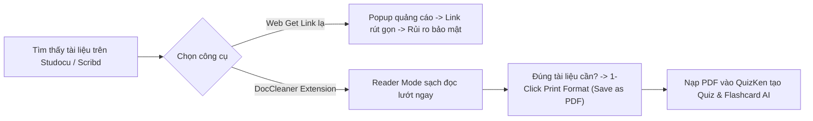

> **TL;DR (Tóm tắt nhanh):**  
> Khi đặt lên bàn cân **so sánh DocCleaner và web get link**, tiện ích **[DocCleaner trên Chrome Web Store](https://chromewebstore.google.com/detail/doccleaner-better-studocu/fnhdoegoihnkgggnaiemommemdejhbkb?hl=vi)** vượt trội hoàn toàn về độ an toàn (chạy 100% local, không tracking), không dính link rút gọn quảng cáo độc hại, bật Reader Mode đọc trực tiếp cực mượt và xuất PDF chuẩn với **1-Click Print Format** để nạp ngay vào **[QuizKen](https://app.quizken.com)**.

---

# So Sánh DocCleaner Extension Và Website Get Link Studocu / Scribd: Sinh Viên Nên Chọn Cách Nào?

Khi tìm thấy một tài liệu hữu ích trên Studocu hoặc Scribd, sinh viên thường đứng trước 2 lựa chọn phổ biến:
1. Copy đường link dán vào các **website get link trực tuyến** trôi nổi trên Google.
2. Cài tiện ích mở rộng **DocCleaner - Better Studocu & Scribd Reader** trực tiếp trên trình duyệt từ Chrome Web Store.

Thoạt nhìn cả hai đều hướng tới việc giúp bạn tiếp cận và lưu tài liệu học tập dễ dàng hơn. Tuy nhiên, xét về trải nghiệm thực tế, bảo mật máy tính và sự ổn định lâu dài trong mùa ôn thi, sự khác biệt giữa hai giải pháp là rất lớn.

---

## 1. Bảng So Sánh Chi Tiết: DocCleaner Extension vs. Web Get Link

| Tiêu chí đánh giá | DocCleaner (Chrome Web Store) | Website Get Link Trực Tuyến |
| :--- | :--- | :--- |
| **Cơ chế hoạt động** | Chạy **100% local** ngay trên trình duyệt | Gửi link qua máy chủ bên thứ 3 |
| **Độ an toàn & Bảo mật** | **Rất cao** (Không tracking, qua duyệt Store) | Thấp (Dễ dính pop-up ẩn, redirect lạ) |
| **Trải nghiệm đọc trực tiếp** | **Có Reader Mode**, dọn sạch banner & cookie | Không có (chỉ tải file về) |
| **Quảng cáo & Link rút gọn** | **0 quảng cáo**, 0 link vượt captcha | Phải vượt 2–3 lớp link rút gọn / quảng cáo |
| **Tốc độ xử lý** | **Tức thì (1-Click)** trên tab đang mở | Phải copy/paste link, chờ hàng đợi |
| **Độ ổn định** | Cao, tự cập nhật qua Chrome Web Store | Thường xuyên lỗi *"Server busy"* hoặc chết link |
| **Chất lượng in / PDF** | **Smart Page Formatter + 1-Click Print Format** | Phụ thuộc server, dễ lỗi font hoặc sót trang |
| **Chi phí** | **Miễn phí (Free) 100%** | Miễn phí kèm quảng cáo hoặc giới hạn lượt/ngày |

---

## 2. Những Rủi Ro Thường Gặp Khi Dùng Website Get Link Bên Thứ Ba

Nếu bạn từng thử tìm từ khóa get link tài liệu trên mạng, chắc chắn bạn không lạ gì cảnh tượng:

* **Ma trận nút Download giả:** Trang web hiển thị 4–5 nút *"Tải xuống ngay"* nhưng bấm vào lại mở ra tab cá độ, game bài hoặc trang yêu cầu cài phần mềm lạ.
* **Vượt link rút gọn tốn thời gian:** Chỉ để lấy một file slide dài 15 trang, bạn mất tới 2–3 phút tắt popup và giải captcha nhiều vòng.
* **Không đọc nhanh được ngay tại chỗ:** Bạn buộc phải tải file về máy mới biết tài liệu đó có đúng môn mình cần hay không, dẫn đến ổ cứng đầy rác toàn những file không dùng tới.

---

## 3. Tại Sao DocCleaner Là Lựa Chọn Tối Ưu Hơn Hẳn?

### Đọc kiểm tra nội dung ngay lập tức với Reader Mode
Với **DocCleaner - Better Studocu & Scribd Reader**, bạn mở link là đọc được ngay trong giao diện gọn sạch không banner, không popup cookie. Nếu thấy tài liệu không khớp giáo trình trường mình, bạn chỉ việc đóng tab, hoàn toàn không tốn thời gian tải rác về máy.

### An tâm tuyệt đối với mô hình xử lý cục bộ
Mọi thao tác làm sạch trang, pre-render qua **Smart Page Formatter** và chuẩn bị in ấn đều chạy nội bộ trên Chrome/Edge của bạn. Không có bên trung gian nào biết bạn đang đọc tài liệu gì.

### Xuất PDF nhanh khi thực sự cần lưu offline
Khi đã ưng ý nội dung tài liệu, chỉ cần bấm nút nổi **1-Click Print Format** để dùng hộp thoại `Save as PDF` của Chrome xuất file gọn đẹp mang đi in hoặc đọc trên máy tính bảng.

---

## 4. Bước Cuối Để Biến Tài Liệu Thành Điểm Số: Kết Hợp Với QuizKen

Dù bạn chọn công cụ đọc nào, mục tiêu cuối cùng vẫn là **hiểu bài và làm bài thi tốt**. Sau khi lọc và lưu được tài liệu chuẩn bằng DocCleaner, hãy đưa file PDF đó lên **[QuizKen](https://app.quizken.com)**:

* Tạo ngay đề kiểm tra trắc nghiệm AI từ chính nội dung đề cương vừa lưu.
* Tự động hóa thẻ Flashcard để ôn tập nhanh trên điện thoại mọi lúc mọi nơi.
* Hoàn toàn miễn phí để bắt đầu trải nghiệm cùng hàng nghìn sinh viên Việt Nam.

---

## 5. Câu Hỏi Thường Gặp (FAQ)

### 1. Dùng DocCleaner có cần copy link sang trang khác như web get link không?
Không. DocCleaner hoạt động trực tiếp trên tab Studocu hoặc Scribd bạn đang xem, không cần chuyển tab hay dán link sang website trung gian nào.

### 2. Nếu tôi dùng Edge hoặc Cốc Cốc thì có cài được DocCleaner thay cho web get link không?
Được. Bạn cài trực tiếp từ [Chrome Web Store](https://chromewebstore.google.com/detail/doccleaner-better-studocu/fnhdoegoihnkgggnaiemommemdejhbkb?hl=vi) trên cả Google Chrome, Microsoft Edge, Cốc Cốc và Brave.

### 3. DocCleaner có giới hạn số tài liệu đọc mỗi ngày như các trang get link không?
Không. Tiện ích chạy cục bộ trên máy bạn nên hoàn toàn free và không giới hạn số lượt sử dụng.

---

**Tổng kết:** Khi **so sánh DocCleaner và web get link**, DocCleaner rõ ràng là phương án văn minh, an toàn và tiết kiệm thời gian hơn hẳn cho sinh viên hiện đại. Hãy cài **[DocCleaner](https://chromewebstore.google.com/detail/doccleaner-better-studocu/fnhdoegoihnkgggnaiemommemdejhbkb?hl=vi)** và kết hợp cùng **[QuizKen](https://quizken.com)** cho kỳ thi sắp tới!
