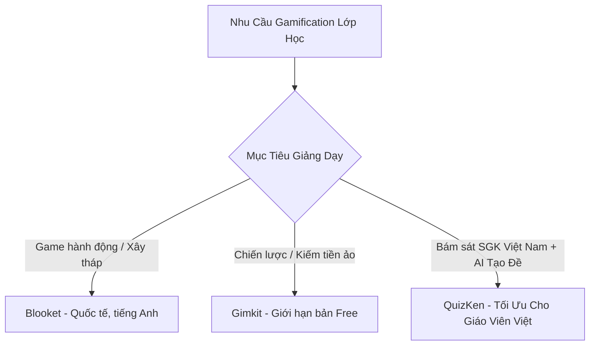

> **Tóm tắt nhanh (TL;DR):** Ứng dụng trò chơi hóa (Gamification) trong lớp học đang là xu hướng bùng nổ giúp xóa tan sự nhàm chán của các tiết ôn tập. Trong khi **Blooket** và **Gimkit** là hai nền tảng quốc tế nổi tiếng với các chế độ game nhập vai và chiến thuật, thì **QuizKen** lại khẳng định vị thế vượt trội tại thị trường Việt Nam nhờ khả năng tạo đề AI bám sát SGK chuẩn GDPT 2018, tốc độ đường truyền máy chủ trong nước siêu mượt và hoàn toàn không bị giới hạn số lượng học sinh miễn phí.

---

## 1. Bối Cảnh Gamification Lớp Học Năm 2026

Thế hệ học sinh Gen Z và Gen Alpha có khả năng tập trung ngắn và bị kích thích mạnh bởi các yếu tố tương tác, thi đua trực quan. Việc sử dụng các câu hỏi trắc nghiệm giấy truyền thống thường tạo ra áp lực nặng nề. Do đó, các nền tảng Gamification ra đời nhằm:

- Biến bài kiểm tra 15 phút thành một đấu trường kịch tính.
- Tăng tỉ lệ tham gia phát biểu bài lên tới 98%.
- Tự động hóa khâu thu thập điểm số và phân tích lỗ hổng kiến thức của học sinh.

---

## 2. Bảng So Sánh Chi Tiết: QuizKen vs Blooket vs Gimkit

Dưới đây là bảng tổng hợp các tiêu chí kỹ thuật và trải nghiệm giảng dạy thực tế:

| Tiêu chí | QuizKen | Blooket | Gimkit |
| :--- | :--- | :--- | :--- |
| **Giao diện ngôn ngữ** | 100% Tiếng Việt thân thiện | Tiếng Anh | Tiếng Anh |
| **Tạo đề bằng AI** | Tự động tạo từ văn bản/PDF theo SGK GDPT 2018 (3 giây) | Không có (Phải nhập tay hoặc tìm đề có sẵn) | Giới hạn tạo đề AI đơn giản |
| **Độ trễ & Tốc độ mạng** | Server Việt Nam cực nhanh, không lag giật | Server Mỹ, dễ nghẽn mạng giờ cao điểm | Server Mỹ, kết nối đôi khi chập chờn |
| **Dạng câu hỏi hỗ trợ** | 4 lựa chọn, Đúng/Sai 4 ý, Trả lời ngắn, Flashcard | 4 lựa chọn đơn thuần | 4 lựa chọn, gõ chữ ngắn |
| **Giới hạn bản Miễn phí** | Không giới hạn số người chơi trong lớp | Tối đa 60 người chơi | Tối đa 5 người chơi (Free rất hạn chế) |
| **Báo cáo & Phân tích điểm** | Phân tích chi tiết từng mức độ tư duy Bloom | Báo cáo cơ bản | Báo cáo cơ bản |
| **Xuất đề PDF in ấn** | Có (Trộn mã đề tự động) | Không hỗ trợ | Không hỗ trợ |

---

## 3. Đánh Giá Điểm Mạnh & Hạn Chế Của Từng Nền Tảng

### 1. Blooket – Thế giới game nhập vai cho học sinh nhỏ tuổi
- **Ưu điểm:** Hệ thống nhân vật "Blook" cực kỳ dễ thương, nhiều chế độ game cuốn hút như *Tower Defense*, *Gold Quest*, *Monster Brawl*.
- **Nhược điểm:** Học sinh dễ mải mê chơi game, hack tiền hoặc phá hoại trận đấu hơn là tập trung đọc kiến thức câu hỏi. Thư viện đề chủ yếu bằng tiếng Anh.

### 2. Gimkit – Đề cao tư duy chiến lược và quản lý tài nguyên
- **Ưu điểm:** Cơ chế trả lời đúng để kiếm tiền ảo và mua các gói nâng cấp sức mạnh (*Power-ups*), tạo động lực thi đua chiến thuật cao.
- **Nhược điểm:** Bản miễn phí chỉ cho phép tối đa 5 học sinh tham gia, buộc giáo viên phải mua gói Pro (khoảng $59.88/năm) nếu muốn dùng cho cả lớp.

### 3. QuizKen – Nền tảng toàn diện số 1 cho trường học Việt Nam
- **Ưu điểm:**
  - Tích hợp **AI Soạn Đề Tức Thì** từ tài liệu SGK mới, giúp giáo viên tiết kiệm 95% thời gian soạn câu hỏi.
  - Hỗ trợ đầy đủ các định dạng đề thi mới của Bộ Giáo dục (Đúng/Sai 4 ý, Trả lời ngắn).
  - Tốc độ kết nối ổn định tuyệt đối trên cả máy tính, máy tính bảng và điện thoại học sinh.
- **Nhược điểm:** Tập trung vào môi trường học đường và ôn thi chuẩn mực thay vì các mini-game hoạt hình quá nặng nề về giải trí.

---

## 4. Lời Khuyên Dành Cho Thầy Cô Giáo

- **Khởi động 5 phút đầu giờ giải trí nhẹ nhàng:** Thầy cô có thể đổi gió bằng một vòng chơi nhanh trên Blooket.
- **Kiểm tra 15 phút, ôn tập học kỳ, đánh giá năng lực thực chất:** **QuizKen** là sự lựa chọn tối ưu tuyệt đối nhờ khả năng quản lý lớp học, phân tích phổ điểm và tạo đề chuẩn Bộ GD&ĐT.

👉 **Trải nghiệm ngay:** Tạo phòng thi đấu trắc nghiệm trực tiếp cho lớp học của bạn với [Đấu Trường Multiplayer QuizKen](https://quizken.com) hoàn toàn miễn phí!

---

## 5. Câu Hỏi Thường Gặp (FAQ)

### Học sinh tham gia chơi QuizKen trên điện thoại có cần cài ứng dụng không?
Không cần cài đặt. Học sinh chỉ cần dùng trình duyệt web trên điện thoại hoặc máy tính, nhập mã PIN phòng chơi và bắt đầu thi đấu ngay lập tức.

### QuizKen có cho phép giáo viên chia sẻ đề thi cho đồng nghiệp không?
Có. QuizKen hỗ trợ tính năng chia sẻ liên kết đề thi công khai hoặc tạo đề nội bộ cho tổ bộ môn một cách thuận tiện.
