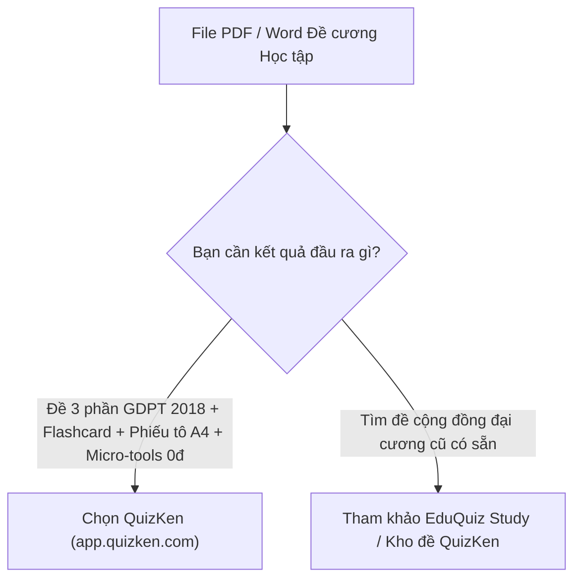

> **Tóm tắt nhanh (TL;DR):** Cả **QuizKen** và **EduQuiz (với trợ lý EduQuiz Agent)** đều là hai nền tảng EdTech nổi bật tại Việt Nam ứng dụng AI để biến file PDF, Word hay ảnh chụp tài liệu thành đề trắc nghiệm tương tác. **EduQuiz** có thế mạnh ở kho đề cộng đồng lớn lâu năm (đặc biệt các môn đại cương đại học) và quy trình tạo đề qua EduQuiz Agent; trong khi **QuizKen** bứt phá nhờ **hỗ trợ mượt định dạng 3 phần chuẩn GDPT 2018 (bao gồm Đúng/Sai 4 ý & Trả lời ngắn), công thức Toán–Lý–Hóa KaTeX, Flashcard Active Recall tích hợp và hệ sinh thái 30+ công cụ học tập miễn phí ngay trên landing page**.

---

# So Sánh QuizKen vs EduQuiz (2026): Đâu Là Công Cụ AI Tạo Đề Từ PDF Tối Ưu Nhất?

Nhu cầu lớn nhất của sinh viên trước kỳ thi cuối kỳ và giáo viên phổ thông khi soạn bài kiểm tra là: **"Có sẵn file PDF đề cương/giáo trình 50–100 trang, làm sao biến thành bài thi trắc nghiệm online trong vài chục giây mà không lỗi font công thức?"**. Năm 2026, cuộc đua giữa **QuizKen** và **EduQuiz** mang lại nhiều lựa chọn chất lượng cho người dùng Việt.

## 1. Bảng So Sánh QuizKen vs EduQuiz Theo 7 Tiêu Chí Thực Tế

| Tiêu chí so sánh | QuizKen | EduQuiz (EduQuiz Agent) |
| :--- | :--- | :--- |
| **Đầu vào tạo đề AI** | PDF, Word, văn bản thô, slide bài giảng → tự sinh câu hỏi mới hoặc bóc tách đề có sẵn. | PDF, Word, ảnh chụp đề thi giấy thông qua trợ lý **EduQuiz Agent**. |
| **Định dạng đề GDPT 2018 (3 phần)** | **Hỗ trợ trọn vẹn:** Nhiều lựa chọn + Đúng/Sai 4 ý + Trả lời ngắn. | Chủ yếu tối ưu trắc nghiệm nhiều lựa chọn truyền thống & phân mức độ Bloom. |
| **Hiển thị công thức Toán–Lý–Hóa** | Render **KaTeX/LaTeX** sắc nét, ít vỡ bố cục khi xuất đề. | Có nhận diện công thức khoa học tự nhiên từ tài liệu đầu vào. |
| **Chế độ học đi kèm** | **Phòng thi bấm giờ + Flashcard Spaced Repetition + Đấu trường Live + AI Tutor.** | **EduQuiz Study:** Chấm điểm, giải thích đáp án tức thì theo Active Recall. |
| **Kho đề miễn phí & Công cụ phụ trợ** | Có `/de-thi` (THPT, ĐGNL 2027, Lớp 10, Đại cương) + **30+ micro-tools 0đ** (trộn đề, in phiếu A4, tính GPA/TT22...). | Kho đề thi đại học, THPT, chứng chỉ phong phú do cộng đồng đóng góp. |
| **Xuất bản in ấn** | Xuất PDF bảng điểm/đề thi, [Phiếu trả lời A4 2027](/cong-cu/tao-phieu-tra-loi-trac-nghiem-2027), [Trộn 4 mã đề](/cong-cu/tron-de-trac-nghiem-online). | Xuất/chia sẻ bài thi trực tuyến và quản lý bộ đề trong thư viện cá nhân. |
| **Mô hình chi phí** | Trải nghiệm miễn phí rộng rãi cho học sinh, sinh viên và giáo viên. | Freemium (giới hạn lượt Agent hoặc tính năng nâng cao theo gói). |

---

## 2. Phân Tích Chuyên Sâu: Khi Nào Nên Dùng QuizKen, Khi Nào Dùng EduQuiz?

### Điểm mạnh của EduQuiz (EduQuiz Agent)
**EduQuiz** xây dựng được cộng đồng người dùng đông đảo tại Việt Nam, đặc biệt ở nhóm sinh viên ôn các môn đại cương và chứng chỉ nhờ kho đề chia sẻ lâu năm. Tính năng **EduQuiz Agent** giúp rút ngắn công đoạn nhập tay câu hỏi từ file PDF/ảnh chụp thành đề trắc nghiệm online kèm giải thích sau khi nộp bài.
* *Phù hợp với:* Sinh viên muốn tìm nhanh các bộ đề ôn thi cũ đã có người đăng sẵn hoặc làm bài tập trắc nghiệm 4 lựa chọn cơ bản.

### Điểm mạnh nổi bật của QuizKen
**QuizKen** được thiết kế xoay quanh triết lý **"All-in-One Active Recall & GDPT 2018"**, giải quyết những điểm nghẽn mà các nền tảng cũ thường bỏ sót:
1. **Chuẩn hóa hoàn toàn theo kỳ thi mới 2026–2027:** Học sinh cấp 3 và giáo viên cần luyện tập **câu hỏi Đúng/Sai 4 mệnh đề** và **Trả lời ngắn** — hai dạng câu hỏi dễ mất điểm nhất trong đề thi THPT, HSA, TSA hiện nay. QuizKen hỗ trợ AI sinh và chấm điểm chuẩn cả 3 dạng thức này.
2. **Không chỉ thi thử — còn có Flashcard & Phân tích lỗ hổng:** Sau khi làm xong một đề từ PDF, người học có thể ôn lại chính những khái niệm còn yếu bằng Flashcard lặp lại ngắt quãng ngay trong cùng một tài khoản trên [QuizKen App](https://app.quizken.com).
3. **Hệ sinh thái công cụ miễn phí bổ trợ toàn diện:** Chỉ trên `quizken.com`, người dùng có thể vừa luyện đề tại [Kho đề cộng đồng](/kho-de) và [Ngân hàng đề thi ĐGNL / Đại học](/de-thi), vừa sử dụng ngay [Công cụ tính điểm học phần tín chỉ](/cong-cu/tinh-diem-hoc-phan-tin-chi-can-dat), [Quy đổi điểm IELTS/ĐGNL](/cong-cu/quy-doi-diem-ielts-dgnl-2027) hay [Đồng hồ Pomodoro](/cong-cu/dong-ho-pomodoro-hoc-tap) mà không phải nhảy qua lại 5–6 trang web khác nhau.

---

## 3. Quy Trình 60 Giây Chuyển File PDF Thành Đề Ôn Thi Trên QuizKen

1. Truy cập [app.quizken.com](https://app.quizken.com) hoặc vào mục [Kho đề thi miễn phí](/kho-de) để tìm đề tương ứng.
2. Tải file PDF đề cương hoặc tài liệu bài giảng lên trình tạo đề AI.
3. Chọn số lượng câu hỏi, định dạng (4 lựa chọn / Đúng-Sai / Trả lời ngắn) và mức độ nhận thức.
4. Bấm **Tạo đề** → vào làm bài có đồng hồ đếm ngược ngay lập tức, hoặc chia sẻ mã QR qua [Công cụ tạo mã QR lớp học](/cong-cu/tao-ma-qr-lop-hoc-mien-phi) cho cả nhóm cùng thi đua.

---

## Câu hỏi thường gặp (FAQ)

### 1. QuizKen có hỗ trợ tạo đề từ file PDF giáo trình đại học bằng tiếng Anh không?
Có. AI của QuizKen đọc hiểu tốt cả tài liệu tiếng Việt lẫn giáo trình tiếng Anh chuyên ngành (kinh tế, CNTT, y khoa, IELTS/TOEIC) và có thể tạo câu hỏi kèm giải thích theo ngôn ngữ bạn chọn.

### 2. Nếu tôi chỉ muốn trộn sẵn một file đề trắc nghiệm đã có đáp án thì dùng ở đâu nhanh nhất?
Bạn không cần dùng đến AI hay đăng nhập: chỉ cần dán trực tiếp văn bản câu hỏi vào công cụ [Trộn đề trắc nghiệm online miễn phí](/cong-cu/tron-de-trac-nghiem-online) để nhận ngay 4 mã đề `101–104` kèm bảng đáp án.

### 3. Sinh viên ôn thi cuối kỳ đại học dùng QuizKen hay EduQuiz lợi hơn?
Bạn hoàn toàn có thể tìm đề tham khảo trên cả hai nền tảng, nhưng nếu bạn có file slide/PDF mới của giảng viên kỳ này và muốn AI tự tạo đề sát bài giảng kèm Flashcard ôn tập và [Công cụ tính điểm qua môn](/cong-cu/tinh-diem-hoc-phan-tin-chi-can-dat), **QuizKen** sẽ mang lại trải nghiệm liền mạch hơn.

### 4. Giáo viên có thể dùng QuizKen để in đề và phiếu tô đáp án phát tại lớp không?
Có. Thầy cô có thể xuất đề từ [QuizKen Teacher Tools](https://app.quizken.com/teacher/tools) và in mẫu phiếu tô chuẩn Bộ GD&ĐT tại [Tạo phiếu trả lời trắc nghiệm 2027](/cong-cu/tao-phieu-tra-loi-trac-nghiem-2027).
