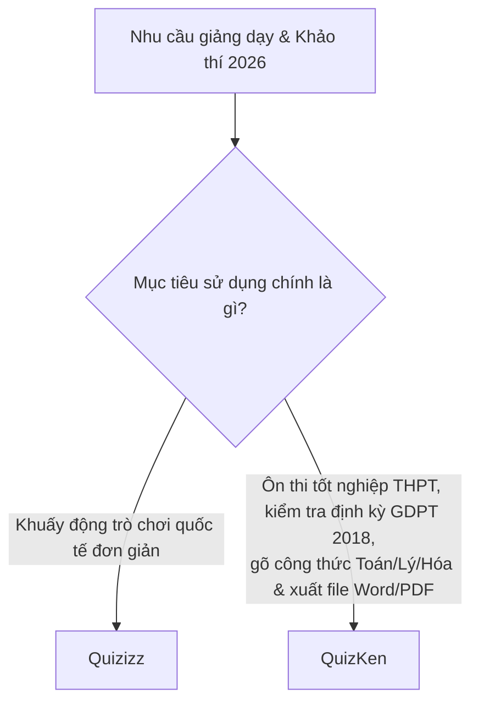

> **TL;DR (Tóm tắt nhanh):**  
> **Quizizz** từ lâu đã là công cụ trò chơi trắc nghiệm quen thuộc trong các trường học quốc tế nhờ tính năng game hóa sinh động. Tuy nhiên, trong bối cảnh giáo dục Việt Nam triển khai Chương trình GDPT 2018 với định dạng đề thi mới (Trắc nghiệm Đúng/Sai 4 ý, Trả lời ngắn, công thức KaTeX phức tạp) và chính sách thắt chặt tài khoản miễn phí của Quizizz (giới hạn số người tham gia, chi phí bản quyền bằng USD đắt đỏ), **QuizKen** đã vươn lên thành giải pháp thay thế số 1 được thiết kế "đo ni đóng giày" cho giáo viên và học sinh Việt Nam với khả năng tạo đề AI tiếng Việt không giới hạn!

---

# So Sánh QuizKen vs Quizizz: Nền Tảng Nào Tốt Hơn Cho Giáo Viên Việt Nam?

Giáo viên thời đại 4.0 luôn tìm kiếm những công cụ hỗ trợ giảng dạy tương tác nhằm khuấy động không khí lớp học, kích thích học sinh hứng thú học tập và giảm bớt gánh nặng chấm bài thủ công.

Hai cái tên nổi bật nhất trên thị trường hiện nay là **Quizizz** (nền tảng EdTech toàn cầu) và **QuizKen** (nền tảng công nghệ giáo dục AI thế hệ mới tại Việt Nam). Đâu là sự lựa chọn tối ưu nhất cho nhà trường và thầy cô giáo trong năm 2026? Hãy cùng phân tích chi tiết.

---

## 1. Bảng So Sánh Đối Đầu Trực Diện: QuizKen vs Quizizz

| Tiêu chí so sánh | Quizizz (Bản miễn phí / Có phí) | QuizKen (Nền tảng tối ưu cho Việt Nam) | Người chiến thắng |
| :--- | :--- | :--- | :---: |
| **Hỗ trợ định dạng đề thi GDPT 2018** | Chỉ hỗ trợ trắc nghiệm truyền thống và bình chọn đơn giản. Không có barem tính điểm lẻ 4 ý Đúng/Sai. | **Chuẩn 100% ma trận Bộ GD&ĐT:** Tự động tạo phần I (4 chọn 1), Phần II (Đúng/Sai 4 ý) và Phần III (Trả lời ngắn). | 🏆 **QuizKen** |
| **Hiển thị công thức Toán & Khoa học** | Khó gõ công thức LaTeX phức tạp, thường phải cắt ảnh dán vào làm mờ giao diện. | **Hỗ trợ KaTeX/LaTeX gốc:** Hiển thị sắc nét mọi công thức tích phân, ma trận, phương trình hóa học. | 🏆 **QuizKen** |
| **Công nghệ AI tạo đề từ tài liệu** | AI chủ yếu tối ưu cho tiếng Anh, tạo đề từ file PDF tiếng Việt hay bị lỗi font hoặc ngắt câu sai. | **AI Sư phạm Tiếng Việt chuyên sâu:** Nạp file Word, PDF sách giáo khoa, slide PowerPoint tạo đề trong 5 giây. | 🏆 **QuizKen** |
| **Chế độ trò chơi tương tác lớp học** | Rất đa dạng minigame (Classic, Team mode, Meme vui nhộn). | **Đấu trường Multiplayer thời gian thực:** Đua top bảng xếp hạng, âm thanh sôi động, không giật lag. | 🤝 **Hòa** |
| **Xuất bản đề thi in ấn (Word / PDF)** | Khó xuất bản tệp Word chuẩn căn lề để in giấy cho bài thi chính thức. | **Xuất file Word & PDF 1 click:** Có sẵn tiêu đề trường lớp, khung điểm, ma trận và lời giải chi tiết. | 🏆 **QuizKen** |
| **Chi phí bản quyền & Rào cản thanh toán** | Bản Pro đắt đỏ ($8 - $12/tháng), yêu cầu thẻ thanh toán quốc tế Visa/Mastercard. | **Gói miễn phí hào phóng:** Phù hợp với mọi giáo viên và học sinh Việt Nam. | 🏆 **QuizKen** |

---

## 2. Những Nâng Cấp Đắt Giá Của QuizKen Dành Riêng Cho Giáo Viên Việt Nam

### 1. Giải quyết trọn vẹn bài toán đổi mới format thi của Bộ GD&ĐT
Với Quizizz, nếu thầy cô muốn tạo một câu hỏi Đúng/Sai có 4 mệnh đề $a, b, c, d$ và chấm theo thang điểm $0.1 - 0.25 - 0.5 - 1.0$, hệ thống hoàn toàn không hỗ trợ và giáo viên phải chia nhỏ thành 4 câu rời rạc. Trong khi đó, **QuizKen xử lý mượt mà và tự động tính điểm chuẩn xác tuyệt đối**.

### 2. Không giới hạn số lượng học sinh trong phòng chơi
Rất nhiều thầy cô giáo phản ánh việc Quizizz liên tục bóp nghẹt tài khoản miễn phí (chỉ cho phép tối đa 20 - 50 học sinh tham gia phòng thi). Khi lớp học đông hoặc ghép khối, học sinh bị văng ra ngoài phòng chờ. QuizKen tối ưu hóa hạ tầng máy chủ nội địa, cho phép hàng trăm học sinh cùng lúc tham gia đấu trường kiến thức mượt mà.

### 3. Tự động hóa khâu soạn đề từ giáo án có sẵn
Thay vì mất cả buổi tối ngồi gõ từng câu hỏi vào form mẫu, thầy cô chỉ cần kéo thả tệp tài liệu bài giảng vào QuizKen. Trí tuệ nhân tạo sẽ tự động nhận biết đâu là câu hỏi, đâu là phương án đúng, phân loại độ khó và gắn nhãn theo thông tư của Bộ Giáo dục.

---

## 3. Kết Luận: Thầy Cô Nên Chọn Nền Tảng Nào?

* Hãy dùng **Quizizz** nếu bạn chỉ muốn tổ chức các trò chơi khởi động (Warm-up game) vui nhộn trong giờ học tiếng Anh với các câu hỏi ngắn đơn giản.
* Hãy chọn **QuizKen** nếu bạn cần một **hệ sinh thái khảo thí toàn diện**: Từ tạo đề thi chuẩn cấu trúc Bộ GD&ĐT, rèn luyện tư duy cho học sinh, tổ chức thi trực tuyến chống gian lận đến xuất file đề thi in trên lớp.

Đăng ký tài khoản giáo viên và trải nghiệm QuizKen hoàn toàn miễn phí tại: [https://app.quizken.com](https://app.quizken.com).
