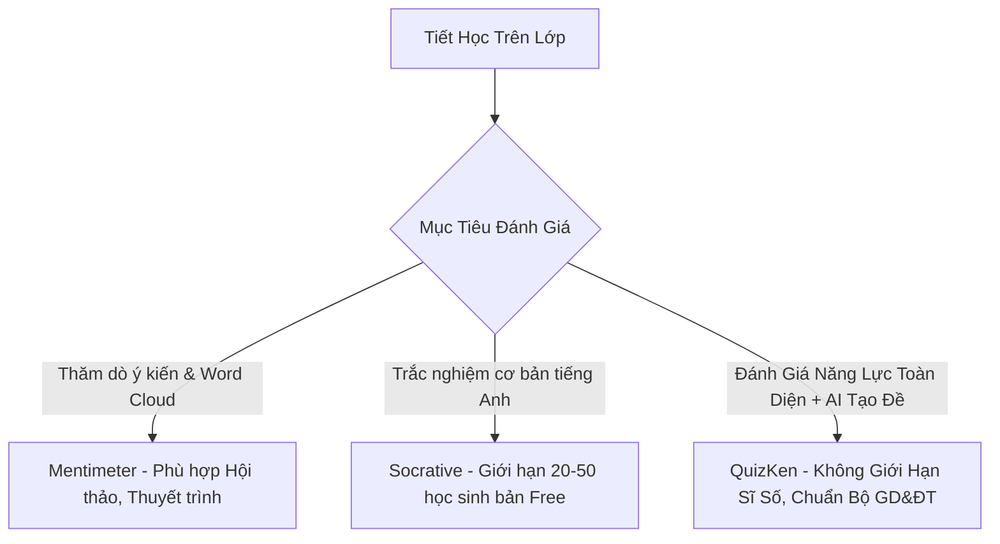

> **Tóm tắt nhanh (TL;DR):** Theo nghiên cứu kinh điển *"Inside the Black Box: Raising Standards Through Classroom Assessment"* của hai giáo sư **Paul Black & Dylan Wiliam (1998)**, việc thực hiện **đánh giá thường xuyên (Formative Assessment)** có tác động lớn nhất đến việc nâng cao thành tích học tập của học sinh. Bài viết này sẽ phân tích chi tiết ưu nhược điểm giữa 3 nền tảng hàng đầu: **Socrative** (chuyên đánh giá học thuật), **Mentimeter** (chuyên thuyết trình thăm dò ý kiến) và **QuizKen** (nền tảng EdTech toàn diện tích hợp AI soạn đề và hỗ trợ chuẩn GDPT Việt Nam).

---

## 1. Tầm Quan Trọng Của Đánh Giá Thường Xuyên (Formative Assessment)

Khác với đánh giá tổng kết (*Summative Assessment* - thi cuối kỳ lấy điểm số), đánh giá thường xuyên diễn ra **ngay trong từng tiết học**:
- Giúp giáo viên biết ngay học sinh có hiểu bài vừa giảng hay không trong 5 phút cuối giờ (*Exit Ticket*).
- Điều chỉnh tốc độ giảng dạy kịp thời thay vì đợi đến khi có kết quả bài thi học kỳ mới biết học sinh hổng kiến thức.

---

## 2. Bảng So Sánh Chi Tiết: QuizKen vs Socrative vs Mentimeter

| Tiêu chí so sánh | QuizKen | Socrative | Mentimeter |
| :--- | :--- | :--- | :--- |
| **Giao diện & Ngôn ngữ** | 100% Tiếng Việt thân thiện | Tiếng Anh (khá đơn giản) | Tiếng Anh (nhiều tính năng đồ họa) |
| **Trí tuệ nhân tạo (AI) soạn đề** | Tự động tạo đề từ Word/PDF trong 3 giây | Không có AI tạo đề | Có AI hỗ trợ tạo slide cơ bản |
| **Hỗ trợ định dạng đề Bộ GD&ĐT** | Đầy đủ: 4 lựa chọn, Đúng/Sai 4 ý, Trả lời ngắn | Chỉ có 4 lựa chọn, Đúng/Sai đơn, Trả lời ngắn | Bình chọn, Đám mây từ (*Word Cloud*), Thang đo |
| **Giới hạn số học sinh bản Free** | **Không giới hạn** (thoải mái cả lớp 45-50 em) | Tối đa 20 - 50 học sinh/phòng | Tối đa 50 người tham gia/tháng (bản Free rất hạn chế) |
| **Chế độ xuất đề PDF in ấn** | Có (Tự động trộn 4 mã đề) | Có tải PDF đơn giản | Không hỗ trợ |
| **Báo cáo phân tích sau giờ học** | Phân tích chi tiết mức độ Bloom, xuất file Excel | Xuất file kết quả cơ bản | Xuất biểu đồ đồ họa |
| **Chi phí bản nâng cao** | Miễn phí trọn đời tính năng cốt lõi | Từ $89.99/năm | Từ $11.99/tháng (~$143/năm) |

---

## 3. Phân Tích Chuyên Sâu Từng Nền Tảng

### 1. Socrative – Công cụ kiểm tra nhanh truyền thống
- **Ưu điểm:** Giao diện đơn giản, tính năng *Space Race* (đua tên lửa) vui nhộn giúp học sinh hào hứng làm việc nhóm.
- **Nhược điểm:** Bản miễn phí bị giới hạn sĩ số nghiêm ngặt, không có tính năng AI tạo câu hỏi từ giáo án, không hỗ trợ công thức toán học KaTeX chuyên sâu.

### 2. Mentimeter – "Ông hoàng" slide tương tác và thăm dò ý kiến
- **Ưu điểm:** Hiệu ứng hiển thị trực quan tuyệt đẹp, đặc biệt là tính năng đám mây từ khóa (*Word Cloud*) và biểu đồ bình chọn trực tiếp (*Live Polling*). Rất thích hợp cho các buổi hội thảo hoặc giờ sinh hoạt lớp.
- **Nhược điểm:** Không được thiết kế cho mục đích kiểm tra chấm điểm học thuật phân hóa. Bản miễn phí bị giới hạn nghiêm ngặt số lượng slide câu hỏi trên mỗi bài thuyết trình.

### 3. QuizKen – Nền tảng đánh giá học thuật toàn diện cho trường học Việt
- **Ưu điểm:**
  - Tiết kiệm 95% thời gian soạn bài nhờ công nghệ AI bám sát chương trình sách giáo khoa mới.
  - Vận hành mượt mà trên máy chủ tốc độ cao trong nước, không bị ảnh hưởng khi đứt cáp quang quốc tế.
  - Phù hợp hoàn hảo cho cả kiểm tra 15 phút, phiếu khảo sát đầu giờ (*Warm-up*), phiếu xuất cảnh cuối giờ (*Exit Ticket*) và thi thử trực tuyến.

---

## 4. Lời Khuyên Lựa Chọn Dành Cho Giáo Viên

- Nếu thầy cô muốn **lấy ý kiến nhanh, tạo đám mây từ ngữ** trong tiết Hoạt động trải nghiệm: Hãy chọn **Mentimeter**.
- Nếu thầy cô muốn **tổ chức kiểm tra định kỳ, ôn tập học kỳ, đánh giá đúng năng lực phân hóa theo chuẩn Bộ**: **QuizKen** là sự lựa chọn số 1 vượt trội.

👉 **Khởi tạo lớp học tương tác:** Trải nghiệm giải pháp kiểm tra trực tuyến toàn diện cùng [QuizKen Classroom](https://quizken.com) hoàn toàn miễn phí!

---

## 5. Câu Hỏi Thường Gặp (FAQ)

### Học sinh có cần tạo tài khoản để tham gia làm bài trên QuizKen không?
Không cần tài khoản. Giáo viên chỉ cần gửi mã phòng hoặc link bài thi, học sinh chỉ cần nhập họ tên là có thể tham gia trả lời ngay.

### QuizKen có dùng được trên máy chiếu của lớp học không?
Rất thuận tiện. Giao diện QuizKen hỗ trợ chế độ hiển thị toàn màn hình (*Fullscreen Projector Mode*) với bảng xếp hạng điểm số trực tiếp tạo không khí sôi nổi cho lớp học.
