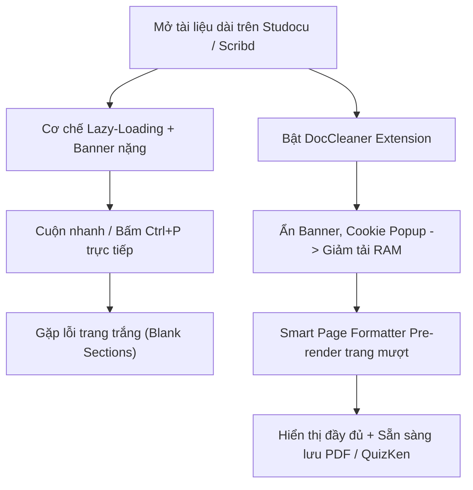

> **TL;DR (Tóm tắt nhanh):**  
> Tình trạng **lỗi trang trắng Studocu** khi cuộn nhanh hoặc lúc bấm in PDF xảy ra do cơ chế *lazy-loading* (chỉ tải trang khi nhìn thấy) và quá nhiều lớp giao diện nặng. Sử dụng **Smart Page Formatter** trong tiện ích miễn phí (free) **DocCleaner** giúp pre-render mượt mà từng trang tài liệu, loại bỏ banner gây lag và chuẩn bị bản in đầy đủ trước khi đưa vào **[QuizKen](https://app.quizken.com)** ôn tập.

---

# Cách Sửa Lỗi Trang Trắng Studocu Khi Cuộn Nhanh Hoặc Lưu Tài Liệu

Đang ôn thi gấp rút với một bộ đề cương dài 60–80 trang trên `studocu.com` hoặc `studocu.vn`, nhưng cứ kéo thanh cuộn xuống giữa tài liệu là gặp ngay **khoảng trắng trống trơn**? Hoặc tệ hơn, khi bạn bấm `Ctrl + P` để lưu tài liệu đọc offline, từ trang thứ 10 trở đi toàn bộ đều biến thành giấy trắng?

Đó là lỗi hiển thị kinh điển mà hầu hết sinh viên đều từng gặp. Trong bài viết này, đội ngũ **QuizKen** sẽ phân tích nguyên nhân kỹ thuật và hướng dẫn cách **sửa lỗi trang trắng Studocu** nhanh chóng với **DocCleaner - Better Studocu & Scribd Reader**.

---

## 1. Vì Sao Tài Liệu Studocu Hay Bị Trang Trắng Và Giật Lag?

Hiện tượng trang trắng không phải do mạng yếu hoàn toàn, mà bắt nguồn từ 3 cơ chế tối ưu phía trình duyệt và website:

1. **Cơ chế Lazy-Loading (Tải chậm theo tầm nhìn):** Để giảm tải ban đầu, trình duyệt chỉ dựng hình ảnh và chữ cho vài trang nằm đúng trong khung màn hình hiện tại. Các trang ở xa hơn chỉ là khung giữ chỗ rỗng.
2. **Tái sử dụng bộ nhớ DOM (Virtualization):** Khi bạn kéo xuống quá sâu, một số trang ở phía trên hoặc phía dưới chưa kịp giải mã sẽ bị hiển thị dưới dạng ô trắng trong vài giây.
3. **Quá tải thành phần giao diện phụ:** Các banner quảng cáo nổi, script theo dõi và hộp thoại cookie chạy đồng thời khiến trình duyệt tốn RAM để vẽ lại (repaint) liên tục, dẫn đến giật lag trên laptop văn phòng.

---

## 2. Smart Page Formatter Của DocCleaner Giải Quyết Vấn Đề Thế Nào?

Thay vì để bạn phải tải lại trang liên tục hay đợi từng trang nhích lên một cách mệt mỏi, **[DocCleaner trên Chrome Web Store](https://chromewebstore.google.com/detail/doccleaner-better-studocu/fnhdoegoihnkgggnaiemommemdejhbkb?hl=vi)** xử lý song song cả phần nền lẫn bố cục:

### Nạp trước trang mượt mà (Smooth Pre-rendering)
Tính năng **Smart Page Formatter** hỗ trợ chuẩn bị và căn chỉnh các trang tài liệu theo luồng đọc liền mạch. Nhờ vậy, khi bạn cuộn lên xuống để so sánh câu hỏi ở trang 5 với đáp án ở trang 40, nội dung vẫn hiển thị rõ ràng, hạn chế tối đa tình trạng hụt trang.

### Dọn sạch Clutter để giải phóng trình duyệt
DocCleaner tự động ẩn bỏ các thành phần giao diện dư thừa như thanh quảng cáo nổi, overlay che màn hình và popup cookie. Khi DOM của trang web nhẹ hơn đáng kể, tốc độ cuộn trang trên Chrome hay Edge mượt hơn thấy rõ.

### Chuẩn hóa đồng bộ trước khi xuất PDF
Nếu bạn cần xuất tài liệu ra file PDF, tuyệt đối không nên bấm `Ctrl + P` ngay khi vừa mở link. Hãy dùng nút nổi **1-Click Print Format** của DocCleaner: công cụ sẽ định dạng lại toàn bộ trang theo cấu trúc in ấn gọn gàng rồi mới gọi hộp thoại **Save as PDF** của Chrome.

---

## 3. Bảng So Sánh Cách Xử Lý Lỗi Trang Trắng Trên Studocu

| Cách khắc phục | Độ hiệu quả | Tốn công sức | Hạn chế lỗi trang trắng khi lưu PDF |
| :--- | :--- | :--- | :--- |
| Tự cuộn tay từ từ từng trang một | Trung bình | Rất mất thời gian với file >50 trang | Dễ sót trang nếu kéo nhanh |
| Nhấn F5 tải lại nhiều lần | Thấp | Phải làm lại từ đầu | Vẫn trắng khi bấm in trực tiếp |
| **Dùng DocCleaner (Smart Page Formatter)** | **Rất cao** | **Tự động hoàn toàn (Free)** | **Tối ưu pre-render + 1-Click Print Format** |

---

## 4. Mẹo 3 Bước Để Không Bao Giờ Gặp Trang Trắng Khi Học Online

1. **Cài sẵn DocCleaner:** Thêm tiện ích miễn phí tại [Chrome Web Store](https://chromewebstore.google.com/detail/doccleaner-better-studocu/fnhdoegoihnkgggnaiemommemdejhbkb?hl=vi) để bộ lọc chạy tự động mỗi lần bạn tra cứu Studocu hoặc Scribd.
2. **Đợi 3–5 giây cho tài liệu dài:** Với các file giáo trình dung lượng lớn, hãy cho Smart Page Formatter vài giây để ổn định bố cục trang trước khi cuộn nhanh hoặc bấm nút **Print Format**.
3. **Đưa PDF đã lưu vào QuizKen:** Sau khi lưu được file PDF đầy đủ không thiếu trang nào, hãy tải lên **[QuizKen](https://app.quizken.com)** để AI tóm tắt kiến thức trọng tâm và tạo bộ trắc nghiệm luyện tập ngay trên điện thoại hoặc laptop.

---

## 5. Câu Hỏi Thường Gặp (FAQ)

### 1. Tại sao tôi bấm Print Format ngay lập tức mà trang cuối vẫn hơi chậm hiển thị?
Với tài liệu dài trên 80–100 trang, trình duyệt cần vài giây để tải đủ dữ liệu từng trang. Bạn hãy cuộn lướt qua phần cuối hoặc đợi thanh tải trang hoàn tất rồi mới bấm nút **1-Click Print Format** để đảm bảo 100% trang đã được render.

### 2. DocCleaner có giúp giảm giật lag trên máy tính RAM 8GB không?
Có. Việc loại bỏ banner động, popup và overlay trên Studocu/Scribd giúp giảm tải bộ nhớ cho tab trình duyệt, rất hữu ích khi bạn phải mở nhiều tab tài liệu cùng lúc.

### 3. Tính năng Smart Page Formatter có áp dụng cho Scribd không?
Có. DocCleaner áp dụng đồng bộ các tối ưu hóa hiển thị và căn trang cho cả hệ thống Studocu (`studocu.com`, `studocu.vn`) và Scribd.

---

**Kết luận:** Đừng để **lỗi trang trắng Studocu** làm gián đoạn nhịp ôn thi của bạn. Cài đặt ngay **[DocCleaner](https://chromewebstore.google.com/detail/doccleaner-better-studocu/fnhdoegoihnkgggnaiemommemdejhbkb?hl=vi)** để đọc tài liệu mượt mà và dùng **[QuizKen](https://app.quizken.com)** biến mọi đề cương thành bài luyện thi hiệu quả!
