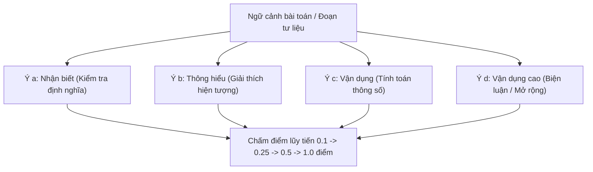

> **Tóm tắt nhanh (TL;DR):** Kể từ khi Chương trình Giáo dục phổ thông 2018 (GDPT 2018) được áp dụng toàn diện vào các kỳ thi định kỳ và thi tốt nghiệp THPT, câu hỏi **trắc nghiệm dạng Đúng/Sai 4 ý (Phần II)** trở thành thách thức lớn nhất trong khâu biên soạn đề của thầy cô. Bài viết này chia sẻ giải pháp sử dụng phần mềm **AI tạo đề thi miễn phí (free tool)** giúp giáo viên thiết lập ngân hàng câu hỏi Đúng/Sai chuẩn ma trận chỉ trong vài cú nhấp chuột.

---

## 1. Nỗi Trăn Trở Của Giáo Viên Khi Soạn Câu Hỏi Đúng/Sai 4 Ý

Dạng câu hỏi trắc nghiệm Đúng/Sai mới của Bộ GD&ĐT quy định: mỗi câu hỏi bao gồm một ngữ cảnh chung (đoạn thông tin, bảng số liệu, đồ thị hoặc bài toán) kèm theo 4 mệnh đề nhỏ **a, b, c, d**.

Thách thức lớn nhất nằm ở **quy tắc tính điểm lũy tiến**:
* Thí sinh chỉ chọn chính xác **01 ý** trong 1 câu: được **0,1 điểm**.
* Thí sinh chọn chính xác **02 ý** trong 1 câu: được **0,25 điểm**.
* Thí sinh chọn chính xác **03 ý** trong 1 câu: được **0,5 điểm**.
* Thí sinh chọn chính xác cả **04 ý** trong 1 câu: được **1,0 điểm** trọn vẹn.

Để tạo ra một câu hỏi chuẩn, giáo viên phải đảm bảo 4 mệnh đề con phân bổ hợp lý từ mức độ *Nhận biết* đến *Vận dụng cao*, không được quá dễ gây lộ đáp án và không được mơ hồ gây tranh cãi học thuật. Việc soạn tay thủ công có thể tốn từ 20 đến 30 phút cho một câu hỏi duy nhất.

---

## 2. Vì Sao Giáo Viên Nên Ứng Dụng Phần Mềm AI Miễn Phí (Free) Vào Khâu Soạn Đề?

Việc ứng dụng Trí tuệ Nhân tạo vào giáo dục không chỉ nhằm tối ưu thời gian mà còn đáp ứng định hướng chuyển đổi số theo **Nghị quyết 71-NQ/TW** của Bộ Chính trị:

| Phương pháp truyền thống | Phương pháp sử dụng AI QuizKen (Free) |
| :--- | :--- |
| Mất 3–4 tiếng để soạn một đề kiểm tra 45 phút hoàn chỉnh | Hoàn thành đề thi chuẩn ma trận chỉ sau **60 giây** |
| Dễ xảy ra lỗi sai ngữ pháp, số liệu hoặc lặp ý giữa các câu hỏi | AI kiểm tra chéo ngữ nghĩa, đảm bảo 4 ý độc lập logic |
| Khó khăn trong việc đảo đề, xáo trộn thứ tự các ý | Tự động sinh ra 4–8 mã đề xáo trộn hoàn hảo kèm đáp án |
| Chi phí mua tài khoản phần mềm nước ngoài đắt đỏ | Được cấp lượt tạo đề **miễn phí (free)** hàng ngày cho giáo viên |

---

## 3. Quy Trình 3 Bước Tạo Đề Đúng/Sai 4 Ý Cùng QuizKen AI

### Bước 1: Chuẩn bị nội dung bài học
Thầy cô chỉ cần tải lên file Word giáo án, bài đọc môn Ngữ văn/Lịch sử/Địa lý, hoặc file tài liệu chuyên đề Khoa học Tự nhiên có sẵn.

### Bước 2: Chọn định dạng "Trắc nghiệm Đúng/Sai 4 ý (GDPT 2018)"
Trên giao diện QuizKen, chọn chế độ tạo đề theo chuẩn cấu trúc Bộ GD&ĐT 2026. Chọn cấp độ lớp học (từ Lớp 10 đến Lớp 12) và môn học tương ứng.

### Bước 3: AI xử lý và xuất đề
Chỉ sau khoảng 30 giây, QuizKen AI sẽ phân tích văn bản nguồn và tạo ra các câu hỏi với cấu trúc:
* Đoạn trích tư liệu chính xác.
* 4 ý mệnh đề $a, b, c, d$ kèm giải thích chi tiết tại sao ý đó Đúng hoặc Sai.
* Thầy cô có thể chỉnh sửa trực tiếp nội dung trên web, sau đó xuất ra file **Word (.docx)** hoặc **PDF** để in phát cho học sinh làm trên lớp.

👉 **Dành cho thầy cô:** [Trải nghiệm công cụ tạo đề thi AI free trên QuizKen ngay hôm nay](https://quizken.com) để tiết kiệm hàng chục giờ soạn giáo án mỗi tuần!

---

## 4. Những Lưu Ý Quan Trọng Về Mặt Liêm Chính Học Thuật

1. **Giáo viên giữ quyền quyết định cuối cùng:** Theo Thông tư 49/2026/TT-BGDĐT, AI chỉ đóng vai trò trợ lý hỗ trợ. Thầy cô cần đọc duyệt lại các câu hỏi trước khi đưa vào bài kiểm tra chính thức để bảo đảm phù hợp với năng lực học sinh lớp mình.
2. **Kiểm tra công thức và số liệu thực tiễn:** Đối với các môn Toán học hay Hóa học, hãy kiểm tra lại các phép tính phức tạp để đảm bảo đáp án chính xác 100%.

---

## Câu hỏi thường gặp (FAQ)

### 1. Phần mềm tạo đề QuizKen có hỗ trợ môn Khoa học Tự nhiên có công thức không?
Có. QuizKen AI được tối ưu hóa hiển thị công thức toán học và ký hiệu hóa học chuẩn định dạng KaTeX/LaTeX, không bị lỗi font khi xuất file Word.

### 2. Giáo viên có phải trả tiền để tạo đề thi Đúng/Sai trên QuizKen không?
Không. QuizKen cung cấp tính năng tạo đề **AI miễn phí (free)** cho các thầy cô phục vụ giảng dạy, với hạn mức tạo câu hỏi mới mỗi ngày.

### 3. Đề thi tạo ra có thể chia sẻ cho học sinh làm trực tuyến trên điện thoại không?
Hoàn toàn được. Thầy cô có thể tạo phòng kiểm tra online để học sinh tham gia bằng mã PIN trên điện thoại hoặc máy tính mà không cần cài đặt phần mềm.
