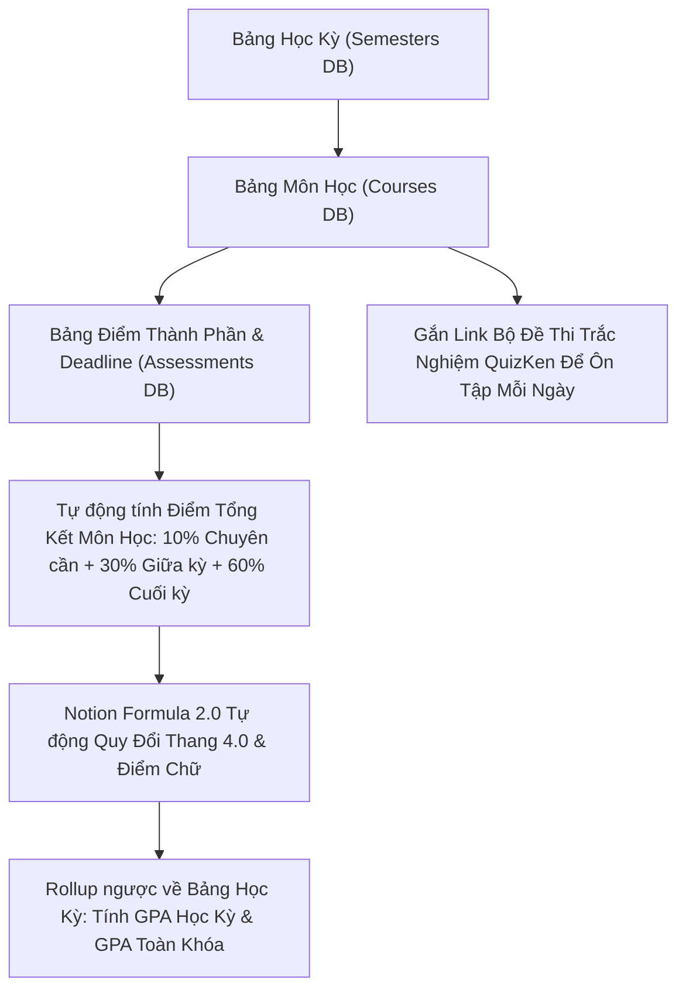

> **TL;DR (Tóm tắt nhanh):**  
> Việc sở hữu một **template Notion quản lý tín chỉ GPA miễn phí** được thiết lập sẵn công thức Formula 2.0 giúp sinh viên tự động tính điểm trung bình tích lũy (GPA hệ 4 và hệ 10), theo dõi số tín chỉ tích lũy, quản lý hạn nộp bài tập lớn (Deadline) và cảnh báo học vụ kịp thời. Bằng cách tích hợp đường link các bộ đề ôn luyện của **QuizKen** trực tiếp vào từng học phần trên Notion, bạn sẽ xây dựng được quy trình học tập khoa học theo phương pháp lặp lại ngắt quãng (Spaced Repetition) để tự tin tốt nghiệp loại Giỏi hoặc Xuất sắc!

---

# Tải Template Notion Quản Lý Tín Chỉ & Tính Điểm GPA Đại Học Miễn Phí 2026

Khi bước chân vào giảng đường đại học, rất nhiều sinh viên năm nhất và năm hai bị "ngợp" trước cơ chế đào tạo tín chỉ:
* Không nắm rõ cách tính điểm trung bình tích lũy GPA: Điểm hệ chữ (A, B, C, D, F) quy đổi sang thang điểm 4.0 và thang điểm 10.0 như thế nào.
* Bị "quên" deadline tiểu luận, bài tập nhóm hoặc lịch thi giữa kỳ do lịch học rải rác ở nhiều phòng học khác nhau.
* Không theo dõi được số tín chỉ tích lũy còn thiếu để kịp xét tốt nghiệp đúng hạn, dẫn đến việc phải học hè hoặc trễ hạn ra trường.

Thay vì ghi chép rời rạc vào sổ tay hay dùng bảng tính Excel khô khan, **Notion** chính là không gian làm việc số All-in-One được sinh viên toàn cầu yêu thích nhất. Bài viết này sẽ hướng dẫn bạn cách thiết lập và chia sẻ **template Notion quản lý tín chỉ GPA miễn phí** tối ưu nhất năm 2026!

---

## 1. Cấu Trúc Database Của Template Notion Quản Lý Tín Chỉ Chuẩn

Một template học tập chuyên nghiệp cần có sự liên kết dữ liệu quan hệ (Relation & Rollup) giữa 3 bảng dữ liệu cốt lõi:

### Các thuộc tính quan trọng trong Bảng Môn Học:
* **Tên môn học:** (Ví dụ: *Triết học Mác - Lênin*, *Toán cao cấp A1*, *Kinh tế lượng*).
* **Số tín chỉ:** (2, 3 hoặc 4 tín chỉ).
* **Điểm thành phần:** Điểm chuyên cần (10%), Điểm bài tập/giữa kỳ (30%), Điểm thi kết thúc học phần (60%).
* **Công thức tính điểm tổng kết (10.0):** `round((prop("Chuyên cần") * 0.1 + prop("Giữa kỳ") * 0.3 + prop("Cuối kỳ") * 0.6) * 100) / 100`.
* **Công thức quy đổi điểm hệ 4 (Formula 2.0):**
  * Từ 8.5 - 10: Điểm A (4.0)
  * Từ 8.0 - 8.4: Điểm B+ (3.5)
  * Từ 7.0 - 7.9: Điểm B (3.0)
  * Từ 6.5 - 6.9: Điểm C+ (2.5)
  * Từ 5.5 - 6.4: Điểm C (2.0)
  * Từ 4.0 - 5.4: Điểm D (1.0)
  * Dưới 4.0: Điểm F (0.0 - Cảnh báo phải học lại môn).

---

## 2. Bảng Xếp Loại Tốt Nghiệp Đại Học Theo Quy Chế Đào Tạo Tín Chỉ

Để đặt mục tiêu học tập rõ ràng, hãy ghi nhớ khung xếp loại bằng tốt nghiệp đại học theo thang điểm 4.0 của Bộ GD&ĐT:

| Thang điểm 4.0 (GPA) | Thang điểm 10.0 tương đương | Xếp loại bằng tốt nghiệp | Mục tiêu tín chỉ |
| :--- | :--- | :--- | :--- |
| **3.60 – 4.00** | 9.0 – 10.0 | **Xuất sắc (High Distinction)** | Không có môn thi lại, điểm F = 0 |
| **3.20 – 3.59** | 8.0 – 8.9 | **Giỏi (Distinction)** | Hầu hết các môn đạt B+ và A |
| **2.50 – 3.19** | 7.0 – 7.9 | **Khá (Credit)** | Đạt chuẩn tốt nghiệp đa số ngành |
| **2.00 – 2.49** | 6.0 – 6.9 | **Trung bình (Pass)** | Cần cải thiện điểm các môn cơ sở |
| **Dưới 2.00** | Dưới 5.0 | **Không đủ điều kiện tốt nghiệp** | Bị cảnh báo học vụ |

---

## 3. Các Tính Năng Nổi Bật Của Template Notion Sinh Viên 2026

1. **Dashboard Tổng Quan (Command Center):** Thanh tiến độ (Progress Bar) trực quan hiển thị bạn đã hoàn thành bao nhiêu trên tổng số 130 - 150 tín chỉ của toàn khóa học.
2. **Lịch Thi & Đếm Ngược Deadline:** Xem theo dạng Lịch (Calendar View) hoặc Bảng Kanban, tự động đổi màu đỏ cảnh báo khi hạn nộp bài tập chỉ còn dưới 48 giờ.
3. **Mục Ghi Chép Bài Học Thông Minh:** Tích hợp sẵn khung ghi chép phương pháp Cornell (Cornell Note-taking) cho từng buổi học trên giảng đường.

---

## 4. Cầu Nối QuizKen: Đồng Bộ Kế Hoạch Notion Vào Ôn Thi Thực Tế

Một template Notion đẹp mắt chỉ là "bản đồ". Muốn đi đến đích là tấm bằng Giỏi, bạn phải biến kế hoạch thành hành động mỗi ngày cùng **QuizKen**:

1. **Gắn Link QuizKen Trong Từng Môn Học:** Trong trang chi tiết của mỗi môn học trên Notion, hãy chèn một khối liên kết (Bookmark) trỏ thẳng đến bộ đề ôn tập của môn đó trên [QuizKen](https://quizken.com).
2. **Thiết Lập Chu Kỳ Lặp Lại Ngắt Quãng (Spaced Repetition):**
   * Tuần 1: Học lý thuyết trên lớp ➔ Làm bài Quick Quiz 15 câu trên QuizKen.
   * Tuần 3: Làm lại đề thi cấp độ Vận dụng để não bộ củng cố trí nhớ.
   * Tuần 8 (Thi giữa kỳ): Thi đấu đối kháng Multiplayer cùng bạn bè để rèn phản xạ.
3. **Cập Nhật Điểm Số Vào Notion:** Sau mỗi bài thi thử trên QuizKen, hệ thống phân tích chi tiết lỗ hổng kiến thức sẽ giúp bạn biết mình đang yếu phần nào để điền mục tiêu ôn tập bổ sung vào Notion.

Tải ngay template Notion quản lý học tập và bắt đầu ôn luyện cùng **QuizKen** để làm chủ 4 năm đại học của bạn một cách bản lĩnh nhất!
