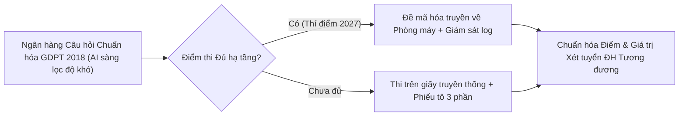

> **Tóm tắt nhanh (TL;DR):** Theo Đề án tổ chức thi tốt nghiệp THPT trên máy tính giai đoạn **2026–2036** của Bộ Giáo dục và Đào tạo, năm **2027** là cột mốc bắt đầu **từng bước thí điểm thi trên máy tính** tại các địa phương và điểm thi đáp ứng đủ hạ tầng kỹ thuật. Trong giai đoạn chuyển tiếp, kỳ thi vẫn diễn ra **song song hai hình thức (trên máy tính và trên giấy)** với giá trị xét tốt nghiệp và xét tuyển đại học tương đương nhau, hướng tới triển khai đồng bộ toàn quốc vào năm 2030.

---

# Thí Điểm Thi Tốt Nghiệp THPT Trên Máy Tính 2027: Bức Tranh Toàn Cảnh Cho Thế Hệ 2K9

Sau khi lứa 2K7 và 2K8 hoàn tất những kỳ thi đầu tiên của Chương trình GDPT 2018 trên giấy, tâm điểm chú ý của phụ huynh và học sinh 2K9 cuối năm 2026 chính là chủ trương **thí điểm thi tốt nghiệp THPT trên máy tính từ năm 2027**. Không ít học sinh lo lắng liệu mình có bị "ép" chuyển sang thi máy ngay khi chưa quen thao tác, hay kết quả giữa hai hình thức có chênh lệch độ khó hay không.

## 1. Lộ Trình 2026–2036 & Nguyên Tắc "Không Cào Bằng" Năm 2027

Bộ GD&ĐT xác định chuyển đổi hình thức thi là lộ trình dài hơi 10 năm (`2026–2036`), tuyệt đối không triển khai vội vàng gây xáo trộn tâm lý thí sinh:

| Giai đoạn | Mốc trọng tâm | Phạm vi & Hình thức áp dụng |
| :--- | :--- | :--- |
| **2026** | Chuẩn bị hạ tầng & thử nghiệm diện rộng | Phối hợp Sở GD&ĐT và các trường ĐH chạy thử nghiệm phần mềm trên hàng chục nghìn học sinh tại nhiều tỉnh/thành. |
| **2027 (Bước ngoặt 2K9)** | **Thí điểm có chọn lọc** | **Song song 2 hình thức:** Địa phương/điểm thi đủ hạ tầng máy tính & nhân lực CNTT được thí điểm thi máy; nơi chưa đủ điều kiện tiếp tục thi giấy. |
| **2028 – 2029** | Mở rộng dần quy mô | Tăng số lượng điểm thi máy tính dựa trên kết quả đánh giá an toàn, bảo mật của năm 2027. |
| **Từ 2030** | Hướng tới đồng bộ | Xem xét tổ chức đồng bộ kỳ thi trên máy tính trên phạm vi cả nước khi điều kiện hạ tầng bảo đảm. |

Quan điểm xuyên suốt của Bộ GD&ĐT là **đảm bảo công bằng tuyệt đối**: ngân hàng câu hỏi chuẩn hóa (có ứng dụng AI hỗ trợ sàng lọc, cân bằng độ khó) được dùng để sinh đề cho cả ca thi máy tính lẫn đề thi giấy. Kết quả của hai hình thức có **giá trị pháp lý hoàn toàn tương đương** trong xét công nhận tốt nghiệp THPT và lọc ảo xét tuyển đại học.

---

## 2. Cơ Chế Vận Hành & Chống Gian Lận Khi Thi Trên Máy Tính

Một trong những lý do Bộ GD&ĐT quyết tâm chuyển dịch sang thi máy tính giống như các kỳ thi HSA (ĐHQG Hà Nội) hay TSA (ĐH Bách khoa Hà Nội) là khả năng **bảo mật và rút ngắn thời gian chấm thi**:

* **Mã hóa sát giờ thi:** Đề thi cho từng ca thi được bốc ngẫu nhiên từ ngân hàng câu hỏi lớn, mã hóa và truyền qua hệ thống mạng bảo mật đến điểm thi ngay trước giờ làm bài, giảm thiểu rủi ro lộ lọt đề in sao.
* **Ghi nhật ký toàn bộ thao tác:** Phần mềm thi tự động phân phối bài, sao lưu liên tục theo từng câu trả lời (tránh mất bài khi mất điện/rớt mạng), đồng thời ghi log thao tác và đối soát danh tính nhằm ngăn chặn gian lận công nghệ cao.
* **Áp lực thao tác khác biệt với thi giấy:** Khi làm câu hỏi **Trắc nghiệm Đúng/Sai 4 ý** và **Trả lời ngắn** trên màn hình máy tính, thí sinh không được gạch chân trực tiếp lên đề như bản in mà phải rèn thói quen đọc nhanh trên màn hình, nháp khoa học ra giấy nháp và nhập số chính xác (tránh nhầm dấu chấm/dấu phẩy thập phân).

---

## 3. Học Sinh 2K9 Cần Chuẩn Bị Gì Ngay Từ Bây Giờ?

Dù tỉnh/thành của bạn có nằm trong danh sách thí điểm thi máy tính năm 2027 hay vẫn thi trên giấy, việc thành thạo kỹ năng làm bài trên máy tính vẫn mang lại lợi thế kép vì **hầu hết các kỳ thi ĐGNL lớn (HSA, TSA, V-SAT) và IELTS/VSTEP hiện nay đều thi trên máy tính**:

1. **Luyện tốc độ đọc hiểu màn hình & gõ phím chuẩn:** Đừng để mất thời gian vì tìm phím số hay gõ chậm trong các bài thi có phần tự luận/nhập đáp án ngắn. Hãy kiểm tra ngay tốc độ tay của bạn bằng công cụ [Kiểm tra tốc độ gõ phím tiếng Việt & WPM](/cong-cu/kiem-tra-toc-do-go-phim-tieng-viet).
2. **Làm quen phòng thi trực tuyến có đồng hồ đếm ngược:** Sử dụng ngân hàng câu hỏi tại [QuizKen](https://app.quizken.com) hoặc luyện đề mẫu [Thi thử vào Đại học & ĐGNL](/de-thi/dgnl) với chế độ bấm giờ 50 phút / 90 phút, gắn cờ câu phân vân và rèn thao tác phím tắt chọn nhanh đáp án.
3. **Nắm chắc công thức điểm tốt nghiệp:** Dù thi máy hay thi giấy, bạn vẫn cần kiểm tra sát điểm học bạ và dự kiến điểm thi qua công cụ [Tính điểm xét tốt nghiệp THPT 2027](/cong-cu/tinh-diem-tot-nghiep-thpt-2027) và theo dõi lịch bằng [Đồng hồ đếm ngược ngày thi 2027](/cong-cu/dem-nguoc-ngay-thi-2027).

---

## Câu hỏi thường gặp (FAQ)

### 1. Toàn bộ học sinh 2K9 năm 2027 có bắt buộc thi tốt nghiệp THPT trên máy tính không?
Không. Năm 2027 chỉ **thí điểm** tại các điểm thi và địa phương đáp ứng đủ điều kiện hạ tầng máy tính, đường truyền và nhân lực kỹ thuật. Các địa phương còn lại vẫn tiếp tục thi trên giấy như bình thường.

### 2. Thi trên máy tính thì đề thi có khó hơn thi trên giấy không?
Theo định hướng của Bộ GD&ĐT, ngân hàng câu hỏi được chuẩn hóa theo cùng ma trận Chương trình GDPT 2018 và ứng dụng AI sàng lọc độ khó tương đương nhau giữa hai hình thức nhằm bảo đảm công bằng tuyệt đối khi xét tốt nghiệp và tuyển sinh đại học.

### 3. Môn Ngữ văn năm 2027 có thí điểm thi trên máy tính không?
Ngữ văn vẫn là môn thi tự luận, nên trong giai đoạn thí điểm ban đầu trọng tâm chuyển sang máy tính chủ yếu nhắm tới các môn thi trắc nghiệm (Toán và các môn tự chọn). Chi tiết từng môn thí điểm sẽ được Bộ GD&ĐT công bố cụ thể trong văn bản hướng dẫn kỳ thi năm 2027.

### 4. Nếu trường tôi vẫn thi trên giấy năm 2027, tôi cần luyện dạng phiếu trả lời nào?
Bạn cần luyện kỹ dạng phiếu mới gồm 3 phần (Phần I nhiều lựa chọn, Phần II Đúng/Sai a-b-c-d, Phần III Trả lời ngắn tô số). Giáo viên và học sinh có thể tự in mẫu chuẩn miễn phí tại công cụ [Tạo phiếu trả lời trắc nghiệm 2027 (In A4)](/cong-cu/tao-phieu-tra-loi-trac-nghiem-2027).
