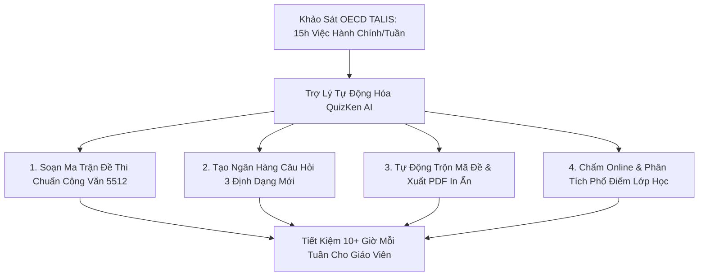

> **Tóm tắt nhanh (TL;DR):** Theo báo cáo khảo sát quốc tế **TALIS (Teaching and Learning International Survey)** của tổ chức **OECD**, giáo viên trên toàn cầu phải dành trung bình **12 đến 15 giờ mỗi tuần** cho các công việc hành chính, soạn kế hoạch bài dạy (theo khung **Công văn 5512/BGDĐT-GDTrH**) và chấm bài thi thủ công. Bằng cách ứng dụng quy trình tự động hóa **QuizKen AI**, thầy cô có thể cắt giảm hơn **80% khối lượng việc sự vụ**, tạo lập ngân hàng đề thi 3 định dạng GDPT 2018 và xuất bản bảng điểm tự động trong vòng chưa đầy 1 phút.

---

## 1. Khảo Sát OECD TALIS & Gánh Nặng Hành Chính Của Giáo Viên

Báo cáo **OECD TALIS** chỉ ra một thực tế đáng báo động: Thời gian đứng lớp giảng dạy thực tế của giáo viên chỉ chiếm khoảng 45% tổng thời lượng làm việc. 55% thời gian còn lại bị tiêu tốn vào:
- Xây dựng kế hoạch bài dạy (giáo án) theo chuẩn mẫu **Công văn 5512/BGDĐT-GDTrH** (bao gồm 4 hoạt động: Mở đầu, Hình thành kiến thức, Luyện tập, Vận dụng).
- Thiết kế ma trận đặc tả đề kiểm tra định kỳ (15 phút, 1 tiết, học kỳ).
- Soạn đề, trộn mã đề thi trắc nghiệm chống nhìn bài.
- Chấm bài giấy và ghi chép sổ theo dõi đánh giá học sinh.

Khối lượng công việc khổng lồ ngoài giờ lên lớp là nguyên nhân chính dẫn đến tình trạng kiệt sức (*teacher burnout*).

---

## 2. Bảng So Sánh Hiệu Quả Thời Gian: Truyền Thống vs QuizKen AI

| Hạng mục công việc giáo viên | Thời gian làm thủ công | Thời gian dùng QuizKen AI | Mức độ tiết kiệm |
| :--- | :--- | :--- | :--- |
| **Soạn ma trận đặc tả đề thi** | 90 - 120 phút | 1 phút (AI phân tích tự động) | **Tiết kiệm 98%** |
| **Biên soạn 40 câu hỏi trắc nghiệm 3 dạng thức** | 180 - 240 phút | 3 giây (AI bám sát ngữ liệu SGK) | **Tiết kiệm 99%** |
| **Trộn 4 mã đề & Căn chỉnh Word** | 60 phút | 5 giây (Tự động cập nhật bảng đáp án) | **Tiết kiệm 95%** |
| **Chấm bài kiểm tra lớp 45 học sinh** | 120 phút | Tức thì (Hệ thống tự chấm & xếp hạng) | **Tiết kiệm 100%** |
| **Tổng hợp phổ điểm & Báo cáo** | 60 phút | 1 cú click xuất file Excel | **Tiết kiệm 95%** |
| **Tổng thời gian mỗi tuần** | **~12 - 15 Giờ** | **~1 - 2 Giờ** | **Giải phóng 10+ Giờ** |

---

## 3. Quy Trình 4 Bước Tự Động Hóa Giảng Dạy Cùng QuizKen

### Bước 1: Chuẩn bị tài liệu bài giảng
Tập hợp các file tài liệu Word bài giảng hoặc đề cương môn học theo chương trình SGK mới.

### Bước 2: Kích hoạt tính năng tạo đề thi thông minh
Truy cập [QuizKen Dành Cho Giáo Viên](https://quizken.com), tải file tài liệu lên và chọn dạng bài kiểm tra mong muốn:
- Đầy đủ 3 dạng thức: *Nhiều lựa chọn*, *Đúng/Sai 4 ý*, và *Trả lời ngắn*.
- Phân bổ chính xác theo 4 mức độ nhận thức của Công văn 5512.

### Bước 3: Xuất bản đề thi linh hoạt (Online & In ấn)
- **Nếu làm bài trên lớp/về nhà:** Gửi link phòng thi trực tuyến cho học sinh làm bài trên điện thoại/máy tính.
- **Nếu thi giấy truyền thống:** Tải về các bản PDF đã trộn mã đề kèm phiếu trả lời trắc nghiệm chuẩn Bộ.

### Bước 4: Tự động phân tích năng lực học sinh
Hệ thống tự động thống kê:
- Bảng điểm chi tiết từng học sinh.
- Phổ điểm phân hóa của cả lớp.
- Danh sách 5 câu hỏi có tỉ lệ sai cao nhất để giáo viên chữa bài trọng tâm trên lớp.

---

## 4. Cam Kết Đồng Hành Cùng Giáo Viên Việt Nam

- **Bảo mật dữ liệu tuyệt đối:** Đề thi và thông tin học sinh được lưu trữ bảo mật trên hạ tầng riêng biệt.
- **Miễn phí trọn đời các tính năng cơ bản:** QuizKen cam kết đồng hành cùng các thầy cô giáo cả nước trong công cuộc chuyển đổi số giáo dục.

👉 **Nâng cao hiệu suất giảng dạy:** Trải nghiệm ngay công cụ [Tự Động Hóa Dạy Học Cùng QuizKen](https://quizken.com) hoàn toàn miễn phí!

---

## 5. Câu Hỏi Thường Gặp (FAQ)

### Đề thi do QuizKen tạo ra có đúng định dạng Công văn 5512 không?
Có. Các câu hỏi được thiết kế theo đúng bảng mô tả mức độ nhận thức (Nhận biết, Thông hiểu, Vận dụng, Vận dụng cao) theo hướng dẫn chuyên môn của Bộ GD&ĐT.

### Giáo viên có thể chia sẻ đề thi cho các đồng nghiệp trong tổ bộ môn không?
Hoàn toàn được. QuizKen hỗ trợ tính năng chia sẻ đề nội bộ trong tổ chuyên môn để cùng duyệt đề và thẩm định ngân hàng câu hỏi.
