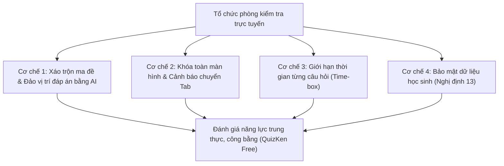

> **Tóm tắt nhanh (TL;DR):** Kiểm tra đánh giá thường xuyên trên môi trường trực tuyến đang là xu thế tất yếu trong công cuộc chuyển đổi số giáo dục. Tuy nhiên, tình trạng học sinh mở tab khác để tra cứu Google hoặc dùng bot AI làm bài hộ đặt ra bài toán hóc búa về tính trung thực. Bài viết này hướng dẫn quy trình 4 bước tổ chức phòng kiểm tra trực tuyến an toàn, bảo mật dữ liệu theo **Nghị định 13/2023/NĐ-CP** và tích hợp công nghệ xáo đề **AI chống gian lận miễn phí (free)**.

---

## 1. Thách Thức Trong Kiểm Tra Trực Tuyến & Yêu Cầu Pháp Lý Năm 2026

Theo các quy chuẩn kỹ thuật tại **Thông tư 49/2026/TT-BGDĐT**, các hệ thống quản lý học tập (LMS) và phần mềm tổ chức thi trực tuyến được nhà trường sử dụng bắt buộc phải đáp ứng:
* **Khả năng lưu vết (Audit Trail):** Ghi nhận chính xác mốc thời gian làm bài, thời gian chuyển câu và các hành vi bất thường của người dự thi.
* **Bảo vệ dữ liệu cá nhân:** Tuyệt đối tuân thủ Nghị định 13/2023/NĐ-CP; không sử dụng các phần mềm cài cắm quyền truy cập micro/camera xâm phạm quyền riêng tư của học sinh khi không có sự đồng thuận từ phụ huynh.
* **Đảm bảo tính công bằng:** Ngăn chặn triệt để hành vi chia sẻ đáp án trong phòng thi ảo.

---

## 2. 4 Lớp Bảo Vệ Chống Gian Lận Độc Quyền Của QuizKen AI

Khác với Google Forms truyền thống (dễ dàng bị học sinh chia sẻ link đáp án hoặc inspect mã nguồn), **QuizKen** áp dụng giải pháp bảo mật 4 lớp hoàn toàn **miễn phí (free)**:

| Cơ chế bảo vệ | Cách thức hoạt động | Hiệu quả thực tế |
| :--- | :--- | :--- |
| **Xáo trộn đa chiều (Dynamic Shuffling)** | AI tự động đổi vị trí câu hỏi VÀ hoán đổi thứ tự các đáp án $A, B, C, D$ cho từng học sinh riêng biệt | Học sinh ngồi cạnh nhau không thể nhìn bài nhau vì cùng câu hỏi nhưng đáp án khác chữ cái |
| **Phát hiện chuyển Tab (Tab-switch Detection)** | Hệ thống tự động ghi nhận số lần học sinh rời khỏi màn hình làm bài và phát tín hiệu cảnh báo đến giáo viên | Triệt tiêu hành vi mở cửa sổ ChatGPT hay Google để tra cứu |
| **Hạn chế Copy/Paste** | Vô hiệu hóa tính năng bôi đen văn bản và phím tắt `Ctrl+C` / `Ctrl+V` | Ngăn chặn việc gửi nhanh câu hỏi vào các nhóm chat trao đổi |
| **Hệ thống xác thực mã PIN bảo mật** | Mỗi phòng thi chỉ mở trong khung giờ quy định với mã PIN ngẫu nhiên | Ngăn người ngoài đột nhập vào phòng thi |

---

## 3. Quy Trình 4 Bước Giáo Viên Tổ Chức Kiểm Tra Online Miễn Phí

### Bước 1: Khởi tạo ngân hàng đề thi
Tải tài liệu chuyên đề lên QuizKen để AI tạo bộ đề 20–40 câu hỏi chuẩn GDPT 2018.

### Bước 2: Thiết lập quy tắc phòng thi
* Bật tính năng **"Đảo ngẫu nhiên câu hỏi & phương án"**.
* Thiết lập giới hạn thời gian làm bài (ví dụ: 45 phút) và khung giờ mở phòng thi.
* Kích hoạt chế độ **"Giám sát rời màn hình"**.

### Bước 3: Gửi mã PIN cho học sinh
Học sinh truy cập vào phòng thi từ bất kỳ trình duyệt nào (trên máy tính, điện thoại thông minh) mà không cần cài đặt ứng dụng rườm rà.

### Bước 4: Xem báo cáo phân tích phổ điểm tức thì
Sau khi kết thúc giờ thi, hệ thống sẽ tự động tổng hợp:
* Điểm số chi tiết của từng học sinh.
* Danh sách học sinh có số lần chuyển tab cảnh báo.
* Biểu đồ phân tích những câu hỏi có tỷ lệ học sinh chọn sai nhiều nhất để giáo viên chữa bài ngay tại lớp.

👉 **Bắt đầu trải nghiệm:** [Tạo phòng thi online chống gian lận AI miễn phí trên QuizKen](https://quizken.com) ngay hôm nay!

---

## Câu hỏi thường gặp (FAQ)

### 1. Dùng QuizKen tổ chức phòng thi trực tuyến cho cả trường có mất phí không?
QuizKen hỗ trợ giáo viên và nhà trường tổ chức các buổi kiểm tra, đấu trường tri thức trực tuyến hoàn toàn **miễn phí (free)** với quy mô hàng trăm học sinh cùng tham gia một lúc.

### 2. Nếu học sinh bị mất mạng đột ngột trong khi làm bài thì sao?
QuizKen có cơ chế tự động lưu tạm (Auto-save) bài làm trên đám mây. Khi kết nối lại, học sinh có thể tiếp tục làm bài mà không bị mất tiến trình trước đó.

### 3. Nền tảng có thu thập hình ảnh qua webcam của học sinh không?
Không. Nhằm tuân thủ nghiêm ngặt Luật Bảo vệ Dữ liệu Cá nhân và Nghị định 13/2023/NĐ-CP, QuizKen không ghi hình webcam mà sử dụng thuật toán giám sát tương tác màn hình an toàn và minh bạch.
